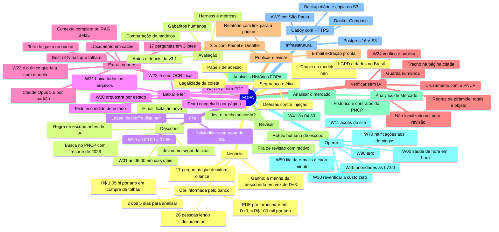

# Mapa mental

> [!abstract] Em uma frase
> A solução inteira numa figura: do problema de negócio ao resultado no site, passando pela descoberta, a fila, a leitura, a extração com IA, a verificação sem IA, a revisão humana e a análise de mercado — com a operação, a infraestrutura, a segurança e a avaliação que sustentam tudo.

## Papel na solução

É o mapa de navegação: cada ramo corresponde a uma família de notas. A versão navegável, em que cada caixa abre a nota correspondente, é o canvas [[Mapa da solução.canvas|Mapa da solução]].

## O fluxo inteiro

## Onde cada ramo está descrito

| Ramo | Notas |
|---|---|
| Negócio | [[MOC Negócio]] · [[Problema de negócio]] · [[Questionário — as 17 perguntas]] · [[Ganho para o negócio]] |
| Descobrir | [[W01 Descoberta]] · [[Regras antes de IA]] · [[Jev — score de escopo e sustentação]] |
| Fila | [[W10 Fila]] · [[Funções e views do banco]] |
| Baixar e ler | [[W20 Processar uma licitação]] · [[W21 Baixar]] · [[Conversão de formatos]] · [[W22 Ler]] · [[OCR]] |
| Extrair com IA | [[W23 Extrair]] · [[Modelos e provedores]] · [[Prompt do extrator]] · [[RAG com BM25]] · [[Cache de prompt e ordem do prompt]] · [[Best-of-N]] · [[Custo por edital]] |
| Verificar sem IA | [[W24 Verificar e publicar]] · [[Verificador determinístico]] |
| Publicar e avisar | [[Página Relatório]] · [[E-mails do produto]] · [[MOC Site]] |
| Revisar | [[Página Revisão]] · [[Página Detalhe da licitação]] |
| Analisar o mercado | [[W41 Histórico do PNCP]] · [[Página Analytics de Mercado]] · [[Página Analytics Histórico FOPA]] |
| Operar | [[MOC Fluxos n8n]] · [[Horários e agendamentos]] · [[Saúde e observabilidade]] |
| Infraestrutura | [[MOC Infra]] |
| Segurança e ética | [[MOC Segurança e Ética]] · [[Página Governança]] |
| Avaliação | [[MOC Avaliação]] |

## Relacionadas

[[Home]] · [[Visão geral da solução]] · [[Arquitetura]] · [[Ciclo de vida de uma licitação]]
