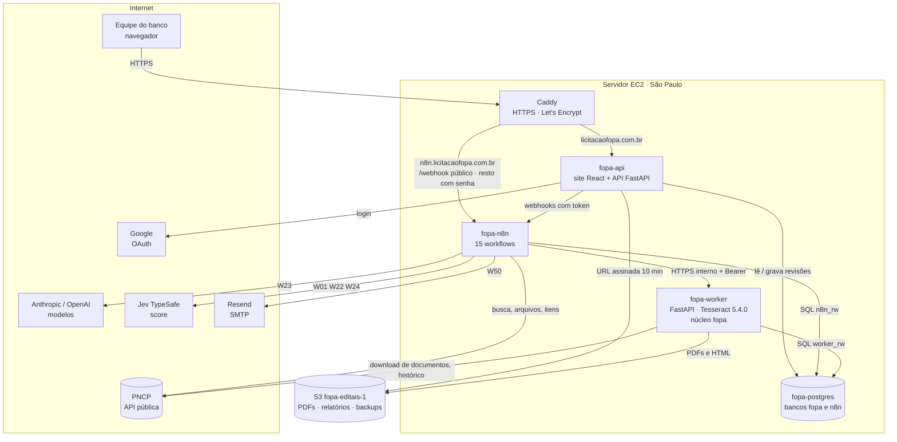
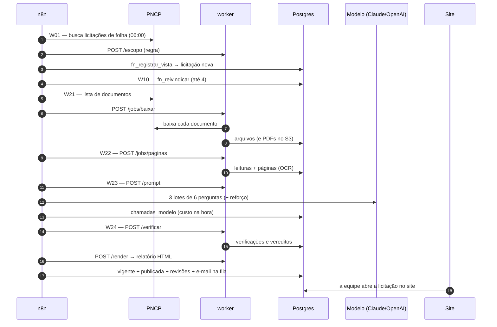

# Arquitetura

> [!abstract] Em uma frase
> Seis serviços num único servidor — **Caddy** (HTTPS), **site + API** (FastAPI e React), **worker** (Python com OCR e o núcleo de extração e verificação), **n8n** (orquestração), **Postgres** (banco de negócio e do n8n) e um serviço de **migração** — mais o **S3** para os documentos, falando com cinco serviços externos: PNCP, provedores de modelo (Anthropic e OpenAI), Jev, Resend (e-mail) e Google (login).

## Papel na solução

A arquitetura separa **quem decide o fluxo** (n8n), **quem faz o trabalho** (worker), **quem guarda a verdade** (Postgres) e **quem mostra** (site). Cada peça tem um dono único para cada regra, o que torna o sistema auditável e fácil de trocar por partes — o motor de orquestração, o provedor de modelo ou o armazenamento podem mudar sem reescrever o resto.

## Diagrama de componentes

## Os componentes

| Serviço | Tecnologia | Responsabilidade | Exposição |
|---|---|---|---|
| `fopa-caddy` | Caddy 2.11 | HTTPS automático (Let's Encrypt), HSTS, compressão; separa site e n8n; senha na frente do editor do n8n | portas 80 e 443 públicas |
| `fopa-api` | FastAPI + build React (mesma imagem do worker) | login Google, sessão, as rotas `/api/*`, o relatório HTML e o PDF (por URL assinada), os botões que chamam o n8n | só via Caddy |
| `fopa-worker` | FastAPI + Tesseract 5.4.0 compilado + pacote `fopa` | download e conversão de documentos, OCR e leitura, montagem do prompt, verificação, relatório, jobs assíncronos, regra de escopo, corpo das consultas ao Jev | só na rede interna (HTTPS interno pelo Caddy + token) |
| `fopa-n8n` | n8n 2.37.10 | agendas, encadeamento, webhooks do site, chamadas ao PNCP, ao modelo, ao Jev e ao SMTP | editor atrás de senha; só `/webhook/*` público |
| `fopa-postgres` | PostgreSQL 16 | banco `fopa` (negócio) e banco `n8n` (estado do n8n); regras de fila, estado, orçamento e escopo como funções SQL | sem porta publicada em produção |
| `fopa-migrate` | mesma imagem | aplica as migrações `db/NNN_*.sql` (idempotente) e as senhas dos papéis | roda e sai |
| `fopa-importar` | mesma imagem | importa o acervo da versão anterior (usado na montagem) | roda e sai |
| S3 `fopa-editais-1` | Amazon S3, mesma região | PDFs (chave pelo SHA-256), relatórios HTML, backups | privado; acesso por URL assinada |

Detalhes de cada container em [[Containers e serviços]]; do servidor em [[Hospedagem na AWS]].

## Princípios de arquitetura

1. **O pipeline de IA não foi reescrito, foi exposto.** O núcleo `scripts/fopa` (extrator, verificador, OCR, recuperação, página) é o mesmo que produziu as medições do projeto; o worker o **expõe por HTTP** e o n8n o orquestra. Os números medidos continuam valendo para o que está em produção.
2. **Quem gera não verifica.** A única chamada a modelo generativo está no [[W23 Extrair]]; a verificação é determinística, no worker ([[Verificador determinístico]]).
3. **A chave do modelo mora só no n8n.** O worker nunca a recebe (o [[W00 Saúde]] confere de hora em hora); o site nunca a recebe.
4. **A regra mora no banco.** Fila, lease, backoff, disjuntor, orçamento, escopo efetivo, máquina de estados: funções SQL com testes; os fluxos só as chamam ([[Funções e views do banco]]).
5. **Trabalho pesado é assíncrono.** Download, OCR e coleta de histórico são jobs no worker; o n8n pergunta o status em intervalos ([[Worker — visão geral e jobs]]).
6. **O site só lê do banco** (e grava as decisões humanas): nunca chama PNCP nem modelo diretamente; todo botão passa pelo n8n ([[W11 Ações do site]]).
7. **Menor privilégio no banco.** Quatro papéis: `n8n_rw` (fluxos), `worker_rw` (worker), `api_ro` (leitura) e `api_rw` (o site: lê tudo e grava só o que é decisão de gente — revisões humanas, rótulos de escopo, usuários, sessões, termos de busca, orçamento, configuração e pedidos de extração —, além de poucos campos de `licitacoes`: reserva de demonstração, prazo, prioridade e solicitante). Tabelas de histórico são **só inserção** (eventos, páginas, respostas, chamadas ao modelo, vereditos, buscas).
8. **Arquivos por conteúdo.** Cada PDF é guardado com a chave pelo seu SHA-256: o mesmo arquivo nunca é guardado duas vezes e a integridade é verificável ([[Armazenamento de arquivos (S3)]]).
9. **Tudo por variável de ambiente.** Endereços, credenciais e limites vêm do `.env` (fora do Git) e da tabela `configuracao`; o código é o mesmo em qualquer máquina ([[Como rodar em outra máquina]]).

## Fluxo ponta a ponta

## Onde cada peça do case está

| Pedido do case | Onde está na arquitetura |
|---|---|
| Modelo(s) de IA | provedores Claude e OpenAI chamados só pelo W23; Jev como sinal ([[Modelos e provedores]]) |
| Prompts e orquestração | prompt montado pelo worker; orquestração no n8n ([[Prompt do extrator]], [[MOC Fluxos n8n]]) |
| Dados: preparo, armazenamento, uso | PNCP → worker (download, OCR) → Postgres + S3 → site ([[Pipeline de dados]]) |
| RAG | BM25 no worker, por tamanho do edital ([[RAG com BM25]]) |
| Avaliação | verificador em produção + harness de medição ([[MOC Avaliação]]) |
| Segurança | Caddy, papéis do banco, chave só no n8n, verificador contra injeção ([[MOC Segurança e Ética]]) |

## Relacionadas

[[MOC Solução]] · [[Visão geral da solução]] · [[Stack e justificativa tecnológica]] · [[Containers e serviços]] · [[Hospedagem na AWS]] · [[Ciclo de vida de uma licitação]] · [[MOC Fluxos n8n]] · [[Worker — visão geral e jobs]] · [[API do site — endpoints]] · [[Modelo de dados]] · [[Escalabilidade]]
