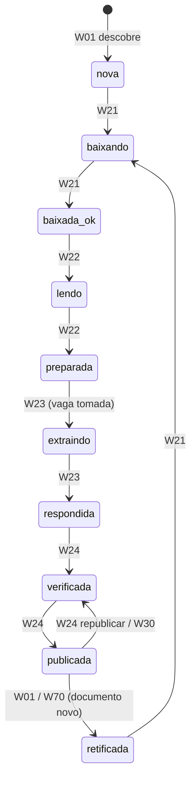
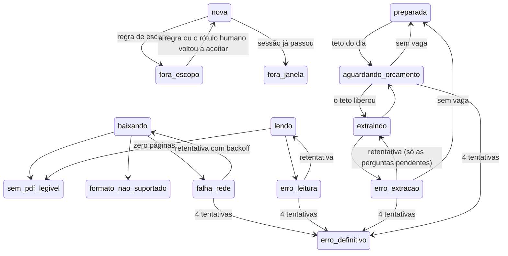

# Ciclo de vida de uma licitação

> [!abstract] Em uma frase
> Toda licitação no sistema está em **um de 20 estados** — de `nova` a `publicada` —, e só pode mudar de estado por uma **transição permitida**, registrada como evento com data, motivo e quem fez; é isso que torna o processamento retomável e cada licitação auditável.

## Papel na solução

A máquina de estados é o **esqueleto** da automação:
- o [[W10 Fila]] escolhe o que processar pelo estado;
- o [[W20 Processar uma licitação]] decide por onde começar pelo estado — se a leitura falhou ontem, hoje começa pela leitura;
- o site mostra a **linha do tempo** de cada licitação ([[Página Detalhe da licitação]]) a partir dos eventos.

As transições permitidas são **dados**, numa tabela (`transicoes`), não código espalhado: qualquer um pode ler no banco exatamente o que é permitido. A função `fn_transicao` valida cada mudança contra essa tabela e grava o evento em `licitacao_eventos` (tabela que só aceita inserção — a história não se reescreve).

## Os 20 estados

| Grupo | Estado | Significado |
|---|---|---|
| **Entrada** | `nova` | descoberta, no escopo, esperando processamento |
| | `fora_escopo` | a regra de escopo recusou (não é compra de folha) |
| | `fora_janela` | a sessão já passou quando foi descoberta (entra só como histórico) |
| **Download** | `baixando` | o [[W21 Baixar]] está trabalhando |
| | `baixada_ok` | pelo menos um PDF bom |
| | `sem_pdf_legivel` | nenhum documento legível (desfecho) |
| | `formato_nao_suportado` | só arquivos que não viram PDF (desfecho) |
| | `falha_rede` | o download falhou na rede (erro; tenta de novo) |
| **Leitura** | `lendo` | o [[W22 Ler]] está trabalhando |
| | `erro_leitura` | a leitura falhou (erro; tenta de novo) |
| | `preparada` | texto congelado; pronta para extrair |
| **Extração** | `extraindo` | o [[W23 Extrair]] está chamando o modelo |
| | `respondida` | todas as respostas chegaram |
| | `erro_extracao` | um lote falhou (erro; a execução fica parcial) |
| | `aguardando_orcamento` | o teto de gasto do dia foi atingido |
| **Publicação** | `verificada` | o verificador julgou as respostas |
| | `publicada` | a verificação é a vigente e o relatório está no ar |
| | `retificada` | apareceu documento novo ou a licitação mudou no PNCP — volta a baixar |
| **Terminais** | `erro_definitivo` | 4 falhas seguidas |
| | `legado_suspeito` | na importação do acervo da versão anterior, um mesmo controle tinha duas extrações completas e nenhum critério objetivo para escolher a canônica — não é publicada até uma decisão humana ([[Acervo e migração da v2]]) |

## O caminho feliz

## Os desvios

## Todas as transições permitidas

| De | Para | Quem |
|---|---|---|
| `nova` | `baixando` | W21 |
| `nova` | `fora_escopo` | regra de escopo |
| `nova` | `fora_janela` | W01 (sessão encerrada) |
| `baixando` | `baixada_ok`, `sem_pdf_legivel`, `formato_nao_suportado`, `falha_rede` | W21 (e W90 para `falha_rede`) |
| `baixada_ok` | `lendo` | W22 |
| `lendo` | `preparada`, `sem_pdf_legivel`, `erro_leitura` | W22 (e W90 para `erro_leitura`) |
| `preparada` | `extraindo` | W23, via `fn_tomar_vaga_extracao` |
| `preparada` | `aguardando_orcamento` | W23 (teto do dia) |
| `extraindo` | `respondida`, `erro_extracao`, `aguardando_orcamento` | W23 (e W90 para `erro_extracao`) |
| `respondida` | `verificada` | W24 |
| `verificada` | `publicada` | W24 |
| `publicada` | `publicada` | ramo de erro depois da publicação (sem efeito) |
| `publicada` | `verificada` | W24 republicar / W30 |
| `publicada`, `verificada`, `preparada`, `baixada_ok` | `retificada` | W01 / W70 |
| `sem_pdf_legivel`, `formato_nao_suportado`, `falha_rede`, `erro_leitura`, `erro_extracao`, `aguardando_orcamento`, `erro_definitivo` | `retificada` | W01 / W70 — documento novo é motivo para tentar de novo |
| `retificada` | `baixando` | W21 |
| `falha_rede` | `baixando` | retentativa |
| `erro_leitura` | `lendo` | retentativa |
| `erro_extracao` | `extraindo` | retentativa (só as perguntas pendentes) |
| `erro_extracao` | `preparada` | W23 sem vaga |
| `aguardando_orcamento` | `extraindo`, `preparada` | teto liberado / sem vaga |
| `falha_rede`, `erro_leitura`, `erro_extracao`, `aguardando_orcamento` | `erro_definitivo` | 4 tentativas |
| `baixada_ok`, `sem_pdf_legivel`, `formato_nao_suportado`, `falha_rede`, `erro_leitura`, `preparada`, `erro_extracao`, `aguardando_orcamento`, `erro_definitivo` | `fora_escopo` | regra de escopo reaplicada |
| `fora_escopo` | `nova` | a regra de escopo ou o rótulo humano voltou a aceitar |
| `fora_janela`, `erro_definitivo`, `publicada`, `sem_pdf_legivel`, `formato_nao_suportado` | `nova` | um administrador forçou o reprocessamento (W11, `forcar`) |
| `baixada_ok`, `preparada` | `nova` | "baixar de novo" (arquivo antes recusado agora vira PDF) |
| `publicada` | `preparada` | rearmar uma licitação reservada para demonstração |

## Travas que a máquina de estados garante

| Trava | Como |
|---|---|
| Não se publica sem verificação vigente | `fn_transicao` recusa `→ publicada` sem verificação vigente ([[ADR-004 Evidência obrigatória]]) |
| Resultado simulado não vira oficial | gatilho T15 no banco recusa tornar vigente a verificação de uma execução `simulado`/`gravado` em licitação que não é de ensaio |
| Estado não muda "por fora" | toda mudança sem evento é detectada pelos invariantes (`db/invariantes.sql`) |
| Dois processos não mexem na mesma licitação | lease (`lease_por`, `lease_ate`) e `FOR UPDATE SKIP LOCKED` |

## Relacionadas

[[MOC Solução]] · [[W20 Processar uma licitação]] · [[W10 Fila]] · [[Modelo de dados]] · [[Funções e views do banco]] · [[Controles de consistência]] · [[Página Detalhe da licitação]]
