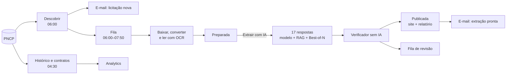

# Visão geral da solução

> [!abstract] Em uma frase
> O **FOPA** acompanha as licitações de **folha de pagamento pública** do Brasil: toda manhã descobre as novas no PNCP, avisa por e-mail, baixa e lê todos os documentos, responde a pedido as **17 perguntas** que decidem o lance com **arquivo, página e trecho literal** — conferidos por um verificador **sem IA** —, publica tudo num site com revisão humana e mostra quem compra folha no país, por quanto e até quando.

## Papel na solução

É a primeira leitura, para o negócio e para a engenharia: o que a solução faz, com que números está no ar e um caso real do começo ao fim. Cada linha aponta para a nota que detalha o passo.

## O que a solução faz, em seis passos

| # | Passo | Como | Onde está descrito |
|---|---|---|---|
| 1 | **Descobrir** | busca no PNCP às 06:00 de cada dia útil (e a qualquer hora pelo botão), com regra de escopo e segunda opinião de IA; aviso por e-mail das novas | [[W01 Descoberta]], [[Regras antes de IA]] |
| 2 | **Baixar e ler** | todos os documentos; o que não é PDF vira PDF; texto por página com OCR local; texto escondido detectado | [[W21 Baixar]], [[W22 Ler]], [[OCR]] |
| 3 | **Extrair** | um modelo de linguagem (Claude Opus 5.5 por padrão) responde as 17 perguntas em 3 lotes, lendo o documento inteiro ou as páginas recuperadas por BM25; o que falha ganha até duas tentativas extras | [[W23 Extrair]], [[MOC IA]] |
| 4 | **Verificar** | o trecho citado precisa existir na página citada, com os números exatos; regras conferem pirâmide, totais, objeto, lacunas e o registro do PNCP | [[Verificador determinístico]] |
| 5 | **Publicar e avisar** | relatório com o link para cada página; e-mail para quem pediu; fila de revisão com o motivo de cada item | [[W24 Verificar e publicar]], [[E-mails do produto]] |
| 6 | **Revisar e analisar** | pessoas aceitam, corrigem ou rejeitam o que ficou em dúvida; o Analytics mostra o mercado a partir do histórico e dos contratos do PNCP | [[Página Revisão]], [[Página Analytics de Mercado]] |

## A solução em números (produção, 28/09/2026)

| | |
|---|---|
| licitações de folha em andamento no painel | **71** (20 fecham em até 7 dias) |
| licitações no histórico | **2.020**, com **2.019** extraídas |
| respostas com o trecho conferido na página citada | **99,96%** no histórico · **98,67%** nas ativas |
| mercado no histórico do PNCP | **726** compras, **R$ 5,56 bi**, **79** instituições |
| custo de uma extração | de **R$ 0,20** (GPT-6 Luna, 60 páginas) a cerca de R$ 5 |
| gasto total com IA desde 21/09 (fatura) | US$ 47,82 ≈ R$ 243,89 |
| fluxos de automação | **15**, com **368** nós |
| versão no ar | v3.1, desde 28/09/2026 07:58 |

## Um caso real, ponta a ponta

Itapecuru Mirim/MA, Pregão Eletrônico `05648696000180-1-000088/2026`, em 28/09/2026:

| Hora | O que aconteceu |
|---|---|
| 06:00 | a descoberta encontrou a licitação e a registrou como nova |
| 06:04 | e-mail "Licitação nova de folha" para os administradores |
| 06:20 | a fila baixou 1 arquivo de 60 páginas e o leu (0 páginas por OCR) em 36,7 s; a licitação ficou **preparada** |
| 10:22 | alguém clicou em "Extrair com IA" (Claude Haiku 4.5) |
| 10:24 | publicada: 5 chamadas ao modelo (3 lotes + 2 de reforço), **R$ 0,78**; 9 de 16 respostas ancoradas, 7 aprovadas, 8 para revisão, 2 reprovadas; alertas de pirâmide (faixas 3.338 × total 3.385) e de ausência (Q16) |
| 10:25 | e-mail "Processada: Itapecuru Mirim/MA · 9/16 ancoradas · R$ 0,78" para quem pediu |

A resposta errada não passou calada: as reprovadas e as críticas em revisão foram para a fila, com o motivo e o trecho ([[W20 Processar uma licitação]]).

Depois, a mesma licitação foi extraída de novo pelo botão com o GPT-6 Luna: R$ 0,20, e o reforço do Best-of-N levou a extração de 2 respostas reprovadas para nenhuma, com 16 de 16 ancoradas — ancoragem, não acurácia, porque esta licitação não tem gabarito ([[Best-of-N]]).

## O que torna o resultado confiável

1. **A IA gera, o código confere, a pessoa decide** ([[ADR-004 Evidência obrigatória]]).
2. **Cada técnica foi medida** contra gabarito humano antes de entrar ([[MOC Avaliação]]).
3. **Tudo tem procedência:** o documento pelo hash, o texto congelado, o prompt e as regras por versão, o código pelo commit ([[Pipeline de dados]]).
4. **Custo com teto**, conferido na fatura ([[Custo por edital]]).
5. **Segurança e privacidade por desenho:** dados no Brasil, chave do modelo num só lugar, acesso por papéis, defesas contra injeção ([[MOC Segurança e Ética]]).

## Onde está

- **No ar:** https://licitacaofopa.com.br ([[Como acessar a versão no ar]]).
- **Para rodar em outra máquina:** o repositório da entrega, com os scripts e as instruções ([[Como rodar em outra máquina]]).
- **Como foi construída:** [[Linha do tempo da construção]].

## Relacionadas

[[MOC Solução]] · [[Arquitetura]] · [[Stack e justificativa tecnológica]] · [[Ciclo de vida de uma licitação]] · [[Controles de consistência]] · [[Problema de negócio]] · [[Home]]
