# Horários e agendamentos

> [!abstract] Em uma frase
> Tudo o que o sistema faz sozinho, com hora marcada, numa tabela só — os agendamentos dos workflows do n8n e as rotinas do servidor — com o que cada um dispara e o que acontece se falhar.

## Papel na solução

A solução roda sem ninguém apertar botão: de madrugada ela faz backup e atualiza o histórico de mercado; de manhã descobre as licitações novas, baixa e lê o que entrou; ao longo do dia, confere a própria saúde e entrega os e-mails. Esta nota é o **relógio** do sistema. Todos os horários estão no fuso **America/Sao_Paulo** (definido no container do n8n, em cada workflow e no `crontab` do servidor).

## O dia do sistema

| Horário | Quem | O que faz | Se falhar |
|---|---|---|---|
| 03:15, todo dia | `crontab` do servidor → `docker/backup.py` | backup do banco `fopa`, do banco do n8n e export cifrado do n8n; guarda 7 | a próxima rodada tenta de novo; o log fica em `backups/backup.log` ([[Backup e restauração]]) |
| 03:35, todo dia | `crontab` → `docker/backup_fora.py` | sobe cada backup `ok` para o S3 (`backups/<carimbo>/`), conferindo o SHA-256 de cada arquivo | idem |
| 03:45, domingo | `crontab` → `backup.py --verificar` | restaura o backup mais recente num Postgres temporário e compara as contagens com o manifesto | idem |
| 04:30, todo dia | [[W41 Histórico do PNCP]] | recoleta itens, resultados e contratos de folha no PNCP (analytics) | linha `erro` em Execuções; o que já foi coletado continua |
| 05:00, domingo | [[W70 Retificações]] | confere documentos novos no PNCP das licitações abertas | licitação sem resposta fica "não conferida"; a rodada pode sair `cega` |
| 06:00, segunda a sexta | [[W01 Descoberta]] | busca no PNCP o que é compra de folha; registra as novas; enfileira o e-mail "licitação nova" | páginas com falha ficam registradas; coleta toda falha = `cega`; worker fora = rodada com erro |
| 06:00 a 07:50, a cada 10 min, todo dia | [[W10 Fila]] | recupera trabalhos mortos, confere o disjuntor e manda até 4 licitações para processamento | disjuntor abre com 3 erros do W20 em 30 min sem sucesso |
| 07:00, todo dia | [[W40 Alerta diário]] | calcula as seis prioridades do dia e registra os números | linha `erro` em Execuções |
| minuto 0 de toda hora | [[W00 Saúde]] | confere o contrato do worker (OCR, chave, versão) e o canal de e-mail; grava em `saude` | a linha registra `worker_ok = false` e os motivos |
| todo minuto | [[W50 Envio de e-mails]] | entrega os e-mails pendentes | nova tentativa em 2, 5, 15 e 40 min; `falhou` na 5ª |

**Sob demanda (sem horário):** [[W11 Ações do site]] (botões do site), [[W20 Processar uma licitação]] e os sub-fluxos [[W21 Baixar]], [[W22 Ler]], [[W23 Extrair]], [[W24 Verificar e publicar]] (chamados pela fila e pelo site), [[W30 Reverificar em lote]] (manual, quando as regras mudam) e [[W90 Erro]] (quando um fluxo raiz falha).

## A manhã em linha do tempo

```mermaid
gantt
    title Um dia útil do sistema (horário de São Paulo)
    dateFormat HH:mm
    axisFormat %H:%M
    section Servidor
    Backup local           :03:15, 15m
    Backup para o S3       :03:35, 10m
    section Mercado
    W41 Histórico do PNCP  :04:30, 20m
    section Licitações
    W01 Descoberta         :06:00, 10m
    W10 Fila (a cada 10 min) :06:00, 110m
    W40 Alerta diário      :07:00, 5m
```

> [!note] Por que a ordem é esta
> 1. **Backups antes de tudo**, com o sistema parado (madrugada).
> 2. **Histórico às 04:30**, para não disputar o worker com a descoberta e a fila, e para o Analytics abrir o dia atualizado.
> 3. **Retificações no domingo às 05:00**, quando não há descoberta.
> 4. **Descoberta às 06:00** em dias úteis, quando o que foi publicado na véspera já está indexado no PNCP.
> 5. **Fila junto com a descoberta**, até 07:50: as licitações novas são baixadas e lidas antes do expediente. Com provedor de extração pago, também extraídas, dentro do teto do dia.
> 6. **Alerta às 07:00**, com o resultado da descoberta e das primeiras rodadas da fila.

## Frequência e volume

| Rotina | Rodadas por dia | Volume por rodada |
|---|---|---|
| W50 | 1.440 | até 20 e-mails |
| W00 | 24 | 1 conferência |
| W10 | 12 | até 4 licitações → até 48 por manhã |
| W01 | 1 (dias úteis) | 6 termos × 2 consultas, até 10 páginas de 50 cada no recorte e 2 nas abertas |
| W41 | 1 | o acervo inteiro (itens e resultados), cabeçalhos pendentes e contratos |
| W40 | 1 | 6 prioridades |
| W70 | 1 por semana | até 200 licitações abertas |

## Relacionadas

[[MOC Fluxos n8n]] · [[Convenções dos fluxos n8n]] · [[Backup e restauração]] · [[Saúde e observabilidade]] · [[Escalabilidade]] · [[Página Execuções]] · [[Página Saúde]]
