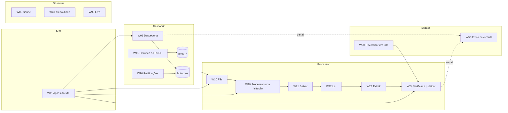

# MOC Fluxos n8n

> [!abstract] Em uma frase
> Os **15 workflows** do n8n que fazem a solução funcionar sozinha — **368 nós** no total, cada um descrito passo a passo na sua nota e com uma nota explicativa ao lado, no próprio canvas —, organizados em quatro grupos: descobrir, processar, manter e observar.

## Papel na solução

O n8n é o orquestrador: agenda as rotinas, encadeia os passos de cada licitação, recebe os botões do site e registra tudo no banco. Quem faz o trabalho pesado é o worker ([[Worker — visão geral e jobs]]) e quem guarda as regras é o Postgres ([[Funções e views do banco]]). As regras comuns a todos os fluxos estão em [[Convenções dos fluxos n8n]]; os horários, em [[Horários e agendamentos]].

## O encadeamento

## Os 15 workflows

| Workflow | Nós | Quando | O que faz |
|---|---|---|---|
| [[W00 Saúde]] | 9 | de hora em hora | confere o contrato do worker e o canal de e-mail |
| [[W01 Descoberta]] | 46 | 06:00, dias úteis | acha no PNCP as licitações de folha e registra as novas |
| [[W10 Fila]] | 15 | a cada 10 min, 06:00–07:50 | escolhe até 4 licitações e dispara o processamento |
| [[W11 Ações do site]] | 52 | botões do site (webhooks) | verificar agora, processar, extrair com IA, reverificar, importar respostas |
| [[W20 Processar uma licitação]] | 24 | chamado pela fila ou pelo site | encadeia baixar → ler → extrair → verificar e publicar |
| [[W21 Baixar]] | 28 | chamado pelo W20 | baixa os documentos do PNCP pelo worker |
| [[W22 Ler]] | 29 | chamado pelo W20 | congela o texto (com OCR) e consulta o Jev com o edital |
| [[W23 Extrair]] | 40 | chamado pelo W20 | chama o modelo em 3 lotes e faz o reforço Best-of-N |
| [[W24 Verificar e publicar]] | 38 | chamado pelo W20, W11 e W30 | verifica sem IA, gera o relatório, publica |
| [[W30 Reverificar em lote]] | 22 | manual | aplica regras novas às respostas existentes, a custo zero |
| [[W40 Alerta diário]] | 14 | 07:00 | calcula as seis prioridades do dia |
| [[W41 Histórico do PNCP]] | 14 | 04:30 | recoleta resultados e contratos de folha (analytics) |
| [[W50 Envio de e-mails]] | 11 | todo minuto | entrega a fila de e-mails |
| [[W70 Retificações]] | 19 | domingo, 05:00 | detecta documento novo nas licitações abertas |
| [[W90 Erro]] | 7 | quando um fluxo raiz falha | devolve reservas, marca erro, fecha a execução |
| **Total** | **368** | | |

> [!info] Como cada nota de fluxo está organizada
> Em uma frase · papel na solução · quando roda · entradas e saídas · **fluxograma** · **passo a passo com todos os nós** (na ordem de execução, com o nome exato do nó no n8n) · tratamento de erros · exemplo · decisões · notas relacionadas. A contagem de passos de cada nota é conferida contra o JSON publicado.

## Notas de apoio

- [[Convenções dos fluxos n8n]] — as regras comuns (erro, retentativa, jobs, lease, credenciais, publicação).
- [[Horários e agendamentos]] — o relógio do sistema.
- [[Ciclo de vida de uma licitação]] — os estados por onde uma licitação passa e quem muda cada um.

## Relacionadas

[[Home]] · [[MOC Solução]] · [[MOC Worker e API]] · [[MOC Dados]] · [[MOC IA]] · [[Mapa mental]]
