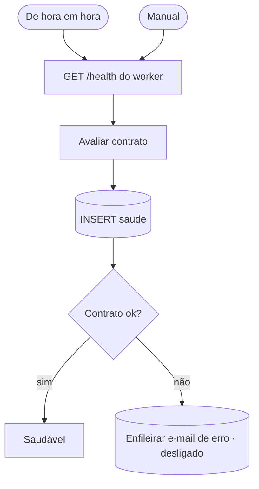

# W00 Saúde

> [!abstract] Em uma frase
> De hora em hora, o W00 confere se o worker está **no contrato** — respondendo, com o Tesseract exatamente na versão 5.4.0 com o idioma português, com o arquivo de treino do OCR idêntico ao do build e **sem** a chave de API do modelo — e grava uma linha em `saude`, que a página Saúde do site mostra.

## Papel na solução

Garante que o sistema em produção é **o mesmo** que foi medido. O OCR precisa ser a versão exata das medições, senão os números de qualidade deixam de valer ([[ADR-008 OCR — stack, configuração e limites]]); a chave do modelo nunca pode chegar ao worker ([[Controle de acesso e segredos]]); e a fila de e-mails não pode estar travada. O W00 transforma essas garantias em **verificação contínua**, visível na [[Página Saúde]].

## O contrato do `/health` do worker

| Item | Esperado | Por quê |
|---|---|---|
| HTTP | 200 com `ok = true` | o worker responde e a configuração é válida |
| `tesseract` | começa com `5.4.0` (aceita `5.4.0.20240606`; recusa `5.4.1`) | OCR comparável às medições |
| idiomas | contém `por` | OCR em português |
| `tessdata_sha256` | igual ao valor pinado no build | o arquivo de treino não está no git; o hash prova que é o mesmo |
| `anthropic_key_presente` | **falso** | só o n8n pode ter a chave |
| `git_sha` | registrado | qual código está rodando |

## Fluxograma

## Passo a passo — os 9 nós

#### Passo 1 — Sobre o W00
- **Tipo:** nota do canvas.
- **O que diz:** de hora em hora confere o contrato do worker e grava uma linha em `saude`; lista as regras (Tesseract 5.4.0 com `por`, `tessdata` por SHA-256, o worker nunca tem a chave, tempo limite explícito de 15 s com erro tratado, link da execução sem supor barra no fim da URL) e lembra que o n8n de produção **exclui** os nós que executam comandos no servidor ou leem arquivos do disco (`NODES_EXCLUDE`) — nada aqui roda comando nem lê disco do host.

#### Passo 2 — De hora em hora
- **Tipo:** *Schedule Trigger*, cron `0 * * * *` (minuto zero de toda hora).

#### Passo 3 — Manual
- **Tipo:** *Manual Trigger*.

#### Passo 4 — GET /health do worker
- **Tipo:** *HTTP Request* (GET `{FOPA_WORKER_URL}/health`), 15 s, nunca erro, saída de erro ligada — DNS, recusa de conexão e tempo esgotado também viram item (e linha em `saude`), nunca exceção silenciosa.

#### Passo 5 — Avaliar contrato
- **Tipo:** *Code*.
- **O que faz:** junta sucesso e erro de rede num item só e lista os **motivos** de quebra de contrato (worker inalcançável, HTTP diferente de 200, Tesseract fora da versão, `tessdata` diferente do pinado, chave presente). Monta `worker_ok`, `tesseract_ok`, os detalhes (status, corpo, motivos, id e link da execução, valores esperados) e o texto de um aviso.

#### Passo 6 — INSERT saude
- **Tipo:** *Postgres*.
- **O que grava em `saude`:** `worker_ok`, versão do Tesseract, SHA-256 do `tessdata`, `git_sha`, os detalhes e **`email_ok`** — calculado na hora a partir da própria fila: o canal de e-mail está saudável se **nenhum** e-mail falhou na última hora **e** nenhum pendente está parado há mais de 10 minutos. `n8n_ok` e `postgres_ok` são verdadeiros por construção (se o n8n e o Postgres não estivessem de pé, a linha nem seria gravada).

#### Passo 7 — Contrato ok?
- **Tipo:** *IF* — `worker_ok` **e** Tesseract na versão **e** `tessdata` igual ao pinado.

#### Passo 8 — Saudável
- **Tipo:** *No Operation* — fim explícito do caminho feliz.

#### Passo 9 — Enfileirar e-mail de erro
- **Tipo:** *Postgres* — **desligado** (devolve `id = NULL`), pela decisão de dois e-mails no produto ([[ADR-016 O produto manda só dois e-mails]]). A quebra de contrato continua visível: a linha em `saude` tem `worker_ok = false` e os motivos, e a [[Página Saúde]] mostra.

## Outras verificações de saúde

O W00 é uma das três camadas ([[Saúde e observabilidade]]):
- o **healthcheck do Docker Compose** chama o `/health` do worker (a cada 30 s) e o `/api/saude` da API (a cada 30 s): um worker com OCR fora do contrato nunca fica `healthy`, e os serviços que dependem dele só sobem com ele saudável;
- a **API do site** (`GET /api/saude`) responde 503 quando o Postgres ou o worker caem, dizendo quem caiu;
- o **W00** grava o histórico de hora em hora.

## Relacionadas

[[MOC Fluxos n8n]] · [[Horários e agendamentos]] · [[Página Saúde]] · [[Saúde e observabilidade]] · [[OCR]] · [[Endpoints do worker]] · [[W50 Envio de e-mails]] · [[ADR-008 OCR — stack, configuração e limites]]
