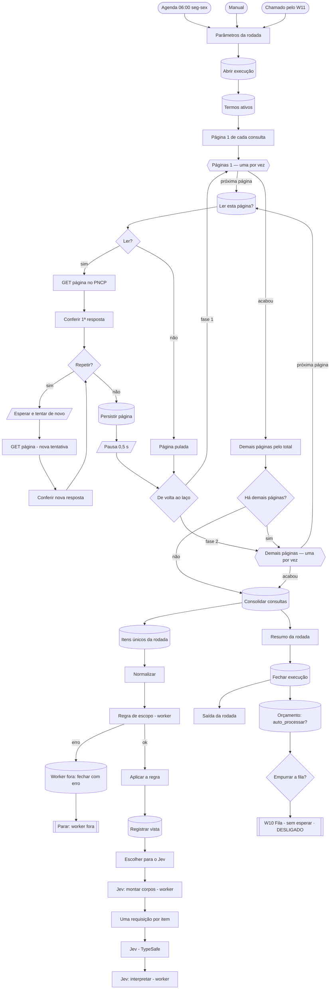

# W01 Descoberta

> [!abstract] Em uma frase
> Todo dia útil às 06:00, o W01 pergunta ao PNCP quais licitações de **compra de folha de pagamento** existem, grava cada página de resultado antes de pedir a próxima, classifica cada licitação **por regra** (sem IA) e registra no banco só o que é novo — e, para cada licitação nova de folha, enfileira o e-mail "licitação nova" para os administradores.

## Papel na solução

O W01 é a **porta de entrada** de todo o sistema: nenhuma licitação chega ao banco, ao site ou à extração sem passar por ele (ou pelo [[W41 Histórico do PNCP]], que traz o passado). Ele resolve a primeira dor do negócio — o edital chegar em D+3 por um fornecedor — trocando o fornecedor por uma consulta direta à fonte oficial, o PNCP, no próprio dia ([[Problema de negócio]]).

Ele **não** baixa documento nem chama modelo de extração: descobre, classifica e registra. O que acontece depois (baixar, ler, extrair, verificar) é do [[W10 Fila]] e do [[W20 Processar uma licitação]].

## Quando roda

| Gatilho | Quando | Modo | O que muda |
|---|---|---|---|
| Agenda | `0 6 * * 1-5` — 06:00 de segunda a sexta, fuso `America/Sao_Paulo` | grava (`seco = false`) | rodada normal; teto de 300 chamadas ao Jev |
| Manual | clique no editor do n8n | grava (`seco = false`) | rodada de teste; teto de 100 chamadas ao Jev |
| Chamado por outro fluxo | o [[W11 Ações do site]] chama quando alguém clica em **"Verificar agora"** no [[Página Admin|Admin]] | **seco** (não grava licitação) | só lista o que é novo; devolve a lista ao site |

A tabela completa de horários do sistema está em [[Horários e agendamentos]].

## Entradas, saídas e dependências

| | |
|---|---|
| **Lê** | `termos` (os termos de busca ativos, editáveis no Admin), `configuracao` (ano mínimo do recorte, por `fn_ano_minimo()`), `orcamento` (se a esteira pode ser empurrada), `licitacoes` (para saber o que já é conhecido) |
| **Escreve** | `execucoes_workflow` (uma linha por rodada), `buscas_paginas` (uma linha por página lida do PNCP), `buscas` (uma linha por consulta, com a cobertura), `licitacoes` (via `fn_registrar_vista`), `sinais_jev` (via worker), `emails` (o aviso `licitacao_nova`) |
| **Chama** | API de busca do PNCP (`https://pncp.gov.br/api/search/`); worker `POST /escopo`, `POST /jev/escopo/corpos`, `POST /jev/escopo/interpretar`; API do Jev (TypeSafe); o [[W10 Fila]] (nó hoje desligado — ver passo 46) |
| **Em caso de erro** | o workflow de erro é o [[W90 Erro]] |
| **Custo** | R$ 0 de modelo de extração; o Jev custa frações de centavo por chamada e é registrado em `sinais_jev.usd` |

Tabelas descritas em [[Modelo de dados]]; endpoints do worker em [[Endpoints do worker]].

## Fluxograma

> [!info] Como ler o fluxograma
> Retângulos com borda arredondada são gatilhos; cilindros são consultas ao Postgres; hexágonos são laços (*Split in Batches*); losangos são decisões (*IF*); trapézios são esperas. O ramo "Resumo da rodada" só roda depois que o ramo de cima (registro e Jev) terminou, porque o n8n executa em ordem `v1`: o primeiro ramo vai até o fim antes do segundo começar.

## Passo a passo — os 46 nós

A numeração segue a ordem em que o fluxo executa. Os quatro primeiros nós são **notas do canvas** (*sticky notes*): não executam nada, documentam o fluxo dentro do próprio n8n, e estão aqui porque fazem parte do workflow publicado.

### Notas do canvas

#### Passo 1 — Sobre o W01
- **Tipo:** nota do canvas.
- **O que diz:** resume o fluxo — recorte de 2026 feito na própria consulta ao PNCP, termos vindos do Admin, paginação explícita com gravação antes da próxima página, política de novas tentativas (429/5xx: 30 s e uma nova tentativa; conexão derrubada: até 5 tentativas), deduplicação pelo número de controle, regra antes de IA, Jev só como sinal, coleta cega diferente de "nada a fazer", e o motivo de `saveExecutionProgress = false`.
- **Por que existe:** quem abre o canvas entende o fluxo sem abrir cada nó.

#### Passo 2 — Paginação
- **Tipo:** nota do canvas.
- **O que diz:** a primeira passada lê a página 1 de cada consulta; a segunda lê as demais até `ceil(total/50)`, sem passar do teto de páginas do termo (ou 2, nas abertas). Página curta ou que falhou encerra a consulta. Erro de rede também vira linha gravada, nunca exceção silenciosa.

#### Passo 3 — Registro
- **Tipo:** nota do canvas.
- **O que diz:** deduplica pelo que foi gravado, normaliza, faz **uma** chamada ao `POST /escopo` com todos os textos e chama `fn_registrar_vista` uma vez por item. O Jev só vê o que a rodada inseriu, nunca na rodada seca, e só pontua.

#### Passo 4 — Fim da rodada → W10 (desligado)
- **Tipo:** nota do canvas.
- **O que diz:** documenta por que o nó que empurraria a fila ([[#Passo 46 — W10 Fila (sem esperar)]]) é publicado desligado: com o orçamento em `auto_processar = true` e o provedor de extração da esteira em `simulado`, empurrar a fila logo depois da descoberta mandaria licitações reais para extração simulada — e o banco recusa publicar extração simulada em licitação real (a trava T15, ver [[Controles de consistência]]), o que viraria erro em série. A fila é acionada pela agenda própria do [[W10 Fila]]. Explica como ligar: ativar o nó no canvas, ou tirar `"disabled": true` do JSON e reimportar.

### Etapa 1 — Gatilhos e abertura da rodada

#### Passo 5 — Agenda 06:00 seg-sex
- **Tipo:** *Schedule Trigger*, expressão cron `0 6 * * 1-5`.
- **O que faz:** dispara a rodada às 06:00 de segunda a sexta, no fuso `America/Sao_Paulo` (definido nas *settings* do workflow e no container do n8n).
- **Saída:** um item vazio para [[#Passo 8 — Parâmetros da rodada]].
- **Por que 06:00 em dia útil:** as licitações publicadas no dia anterior e na madrugada já estão indexadas, e a equipe começa o dia com a lista pronta; o alerta diário ([[W40 Alerta diário]]) sai às 07:00, depois da descoberta e da fila.

#### Passo 6 — Manual
- **Tipo:** *Manual Trigger*.
- **O que faz:** permite rodar a descoberta pelo editor do n8n, gravando de verdade. É a rodada de teste: o teto de chamadas ao Jev cai para 100.

#### Passo 7 — Chamado por outro fluxo
- **Tipo:** *Execute Workflow Trigger*, com as entradas `seco` (booleano) e `execucao_id` (número).
- **Quem chama:** o [[W11 Ações do site]], quando alguém clica em "Verificar agora". O W11 já abriu a linha em `execucoes_workflow` e passa o id para o site acompanhar o andamento.

#### Passo 8 — Parâmetros da rodada
- **Tipo:** *Code* (JavaScript).
- **O que faz:** descobre qual gatilho disparou e monta os parâmetros da rodada: `hoje` (data em São Paulo), `inicio` (UTC), `gatilho` (`agenda`, `manual` ou `subfluxo`), `seco`, `execucao_id`, `jev_teto` (100 no manual, 300 nos demais), a base da API (`https://pncp.gov.br/api/search/`), o tamanho da página (50) e o número de páginas das consultas de abertas (2).
- **Regra importante:** quando chamado por outro fluxo sem dizer `seco`, a rodada **é seca** — listar nunca pode gravar por descuido.

#### Passo 9 — Abrir execução
- **Tipo:** *Postgres* (consulta SQL).
- **O que faz:** garante uma linha em `execucoes_workflow` com status `em_curso`. Se veio um `execucao_id` (do W11), atualiza a linha existente com o id da execução do n8n; senão, insere uma nova.
- **Saída:** `execucao_id` — o identificador que todas as linhas seguintes da rodada (páginas, consultas) carregam.
- **Por que existe:** toda rodada deixa rastro auditável; a página [[Página Execuções|Execuções]] do site mostra essas linhas.

#### Passo 10 — Termos ativos
- **Tipo:** *Postgres*.
- **O que faz:** lê os termos de busca ativos (`termos WHERE ativo`), ordenados por prioridade, com o número máximo de páginas de cada um; lê também o ano mínimo do recorte (`fn_ano_minimo()`) e o ano atual.
- **Termos de fábrica** (migração `db/012_seed.sql`, editáveis no [[Página Admin|Admin]]): "cessão onerosa folha de pagamento", "folha de pagamento servidores instituição financeira", "folha de pagamento instituição bancária", "créditos da folha de pagamento", "créditos provenientes da folha de pagamento", "folha salarial instituição financeira" — 10 páginas cada.

#### Passo 11 — Página 1 de cada consulta
- **Tipo:** *Code*.
- **O que faz:** para cada termo monta **duas consultas** ao PNCP, sempre com `tipos_documento=edital`, `ordenacao=-data` e 50 itens por página:
  1. **recorte** — `status=todos` e `anos=<ano mínimo>|…|<ano atual>`: o ano inteiro, aberto ou encerrado (o encerrado serve de referência de preço);
  2. **abertas** — `status=recebendo_proposta`, sem filtro de ano: pega, por exemplo, um credenciamento registrado em ano anterior que continua recebendo propostas.
- **Saída:** um item por consulta, na fase 1, página 1, com a URL pronta.
- **Falha que ele impede:** sem nenhum termo ativo, o nó **para com erro** — uma coleta sem termo seria cega sem ninguém perceber.
- **Por que o recorte vai na consulta:** a decisão de trabalhar só com 2026 ([[ADR-015 Acervo só de 2026 e só compra de folha]]) é aplicada na origem; o banco não recebe lixo para depois filtrar.

### Etapa 2 — Paginação com gravação página a página

#### Passo 12 — Páginas 1 — uma por vez
- **Tipo:** *Split in Batches* (laço), um item por volta.
- **O que faz:** percorre as páginas 1 de todas as consultas, uma de cada vez. A saída "próxima" vai para [[#Passo 13 — Ler esta página?]]; quando acaba, a saída "terminou" vai para [[#Passo 25 — Demais páginas pelo total]].
- **Por que uma por vez:** cada página é gravada antes da próxima ser pedida; se o PNCP cair no meio, o que foi lido não se perde.

#### Passo 13 — Ler esta página?
- **Tipo:** *Postgres*.
- **O que faz:** pergunta ao banco se alguma página anterior **da mesma consulta, nesta rodada**, falhou ou veio curta. Se sim, esta página não é lida.
- **Por que perguntar ao banco:** vale o que foi gravado, não o que está na memória do n8n.

#### Passo 14 — Ler?
- **Tipo:** *IF*.
- **O que faz:** se o passo 13 respondeu `ler = true`, segue para o GET; senão, vai para [[#Passo 23 — Página pulada]].

#### Passo 15 — GET página no PNCP
- **Tipo:** *HTTP Request* (GET), tempo limite de 60 s, "nunca erro" (a resposta volta inteira mesmo com HTTP 4xx/5xx) e saída de erro ligada (queda de DNS ou conexão também vira item).
- **Cabeçalhos:** `User-Agent` que identifica o sistema e traz um contato (regra de boa convivência com a API pública, ver [[Legalidade da automação]]) e `Accept: application/json`.

#### Passo 16 — Conferir 1ª resposta
- **Tipo:** *Code*, um item por vez.
- **O que faz:** interpreta a resposta do PNCP e classifica a falha:
  - **rede** (conexão derrubada, DNS, tempo esgotado, ou HTTP 200 sem `items`) → pode repetir até 5 tentativas, esperando 1, 2, 4 e 8 s;
  - **limite** (HTTP 429 ou 5xx) → espera 30 s e tenta **uma** vez mais (o 429 do PNCP não informa quanto esperar e às vezes vem em HTML);
  - **http** (outro status) → não repete.
- **Saída:** a página com `falhou`, `motivo` (o histórico das tentativas), `repetir`, o tempo de espera, o total declarado e os itens.
- **Origem da regra:** medição de 24/09/2026 às 04h, quando o PNCP derrubava cerca de 40% das conexões e uma única nova tentativa não bastava ([[Disponibilidade do PNCP]]).

#### Passo 17 — Repetir?
- **Tipo:** *IF*.
- **O que faz:** se a conferência mandou repetir, vai para a espera; senão, grava a página.

#### Passo 18 — Esperar e tentar de novo
- **Tipo:** *Wait*, tempo vindo do item (`espera_s`: 30 s no limite; 1, 2, 4 ou 8 s na queda de rede).

#### Passo 19 — GET página (nova tentativa)
- **Tipo:** *HTTP Request*, igual ao passo 15 (mesmos cabeçalhos, 60 s, saída de erro ligada).

#### Passo 20 — Conferir nova resposta
- **Tipo:** *Code*, um item por vez — a mesma avaliação do passo 16, somando a tentativa. Esgotadas as tentativas, a página fica `falhou = true` com o histórico dos motivos e a consulta para ali; o parcial já gravado é aproveitado.

#### Passo 21 — Persistir página
- **Tipo:** *Postgres*.
- **O que faz:** grava a página em `buscas_paginas` (execução, consulta, número da página, itens, status HTTP, se falhou e o motivo). Página que falhou é gravada **sem itens**, com o motivo.
- **Por que existe:** é a prova da coleta. Todo resultado classificado depois sai daqui.

#### Passo 22 — Pausa 0,5 s
- **Tipo:** *Wait* de meio segundo entre páginas — gentileza com a API pública e menos chance de 429.

#### Passo 23 — Página pulada
- **Tipo:** *Code*, um item por vez.
- **O que faz:** marca a página como `pulada` (zero itens) e devolve ao laço. Ela não ganha linha em `buscas_paginas`; a cobertura da consulta mostra o que faltou.

#### Passo 24 — De volta ao laço
- **Tipo:** *IF*.
- **O que faz:** devolve o item ao laço certo: fase 1 volta ao passo 12, fase 2 volta ao passo 27.

#### Passo 25 — Demais páginas pelo total
- **Tipo:** *Code*.
- **O que faz:** olha o total que o PNCP declarou em cada página 1 e calcula as páginas restantes: da 2 até `min(limite, ceil(total/50))`. Consulta cuja página 1 falhou ou veio curta (menos de 50 itens) não gera páginas seguintes. Guarda no primeiro item a lista das consultas com o total declarado, que o passo 28 usa para calcular a cobertura.
- **Saída:** itens da fase 2, ou um item `nenhuma: true` se não há mais páginas.

#### Passo 26 — Há demais páginas?
- **Tipo:** *IF*.
- **O que faz:** se o passo 25 gerou páginas da fase 2, manda para o laço [[#Passo 27 — Demais páginas — uma por vez]]; se não, vai direto para [[#Passo 28 — Consolidar consultas]].

#### Passo 27 — Demais páginas — uma por vez
- **Tipo:** *Split in Batches*.
- **O que faz:** o mesmo laço do passo 12, agora para as páginas da fase 2. Quando termina, segue para a consolidação.

#### Passo 28 — Consolidar consultas
- **Tipo:** *Postgres*, executa uma vez por rodada.
- **O que faz:** grava em `buscas` **uma linha por consulta**: páginas lidas, total declarado pelo PNCP, itens lidos, **cobertura em %**, se o teto de páginas cortou a consulta, se falhou e em que página. Devolve os totais da rodada e o indicador **`cego`** — verdadeiro quando **todas** as consultas falharam.
- **Por que existe:** "nada novo" e "não consegui olhar" são coisas diferentes. A cobertura declarada torna visível quando a busca não viu tudo ([[ADR-007 Cobertura de municípios pequenos]]).

### Etapa 3 — Deduplicação, classificação e registro

#### Passo 29 — Itens únicos da rodada
- **Tipo:** *Postgres*, uma vez por rodada.
- **O que faz:** abre todos os itens de todas as páginas gravadas desta rodada e devolve **um resultado por número de controle do PNCP** (a primeira ocorrência). O mesmo edital aparece em vários termos; aqui ele vira um só.
- **Por que ler do banco:** o que o W01 classifica é exatamente o que ficou gravado como prova ([[ADR-013 Identidade de licitação é o número de controle]]).

#### Passo 30 — Normalizar
- **Tipo:** *Code*.
- **O que faz:** converte o resultado da busca do PNCP nas colunas de `licitacoes`: controle, ano, sequencial, órgão, UF, município, modalidade, objeto (até 1.200 caracteres), situação, data de publicação, fim do prazo, data de atualização no PNCP e o link público do edital. Monta também o **texto que a regra de escopo julga**: descrição + objeto + objeto da compra + título.
- **Descarte:** controle fora do formato `CNPJ-1-sequencial/ano` é descartado (o banco recusaria pela restrição `CHECK`) e conta como "descartado" no resumo.

#### Passo 31 — Regra de escopo (worker)
- **Tipo:** *HTTP Request* (POST `{FOPA_WORKER_URL}/escopo`), uma vez por rodada, credencial `worker`, tempo limite de 30 s.
- **O que faz:** manda **todos** os textos de uma vez para o worker, que aplica a regra determinística de escopo (`scripts/fopa/escopo.py`) e devolve, para cada texto, `dentro` (é compra de folha?) e o `motivo`, mais a `escopo_versao` da regra.
- **Por que regra antes de IA:** barata, auditável e reprodutível ([[ADR-003 Classificação por regras antes de IA]], [[Regras antes de IA]]).
- **Se falhar:** saída de erro para o passo 32.

#### Passo 32 — Worker fora: fechar com erro
- **Tipo:** *Postgres*.
- **O que faz:** fecha a linha da rodada com `status = erro` e o motivo ("worker /escopo: …"). As páginas já gravadas ficam.

#### Passo 33 — Parar: worker fora
- **Tipo:** *Stop and Error*.
- **O que faz:** encerra a execução com a mensagem "o worker não respondeu ao POST /escopo — a rodada não classifica sem a regra"; o erro dispara o [[W90 Erro]].

#### Passo 34 — Aplicar a regra
- **Tipo:** *Code*.
- **O que faz:** confere que o worker devolveu um veredito por objeto (se a contagem não bate, para com erro) e anexa a cada licitação `escopo_dentro`, `escopo_motivo` e `escopo_versao`.
- **Por que guardar a versão:** quando a regra muda, uma migração reavalia pelo que foi gravado, sem nova coleta.

#### Passo 35 — Registrar vista
- **Tipo:** *Postgres*, uma chamada por licitação (`queryBatching: independently`).
- **O que faz:** chama `fn_registrar_vista(controle, payload, hoje, seco, 'W01')`, que decide sozinha a ação:

  | Ação | Quando | Efeito |
  |---|---|---|
  | `ignorar` | fora do recorte de ano | nada é gravado |
  | `inserir_nova` | desconhecida, dentro do escopo, com prazo aberto | entra em `licitacoes` como `nova` — vai para a fila |
  | `inserir_fora_escopo` | desconhecida que a regra recusou | entra como `fora_escopo` — nunca vai para a fila; fica para o Jev e o rótulo humano |
  | `inserir_fora_janela` | desconhecida com sessão já passada | entra como `fora_janela` — histórico |
  | `retificar` | conhecida com data de atualização nova no PNCP | marca retificação ([[W70 Retificações]] cuida do resto) |
  | `visto` | conhecida sem mudança | atualiza "visto em" |

- **Na rodada seca nada é escrito** — nem linha, nem carimbo, nem "visto em".
- **Idempotente:** a segunda rodada do dia vê `visto`.

### Etapa 4 — O Jev como sinal (nunca como decisão)

#### Passo 36 — Escolher para o Jev
- **Tipo:** *Code*.
- **O que faz:** seleciona só as licitações que **esta rodada inseriu** (`inserir_nova` e `inserir_fora_escopo`), coloca as novas primeiro (são as que podem ir para a fila) e corta no teto da rodada (300, ou 100 no manual). Quem passou do teto fica registrado no resumo. Na rodada seca, não escolhe nada.
- **Por que o Jev não decide:** a regra decide; o Jev dá uma probabilidade que aparece no site e alimenta a revisão humana ([[Jev — score de escopo e sustentação]]).

#### Passo 37 — Jev: montar corpos (worker)
- **Tipo:** *HTTP Request* (POST `/jev/escopo/corpos` no worker). Em erro, segue com a saída normal (o Jev nunca derruba a rodada).
- **O que faz:** o worker monta a pergunta ao Jev com o **critério medido** (o texto da pergunta que teve melhor resultado nas medições) e informa ao lado o que a regra decidiu.

#### Passo 38 — Uma requisição por item
- **Tipo:** *Code* — transforma a resposta do worker em um item por licitação, com a URL, o controle, o veredito da regra e o corpo da requisição.

#### Passo 39 — Jev (TypeSafe)
- **Tipo:** *HTTP Request* (POST na API do Jev), credencial `jev` (o segredo fica só na credencial do n8n), lotes de 5 a cada 1 s, tempo limite de 30 s. Em erro, segue.

#### Passo 40 — Jev: interpretar (worker)
- **Tipo:** *HTTP Request* (POST `/jev/escopo/interpretar` no worker), lotes de 5 a cada 250 ms.
- **O que faz:** o worker converte a resposta do Jev em `p_filtro_ok` — a probabilidade de a regra ter acertado (P(folha) se a regra aceitou; 1 − P(folha) se recusou) —, marca discordância e grava em `sinais_jev`.

### Etapa 5 — Fechamento da rodada

#### Passo 41 — Resumo da rodada
- **Tipo:** *Code*.
- **O que faz:** roda depois do ramo de registro e monta os contadores da rodada: quantas vistas, quantas novas, retificadas, fora de escopo, fora de janela, fora do recorte, já conhecidas, páginas lidas, itens únicos, descartados, consultas que falharam e o resumo do Jev (chamadas, respostas, média de `p_filtro_ok`, candidatas, discordâncias, custo em dólar, quem ficou fora do teto).
- **Lista para o site:** até 50 licitações novas com município, UF, modalidade, objeto, prazo e link — é o que a rodada seca do "Verificar agora" mostra na tela.
- **Os e-mails:** para cada licitação inserida como nova (nunca na rodada seca), monta o e-mail **"[FOPA] Licitação nova de folha: <município>/<UF> · <modalidade>"** com órgão, modalidade, prazo, trecho do objeto, link para o site e para o PNCP. É o primeiro dos dois e-mails do produto ([[ADR-016 O produto manda só dois e-mails]], [[E-mails do produto]]).

#### Passo 42 — Fechar execução
- **Tipo:** *Postgres*.
- **O que faz:** fecha a linha da rodada (`status = ok`, duração, contadores, `cego`, custo R$ 0) e **enfileira os e-mails "licitação nova"** em `emails`, um por licitação que (a) a rodada inseriu como nova, (b) continua dentro do escopo efetivo (`fn_escopo_efetivo`, que respeita o rótulo humano) e (c) ainda não recebeu esse e-mail. Quem envia é o [[W50 Envio de e-mails]], para os administradores.
- **Por que "nunca repete":** a condição `NOT EXISTS` garante um aviso por licitação na vida inteira dela.

#### Passo 43 — Saída da rodada
- **Tipo:** *Code*.
- **O que faz:** devolve a quem chamou (o W11, no "Verificar agora") o resultado: `execucao_id`, duração, vistas por ação, lista de novas e retificadas, `cego`, resumo do Jev e as consultas com cobertura.

#### Passo 44 — Orçamento: auto_processar?
- **Tipo:** *Postgres*, uma vez.
- **O que faz:** lê `orcamento.auto_processar` da linha vigente (padrão `true` se não houver linha).

#### Passo 45 — Empurrar a fila?
- **Tipo:** *IF*.
- **O que faz:** verdadeiro só se a rodada **não** é seca **e** o orçamento permite `auto_processar`.

#### Passo 46 — W10 Fila (sem esperar)
- **Tipo:** *Execute Workflow* (chama o [[W10 Fila]] sem esperar a resposta). **Nó desligado** no workflow publicado.
- **O que faria:** logo depois de uma rodada que grava, acordaria a fila para processar as novas.
- **Por que está desligado:** ver [[#Passo 4 — Fim da rodada → W10 (desligado)]]. Na prática a fila não depende dele: o [[W10 Fila]] roda sozinho a cada 10 minutos entre 06:00 e 07:50, logo depois da descoberta; enquanto o provedor da esteira for o `simulado`, ela só baixa e lê, o que custa R$ 0 ([[Modelos e provedores]]).

## Tratamento de erros, em resumo

| Situação | O que acontece | Onde aparece |
|---|---|---|
| PNCP devolve 429/5xx | espera 30 s, uma nova tentativa; persistindo, a página fica `falhou` e a consulta para | `buscas_paginas.motivo`, cobertura em `buscas` |
| Conexão derrubada | até 5 tentativas (1, 2, 4, 8 s) | idem |
| Todas as consultas falham | rodada `cego = true` | [[Página Saúde]] e [[Página Execuções]] |
| Worker fora do ar no `/escopo` | rodada fecha com erro e para | `execucoes_workflow.erro`; [[W90 Erro]] |
| Jev falha | a rodada segue; o sinal fica sem valor | `contadores.jev.falhas` |
| Nenhum termo ativo | para com erro antes de consultar | [[W90 Erro]] |

## Caso real — Itapecuru Mirim/MA (28/09/2026)

> [!example] Pregão Eletrônico, controle `05648696000180-1-000088/2026`
> 1. Na rodada agendada de **28/09/2026 às 06:00**, o W01 encontrou cinco licitações de folha que o banco ainda não conhecia — três dispensas de Brasília/DF, um pregão de Muzambinho/MG e o pregão de **Itapecuru Mirim/MA** ("Contratação de instituição financeira pública ou privada, para a prestação de serviços de gerenciamento de créditos provenientes da folha de pagamento dos servidores públicos…").
> 2. A regra de escopo aceitou; `fn_registrar_vista` devolveu `inserir_nova` e a licitação entrou com estado `nova`.
> 3. A rodada fechou e enfileirou cinco e-mails "licitação nova"; às **06:04** o [[W50 Envio de e-mails]] entregou "[FOPA] Licitação nova de folha: Itapecuru Mirim/MA · Pregão - Eletrônico" aos administradores.
> 4. Às **06:20** a fila ([[W10 Fila]]) mandou a licitação ao [[W20 Processar uma licitação]], que a baixou e leu. A continuação do caso está em [[W20 Processar uma licitação#Caso real — Itapecuru Mirim/MA (28/09/2026)]].
>
> Fonte: páginas [[Página E-mails|E-mails]] e [[Página Execuções|Execuções]] do site em produção, 28/09/2026.

## Decisões que moldam este fluxo

- [[ADR-002 PNCP como fonte primária]] — a fonte é pública, gratuita e obrigatória por lei.
- [[ADR-003 Classificação por regras antes de IA]] — a regra decide; a IA pontua.
- [[ADR-007 Cobertura de municípios pequenos]] — cobertura declarada por consulta.
- [[ADR-013 Identidade de licitação é o número de controle]] — deduplicação e chave primária.
- [[ADR-015 Acervo só de 2026 e só compra de folha]] — recorte na própria consulta.
- [[ADR-016 O produto manda só dois e-mails]] — o aviso de licitação nova é um deles.

## Relacionadas

[[MOC Fluxos n8n]] · [[Horários e agendamentos]] · [[W10 Fila]] · [[W11 Ações do site]] · [[W41 Histórico do PNCP]] · [[W70 Retificações]] · [[W50 Envio de e-mails]] · [[W90 Erro]] · [[Ciclo de vida de uma licitação]] · [[Fontes de dados — PNCP]] · [[Modelo de dados]] · [[Escopo — o que é licitação de folha]] · [[Regras antes de IA]] · [[Jev — score de escopo e sustentação]] · [[E-mails do produto]] · [[Página Admin]]
