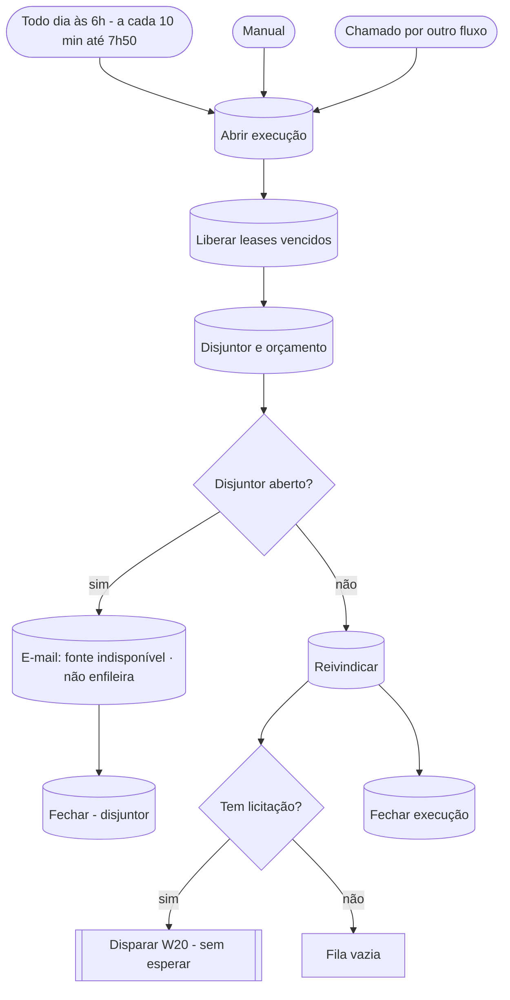

# W10 Fila

> [!abstract] Em uma frase
> A cada 10 minutos, das 06:00 às 07:50, o W10 recupera trabalhos que morreram no meio, confere se a extração está falhando em série, **reivindica no banco até 4 licitações** que podem andar e dispara um [[W20 Processar uma licitação]] para cada uma — sem esperar nenhum terminar.

## Papel na solução

É o **despachante**. O W01 descobre, o W10 decide **o que processar agora e em que ordem**, e o W20 processa. Toda a regra da fila mora no Postgres, em funções testadas (`fn_reivindicar`, `fn_liberar_leases_vencidos`, `fn_disjuntor_w20_aberto`); o canvas do W10 só as chama. Por isso dois W10 rodando ao mesmo tempo (agenda + clique no site) nunca pegam a mesma licitação.

## Quando roda

| Gatilho | Quando | Efeito |
|---|---|---|
| Agenda | `*/10 6-7 * * *` — 06:00, 06:10, …, 07:50, todo dia (12 rodadas) | reivindica só se `orcamento.auto_processar = true` |
| Manual | editor do n8n | reivindica sempre (respeitando o limite) |
| Chamado por outro fluxo | o [[W11 Ações do site]] (botões "Processar" e "Extrair com IA") | reivindica sempre; a licitação pedida já ganhou prioridade no banco |

Com até 4 licitações por rodada e 12 rodadas, a esteira matinal comporta **até 48 licitações por manhã**.

## Conceitos usados aqui

- **Lease (reserva com prazo):** ao reivindicar, a licitação recebe `lease_por = 'W10:<execução>'` e `lease_ate = agora + 2 h`. Enquanto o lease vale, nenhum outro W10 a pega. Se o processo morrer, o lease vence e a próxima rodada a devolve.
- **Backoff:** depois de uma falha, a licitação só volta à fila após 15 minutos (1ª falha), 2 horas (2ª) ou 12 horas (3ª). Na 4ª falha vira `erro_definitivo`.
- **Disjuntor:** se o [[W20 Processar uma licitação]] teve **3 ou mais erros nos últimos 30 minutos e nenhum sucesso**, a fila para de reivindicar até a situação mudar — em vez de queimar tentativas de todas as licitações por causa de um problema geral (PNCP fora, worker fora).

## Fluxograma

## Passo a passo — os 15 nós

### Nota do canvas

#### Passo 1 — Sobre o W10
- **Tipo:** nota do canvas.
- **O que diz:** a fila nunca bloqueia; a regra mora no Postgres; resume os quatro movimentos (devolver leases vencidos, disjuntor, reivindicar até 4 − extraindo, disparar o W20 sem esperar); lembra que, com `auto_processar = false`, a rodada agendada não reivindica nada. Registra também que a fila roda todo dia às 6h, a cada 10 minutos até 7h50 (até ~48 por manhã, 4 por rodada), e que sem provedor real ela só baixa e lê.

### Etapa 1 — Gatilhos e abertura

#### Passo 2 — Todo dia às 6h (a cada 10 min até 7h50)
- **Tipo:** *Schedule Trigger*, cron `*/10 6-7 * * *`, fuso `America/Sao_Paulo`.
- **Por que nesse horário:** começa junto com a descoberta ([[W01 Descoberta]], 06:00) e termina antes do alerta diário ([[W40 Alerta diário]], 07:00 — o alerta usa o que já foi lido) e do expediente.

#### Passo 3 — Manual
- **Tipo:** *Manual Trigger* — rodar a fila pelo editor.

#### Passo 4 — Chamado por outro fluxo
- **Tipo:** *Execute Workflow Trigger* com entrada repassada (*passthrough*). Quem chama: o [[W11 Ações do site]].

#### Passo 5 — Abrir execução
- **Tipo:** *Postgres*, uma vez.
- **O que faz:** insere a linha da rodada em `execucoes_workflow` (`workflow = 'W10'`, id da execução do n8n, gatilho `agenda`, `manual` ou `subfluxo`, status `em_curso`).

### Etapa 2 — Recuperar e proteger

#### Passo 6 — Liberar leases vencidos
- **Tipo:** *Postgres*, uma vez — chama `fn_liberar_leases_vencidos()`.
- **O que faz:** procura licitações com lease vencido. Se estavam num passo transitório, a morte do processo vira a falha daquele passo, pelo mesmo caminho de uma falha comum (tentativa + backoff):

  | Estava em | Vira |
  |---|---|
  | `baixando` | `falha_rede` |
  | `lendo` | `erro_leitura` |
  | `extraindo` | `erro_extracao` |
  | outro estado | só perde o lease |

- **Saída:** quantas foram liberadas e o detalhe de cada uma.
- **Por que existe:** um worker reiniciado no meio de um job não pode deixar licitação "presa" para sempre.

#### Passo 7 — Disjuntor e orçamento
- **Tipo:** *Postgres*, uma vez.
- **O que faz:** lê `fn_disjuntor_w20_aberto()` e, do orçamento vigente, `max_por_execucao` e `auto_processar` (padrão `true`).

#### Passo 8 — Disjuntor aberto?
- **Tipo:** *IF* — se o disjuntor está aberto, segue para o passo 9; senão, para o 10.

#### Passo 9 — E-mail: fonte indisponível
- **Tipo:** *Postgres*, sempre devolve um item.
- **O que faz hoje:** **nada** — devolve `id = NULL`. O nó enfileirava um e-mail de "fonte indisponível"; ele foi desligado quando o produto passou a mandar só dois e-mails ([[ADR-016 O produto manda só dois e-mails]]). O disjuntor continua funcionando: a rodada fecha com status `disjuntor` e isso aparece em [[Página Execuções]] e [[Página Saúde]].

#### Passo 10 — Reivindicar
- **Tipo:** *Postgres*, sempre devolve ao menos um item — chama `fn_reivindicar('W10:<execução>', limite)`.
- **O limite:** na rodada agendada com `auto_processar = false`, **zero** (nada é travado); nos demais casos, o `max_por_execucao` do orçamento (sem valor, sem limite extra).
- **O que a função faz, na ordem:**
  1. calcula as vagas: **4 − quantas estão em `extraindo`** (no máximo 4 extrações simultâneas), limitado pelo `max_por_execucao`;
  2. escolhe as candidatas — licitações que atendem **todas** as condições:
     - estado em `nova`, `retificada`, `falha_rede`, `baixada_ok`, `erro_leitura`, `erro_extracao`, `aguardando_orcamento`, `preparada` ou `verificada`;
     - backoff vencido (`proxima_tentativa_em` nula ou passada) e menos de 4 tentativas;
     - não reservada para demonstração (`reserva_demo`);
     - prazo não vencido (`fim_prazo` nulo ou a partir de hoje);
     - sem lease vivo;
     - **dentro do escopo efetivo** — a regra, ou o rótulo humano mais recente, que prevalece (`fn_escopo_efetivo`);
     - **não travada pela IA** — não é o caso de a IA ter lido o edital e dito, com convicção (nota ≤ 25%), que não é folha (`fn_ia_trava`);
     - **provedor**: se o provedor da esteira é real (Claude ou OpenAI), qualquer estado serve; se é `simulado`, só entram os estados que custam R$ 0 (`nova`, `retificada`, `falha_rede`, `baixada_ok`, `erro_leitura`) — **a não ser** que alguém tenha pedido extração com IA para aquela licitação no site (`fn_provedor_pedido`) ou que ela seja de ensaio;
     - dentro do recorte de ano (`fn_no_recorte`: sessão, ou publicação se não houver sessão, a partir do ano mínimo — 2026).
  3. ordena por **prioridade** (um pedido do site aumenta a prioridade), depois retificadas primeiro, depois **prazo mais próximo**;
  4. trava as escolhidas (`FOR UPDATE SKIP LOCKED` — duas rodadas simultâneas nunca pegam a mesma) e grava o lease de 2 horas.
- **Saída:** um item por licitação reivindicada, com controle, estado e ordem.

#### Passo 11 — Fechar (disjuntor)
- **Tipo:** *Postgres*, uma vez — fecha a linha da rodada com status `disjuntor`, duração e contadores (liberados, 0 reivindicadas, `disjuntor: true`).

### Etapa 3 — Despachar

#### Passo 12 — Tem licitação?
- **Tipo:** *IF* — o item tem `controle`? Sim → despacha; não → fila vazia.

#### Passo 13 — Fechar execução
- **Tipo:** *Postgres*, uma vez — fecha a rodada com status `ok`, duração, contadores (liberados, reivindicadas, `auto_processar`) e a lista de controles reivindicados.

#### Passo 14 — Disparar W20 (sem esperar)
- **Tipo:** *Execute Workflow*, **um por item**, sem esperar o sub-fluxo terminar (`waitForSubWorkflow: false`), com as entradas `controle` e `forcar = false`.
- **Por que sem esperar:** processar uma licitação leva minutos (baixar, OCR, modelo); se o W10 esperasse, a fila ficaria parada e o n8n seguraria uma execução longa à toa.

#### Passo 15 — Fila vazia
- **Tipo:** *No Operation* — ponto final explícito quando não há o que processar.

## Tratamento de erros, em resumo

| Situação | O que acontece |
|---|---|
| Worker morreu no meio de uma licitação | o lease vence em 2 h; a próxima rodada transforma em falha do passo, com backoff |
| Três falhas do W20 em 30 min sem sucesso | disjuntor aberto: nada é reivindicado; rodada `disjuntor` |
| Falha repetida da mesma licitação | backoff 15 min → 2 h → 12 h; na 4ª, `erro_definitivo` |
| Erro inesperado no fluxo | o workflow de erro [[W90 Erro]] registra e fecha a linha |

## Exemplo ilustrativo — uma manhã da fila

> [!example] Os horários e a sequência são de exemplo; as regras (vagas, ordem, backoff) são as do banco.

1. 06:00 — o [[W01 Descoberta]] insere três licitações novas de folha.
2. 06:00 — o W10 roda junto: não há leases vencidos, o disjuntor está fechado, nenhuma extração em curso, então há 4 vagas. `fn_reivindicar` devolve as três novas (a de prazo mais curto primeiro) e uma `falha_rede` de ontem cujo backoff venceu.
3. O W10 dispara quatro W20 e termina em segundos.
4. 06:10 — nova rodada: as quatro continuam com lease vivo; nada novo para pegar.
5. Uma das quatro falha ao baixar (PNCP fora): vira `falha_rede`, tentativa 1, próxima tentativa às 06:25. Às 06:30 o W10 a pega de novo.

## Caso real — Itapecuru Mirim/MA (28/09/2026)

> [!example] Pregão Eletrônico `05648696000180-1-000088/2026`
> O [[W01 Descoberta]] das 06:00 inseriu a licitação como `nova` (o aviso por e-mail saiu às 06:04). Uma rodada seguinte do W10 a reivindicou e disparou o [[W20 Processar uma licitação]], que começou às 06:20 e levou 36,7 s para baixar (1 arquivo, 60 páginas) e ler (leitura 3480). Como o provedor configurado era `simulado`, a licitação parou em `preparada`, sem custo. Na página de execuções, as rodadas do W10 aparecem a cada 10 minutos entre 06:00 e 07:50, todas com status `ok` ([[Página Execuções]]).

## Decisões que moldam este fluxo

- [[ADR-015 Acervo só de 2026 e só compra de folha]] — o recorte e o escopo entram no claim.
- [[ADR-019 O site mostra só o que a IA confirma como folha]] e a trava da IA com o edital.
- [[Decisões de construção da v3]] — no máximo 4 extrações simultâneas; a regra da fila no banco, não no canvas.

## Relacionadas

[[MOC Fluxos n8n]] · [[Horários e agendamentos]] · [[W01 Descoberta]] · [[W11 Ações do site]] · [[W20 Processar uma licitação]] · [[W90 Erro]] · [[Ciclo de vida de uma licitação]] · [[Modelo de dados]] · [[Funções e views do banco]] · [[Modelos e provedores]] · [[Página Admin]]
