# W11 Ações do site

> [!abstract] Em uma frase
> O W11 é a **ponte entre os botões do site e a automação**: recebe quatro tipos de pedido por webhook autenticado, responde ao site **na hora** (202, 409 ou 422) e só depois faz o trabalho — verificar novas licitações, colocar licitações na fila, reverificar uma extração ou importar respostas prontas.

## Papel na solução

O site nunca executa trabalho pesado nem fala com o PNCP, o worker ou o modelo diretamente: ele chama a API do site ([[API do site — endpoints]]), que confere o papel do usuário (só **admin** aciona esses botões — [[Papéis e acesso]]) e repassa ao W11. O W11 valida de novo (segunda cerca), responde em milissegundos e dispara o fluxo certo sem fazer o site esperar.

| Botão no site | Rota da API do site | Webhook do W11 | O que dispara | Custo |
|---|---|---|---|---|
| "Verificar agora" ([[Página Admin]]) | `POST /api/acoes/verificar` | `fopa/verificar` | [[W01 Descoberta]] em modo **seco** | R$ 0 |
| "Processar selecionadas" ([[Página Admin]]) | `POST /api/acoes/processar` | `fopa/processar` | [[W10 Fila]] (ou [[W20 Processar uma licitação]] direto, na reservada de demonstração) | só se o provedor for pago |
| "Extrair com IA" ([[Página Detalhe da licitação]]) | `POST /api/acoes/extrair-ia` | `fopa/processar` com `forcar = true`, depois de gravar o pedido em `pedidos_extracao` | fila → W20 → [[W23 Extrair]] com o provedor escolhido | o do modelo escolhido |
| "Reverificar" ([[Página Detalhe da licitação]]) | `POST /api/acoes/reverificar` | `fopa/reverificar` | worker `/reverificar` + [[W24 Verificar e publicar]] (republicar) | R$ 0 |
| "Importar respostas do agente" ([[Página Admin]]) | `POST /api/acoes/importar-respostas` | `fopa/importar-respostas` | worker `/importar-respostas` + W24 | R$ 0 de API |

Autenticação: todo webhook exige o cabeçalho `X-FOPA-Token` (credencial `site` do n8n). No servidor, o Caddy deixa público só o caminho `/webhook/*` do n8n ([[Domínio, DNS e HTTPS]]); sem o token, a resposta é 403.

## Fluxograma

```mermaid
flowchart TD
    subgraph V[fopa/verificar]
      WV([POST fopa/verificar]) --> V1[(Abrir execução do W01)] --> V2[/Responder 202 - verificar/] --> V3[[W01 seco - sem esperar]]
    end
    subgraph P[fopa/processar]
      WP([POST fopa/processar]) --> P1[Validar pedido] --> P2{Pedido válido?}
      P2 -- não --> P3[/Responder 422/]
      P2 -- sim --> P4[Buscar a compra no PNCP] --> P5[Normalizar a compra] --> P6[Escopo - worker] --> P7[(Registrar a compra - db/020)] --> P8[(Pedir processamento - db/022)] --> P9[Separar] --> P10[/Responder 202 - processar/]
      P10 --> P11{Algo para a fila?} --> P12[[W10 - sem esperar]]
      P10 --> P13[Uma por reservada] --> P14[[W20 direto, forcar - sem esperar]]
    end
    subgraph R[fopa/reverificar]
      WR([POST fopa/reverificar]) --> R1[Pedido - reverificar] --> R2[/Responder 202 - reverificar/] --> R3[POST /reverificar no worker] --> R4{Reverificou?}
      R4 -- verificação nova --> R5[[Republicar - W24]]
      R4 -- já verificada --> R6[GET /versao - retomada] --> R7[(Verificação já gravada)] --> R8{Achou a verificação?}
      R8 -- sim --> R5
      R8 -- não --> R9[Resultado da reverificação]
      R4 -- falhou --> R9
      R5 --> R9 --> R10[(Registrar a reverificação)]
    end
    subgraph I[fopa/importar-respostas]
      WI([POST fopa/importar-respostas]) --> I1[Pedido - importar] --> I2{Importação válida?}
      I2 -- não --> I3[/Responder 422 - importar/]
      I2 -- sim --> I4[(Estado para importar)] --> I5{Pode importar?}
      I5 -- recusada --> I6[/Responder 409 - importar/]
      I5 -- desconhecida --> I7[/Responder 422 - desconhecida/]
      I5 -- aceita --> I8[POST /importar-respostas no worker] --> I9{Importou?}
      I9 -- inválidas --> I10[/Responder 422 - respostas/]
      I9 -- falhou --> I11[/Responder 502 - worker/]
      I9 -- aceitas --> I12[/Responder 202 - importar/] --> I13{Primeira extração?}
      I13 -- sim --> I14[(Lease e → extraindo)] --> I15{Tomou o lease?}
      I15 -- sim --> I16[(→ respondida)] --> I17[[Publicar a importada - W24]] --> I18[Resultado da importação]
      I15 -- não --> I18
      I13 -- não --> I19[[Republicar a importada - W24]] --> I18
      I18 --> I20[(Soltar o lease e registrar)]
    end
```

## Passo a passo — os 52 nós

> [!note] Como os passos estão numerados
> A numeração segue a ordem de execução, ramo por ramo (verificar, processar, reverificar, importar). O nome de cada passo é exatamente o nome do nó no n8n, para quem quiser conferir no editor.

### Nota do canvas

#### Passo 1 — Sobre o W11
- **Tipo:** nota do canvas.
- **O que diz:** o W11 é o "portão grátis × pago" do site, agora no n8n e protegido pelo token. Quatro webhooks, todos com **resposta imediata** (o site nunca espera a fila). Resume o que cada um faz, que toda ação deixa uma linha em `execucoes_workflow` e que uma compra desconhecida é buscada no PNCP e registrada antes do pedido.

### Os quatro webhooks

#### Passo 2 — POST fopa/verificar
- **Tipo:** *Webhook* (POST), autenticação por cabeçalho (credencial `site`), resposta dada por um nó "Responder".
- **Corpo recebido:** `{solicitado_por}` — o e-mail do admin que clicou.

#### Passo 3 — POST fopa/processar
- **Tipo:** *Webhook* (POST), mesma autenticação.
- **Corpo recebido:** `{controles: [...], forcar, solicitado_por}`.

#### Passo 4 — POST fopa/reverificar
- **Tipo:** *Webhook* (POST).
- **Corpo recebido:** `{controle, solicitado_por}`.

#### Passo 5 — POST fopa/importar-respostas
- **Tipo:** *Webhook* (POST).
- **Corpo recebido:** `{controle, respostas: [17 respostas], procedencia: {provedor, modelo, sessao}, solicitado_por}`.

### Ramo 1 — Verificar agora (busca seca no PNCP)

#### Passo 6 — Abrir execução do W01
- **Tipo:** *Postgres*.
- **O que faz:** insere a linha da rodada do W01 em `execucoes_workflow` (`gatilho = 'site'`, `status = em_curso`, argumentos `{seco: true, solicitado_por}`) e devolve o `id`.
- **Por que antes de chamar o W01:** o site recebe esse id e acompanha a rodada por `GET /api/execucoes/{id}` ([[Página Admin]] mostra o andamento e o resultado).

#### Passo 7 — Responder 202 (verificar)
- **Tipo:** *Respond to Webhook* — HTTP 202 com `{execucao_id}`.
#### Passo 8 — W01 seco (sem esperar)
- **Tipo:** *Execute Workflow* — chama o [[W01 Descoberta]] com `seco = true` e o `execucao_id`, sem esperar.
- **Resultado:** o W01 lista até 50 licitações novas (município, UF, modalidade, objeto, prazo, link), **não grava nenhuma** e fecha a linha com os contadores.

### Ramo 2 — Processar (colocar na fila)

#### Passo 9 — Validar pedido
- **Tipo:** *Code*.
- **O que faz:** tira duplicatas, confere o formato do controle do PNCP (`CNPJ-1-sequencial/ano`) e o tamanho do pedido (de 1 a 20). Pedido inválido vira um único item com `valido = false` e a mensagem.
- **Saída:** um item por controle, com `forcar` e `solicitado_por`.

#### Passo 10 — Pedido válido?
- **Tipo:** *IF* — válido segue; inválido vai para o 422.

#### Passo 11 — Responder 422
- **Tipo:** *Respond to Webhook* — HTTP 422 com `{detail}` (por exemplo, "no máximo 20 controles por pedido").

#### Passo 12 — Buscar a compra no PNCP
- **Tipo:** *HTTP Request* (GET na API de consulta do PNCP: `/api/consulta/v1/orgaos/{cnpj}/compras/{ano}/{sequencial}`), um por vez com 300 ms de intervalo, 30 s de limite, nunca erro.
- **Por que:** o pedido pode trazer uma licitação que o sistema ainda não conhece (colada do PNCP, por exemplo). Ela é buscada e registrada antes do pedido.

#### Passo 13 — Normalizar a compra
- **Tipo:** *Code*.
- **O que faz:** converte a resposta da API de consulta no formato do registro (ano, sequencial, órgão, UF, município, modalidade, objeto, situação, publicação, fim do prazo, link). Distingue "não achada" de "PNCP indisponível" (429, 5xx ou rede).
- **Detalhe importante:** a data de atualização vai **vazia** de propósito — a da API de consulta não é o mesmo campo da API de busca, e gravá-la faria o W01 enxergar uma retificação falsa.

#### Passo 14 — Escopo (worker)
- **Tipo:** *HTTP Request* (POST `/escopo` no worker) — a mesma regra de escopo do W01, para o objeto desta compra.

#### Passo 15 — Registrar a compra (db/020)
- **Tipo:** *Postgres*, um por item — `fn_registrar_vista(controle, payload, hoje, seco, 'W11')`.
- **O que faz:** a licitação desconhecida entra como `nova`, `fora_escopo` ou `fora_janela` (ou é ignorada, se fora do recorte de ano). Se a compra não foi achada no PNCP, a chamada é seca: nada é escrito.

#### Passo 16 — Pedir processamento (db/022)
- **Tipo:** *Postgres*, um por item — `fn_pedir_processamento(controle, forcar, solicitante)`.
- **O que a função decide:**

  | Situação | Resposta |
  |---|---|
  | desconhecida | recusada (`desconhecida`) |
  | fora do escopo pela regra | recusada — "se a regra errou, rotule em /revisao" |
  | fora do recorte de ano | recusada — "ajuste ano_minimo no admin" |
  | já em `baixando`, `lendo` ou `extraindo` | aceita, "já em curso" (ganha prioridade) |
  | `fora_janela`, `erro_definitivo`, `publicada`, `sem_pdf_legivel`, `formato_nao_suportado` sem `forcar` | recusada — "reenvie com forcar" |
  | os mesmos estados **com** `forcar` | aceita: volta a `nova`, zera tentativas, **recomeça do download** |
  | qualquer outro estado | aceita: prioridade ≥ 1 ("na fila, com prioridade") |

- Toda transição gera um evento em `eventos` com quem pediu.

#### Passo 17 — Separar
- **Tipo:** *Code*.
- **O que faz:** junta os resultados: lista de aceitos, lista de recusados com o motivo em português, as licitações **reservadas para demonstração** pedidas com `forcar` (vão direto ao W20) e quantas vão para a fila.

#### Passo 18 — Responder 202 (processar)
- **Tipo:** *Respond to Webhook* — HTTP 202 com `{aceitos, recusados}`. O site mostra a resposta ao admin.

#### Passo 19 — Algo para a fila?
- **Tipo:** *IF* — se há pelo menos uma aceita para a fila.

#### Passo 20 — W10 (sem esperar)
- **Tipo:** *Execute Workflow* — acorda o [[W10 Fila]] uma vez, sem esperar. As aceitas já têm prioridade, então são reivindicadas primeiro.

#### Passo 21 — Uma por reservada
- **Tipo:** *Code* — um item por licitação reservada para demonstração.

#### Passo 22 — W20 direto, forcar (sem esperar)
- **Tipo:** *Execute Workflow*, um por item — chama o [[W20 Processar uma licitação]] com `forcar = true`, sem passar pela fila (a fila nunca pega reservadas).

### Ramo 3 — Reverificar (regras atuais sobre o texto já lido)

#### Passo 23 — Pedido (reverificar)
- **Tipo:** *Code* — guarda o controle, quem pediu e a hora de início.

#### Passo 24 — Responder 202 (reverificar)
- **Tipo:** *Respond to Webhook* — HTTP 202 com `{aceito: true, controle}`.

#### Passo 25 — POST /reverificar no worker
- **Tipo:** *HTTP Request* (POST `/reverificar` no worker), 120 s de limite, nunca erro.
- **O que o worker faz:** aplica as **regras atuais do verificador** às respostas vigentes, sobre o texto **congelado** da leitura (sem OCR novo, sem modelo) e grava uma verificação nova ([[Verificador determinístico]], [[Endpoints do worker]]).

#### Passo 26 — Reverificou?
- **Tipo:** *Switch* com três saídas:
  - **verificação nova** (HTTP 200 com `verificacao_id`) → republicar;
  - **já verificada nesta versão** (HTTP 409 "já foi verificada") → verificar se há uma retomada pendente;
  - **falhou** (qualquer outro caso) → registrar o erro.

#### Passo 27 — Republicar (W24)
- **Tipo:** *Execute Workflow*, **esperando** o resultado — chama o [[W24 Verificar e publicar]] em modo `republicar` com a verificação nova. A nova passa a ser a vigente e a mudança fica registrada.

#### Passo 28 — GET /versao (retomada)
- **Tipo:** *HTTP Request* (GET `/versao` no worker) — lê a versão atual das regras.

#### Passo 29 — Verificação já gravada
- **Tipo:** *Postgres*.
- **O que faz:** procura uma verificação desta versão das regras, sobre a mesma execução da vigente, que ainda **não** virou vigente — um `/reverificar` anterior gravou e o W24 não chegou a republicar.
- **Por que:** nada é reverificado duas vezes (existe restrição única por execução + versão das regras); retoma-se o que faltou.

#### Passo 30 — Achou a verificação?
- **Tipo:** *IF* — achou → republica essa; não achou → está tudo em dia.

#### Passo 31 — Resultado da reverificação
- **Tipo:** *Code*.
- **O que faz:** resume o que aconteceu num formato único: republicada (com os vereditos que mudaram, a verificação antes e depois, o e-mail), W24 caiu, worker sem versão, pulada (já nas regras atuais) ou `/reverificar` falhou (404 sem vigente, 409 sem leitura, worker fora). Custo sempre R$ 0.

#### Passo 32 — Registrar a reverificação
- **Tipo:** *Postgres* — insere **uma** linha em `execucoes_workflow` (`workflow = 'W11'`, status, argumentos, contadores, erro, custo 0, duração, controle). A [[Página Execuções]] mostra essa linha.

### Ramo 4 — Importar respostas prontas

Este ramo recebe as 17 respostas produzidas **fora da API paga** — por um agente que leu a mesma leitura congelada — e as submete ao **mesmo verificador** e à mesma publicação de uma extração normal ([[ADR-014 Extração por agente, sem API]]).

#### Passo 33 — Pedido (importar)
- **Tipo:** *Code* — segunda cerca: controle no formato do PNCP e **exatamente 17 respostas**; monta a procedência (provedor, por padrão o id técnico `claude-code`, que o site mostra como "agente de IA"; modelo; identificação da rodada do agente). A validação de cada resposta (ids Q1–Q17, página inteira, confiança) é do worker.

#### Passo 34 — Importação válida?
- **Tipo:** *IF*.

#### Passo 35 — Responder 422 (importar)
- **Tipo:** *Respond to Webhook* — 422 com o motivo.

#### Passo 36 — Estado para importar
- **Tipo:** *Postgres*, **só leitura** — nada muda antes de o worker aceitar as respostas.
- **O que decide:**
  - **modo** `publicar` (primeira extração: estados `preparada`, `erro_extracao`, `aguardando_orcamento`) ou `republicar` (já `publicada` ou `verificada`: extração nova sobre a mesma leitura);
  - **recusa**, com motivo: sem leitura congelada ("precisa ser baixada e lida antes"), em processamento agora (lease vivo), ou estado que não admite importação.

#### Passo 37 — Pode importar?
- **Tipo:** *Switch* — `aceita`, `recusada` ou `desconhecida` (controle que não existe no banco).

#### Passo 38 — Responder 409 (importar)
- **Tipo:** *Respond to Webhook* — 409 com o motivo e o estado.

#### Passo 39 — Responder 422 (desconhecida)
- **Tipo:** *Respond to Webhook* — 422 "licitação desconhecida".

#### Passo 40 — POST /importar-respostas no worker
- **Tipo:** *HTTP Request* (POST `/importar-respostas` no worker), 120 s.
- **O que envia:** controle, id da leitura vigente, as 17 respostas, a procedência e, no modo republicar, `verificar = true` (o worker já verifica e devolve a verificação).
- **O que o worker faz:** valida cada resposta e grava uma `execucoes_modelo` com as respostas, sem custo de API.

#### Passo 41 — Importou?
- **Tipo:** *Switch* — `aceitas` (200 com `execucao_id`), `inválidas` (422) ou `falhou`.

#### Passo 42 — Responder 422 (respostas)
- **Tipo:** *Respond to Webhook* — 422 com o motivo do worker.

#### Passo 43 — Responder 502 (worker)
- **Tipo:** *Respond to Webhook* — 502 "o worker não aceitou a importação".

#### Passo 44 — Responder 202 (importar)
- **Tipo:** *Respond to Webhook* — 202 com `{aceito, controle, modo, execucao_id, verificacao_id}`.

#### Passo 45 — Primeira extração?
- **Tipo:** *IF* — modo `publicar` segue para o lease; modo `republicar` vai direto ao W24.

#### Passo 46 — Lease e → extraindo
- **Tipo:** *Postgres*.
- **O que faz:** toma o lease da licitação para o W11 (2 horas, só se não houver lease vivo de outro fluxo) e faz a transição `preparada → extraindo` (`fn_transicao`), registrando o evento.
- **Por que o lease:** enquanto o W24 trabalha, nenhum W10 pega esta licitação no meio.

#### Passo 47 — Tomou o lease?
- **Tipo:** *IF* — se a transição aconteceu (há evento), segue; se outro fluxo pegou a licitação entre a leitura do estado e agora, vai registrar o motivo.

#### Passo 48 — → respondida
- **Tipo:** *Postgres* — transição `extraindo → respondida`, como o [[W23 Extrair]] faria ao final de uma extração.

#### Passo 49 — Publicar a importada (W24)
- **Tipo:** *Execute Workflow*, esperando — [[W24 Verificar e publicar]] em modo `publicar` com a execução importada.

#### Passo 50 — Republicar a importada (W24)
- **Tipo:** *Execute Workflow*, esperando — W24 em modo `republicar` com a verificação que o worker já gravou.

#### Passo 51 — Resultado da importação
- **Tipo:** *Code* — resume: publicada ou republicada (com ancoradas, respondidas, vereditos que mudaram, e-mail), W24 caiu, ou o lease não veio. O custo de API é R$ 0.

#### Passo 52 — Soltar o lease e registrar
- **Tipo:** *Postgres* — solta **só o lease do próprio W11** e insere a linha da ação em `execucoes_workflow`.

## Códigos de resposta que o site recebe

| Código | Significado | Onde aparece |
|---|---|---|
| 202 | aceito; o trabalho segue em segundo plano | mensagem de confirmação no site |
| 403 | token ausente ou errado | nunca deve chegar a um usuário |
| 409 | recusado pelo estado da licitação (importar) | mensagem com o motivo |
| 422 | pedido inválido (formato, quantidade, respostas) | mensagem com o motivo |
| 502 | o worker não aceitou | mensagem com o motivo |

## Caso real — "Extrair com IA" em Itapecuru Mirim/MA (28/09/2026)

> [!example] Pregão Eletrônico `05648696000180-1-000088/2026`, estado `preparada`
> 1. Às **10:22**, um administrador abriu o detalhe da licitação e clicou em **Extrair com IA**, escolhendo Claude e o modelo **Claude Haiku 4.5** (que não tem controle de esforço).
> 2. A API do site confirmou que a licitação está no escopo e tem texto legível, gravou o pedido em `pedidos_extracao` e chamou o webhook `fopa/processar` com `forcar = true`; o W11 respondeu 202.
> 3. A licitação ganhou prioridade; o W20 foi disparado e começou pelo [[W23 Extrair]], que usou o provedor do pedido (e não o `simulado` da esteira) e marcou o pedido como usado.
> 4. O [[W24 Verificar e publicar]] publicou a verificação 3776 às 10:24; às **10:25** quem pediu recebeu o e-mail "[FOPA] Processada: Itapecuru Mirim/MA · 9/16 ancoradas · R$ 0,78".
>
> Fonte: detalhe da licitação, [[Página Execuções|Execuções]] e [[Página E-mails|E-mails]] em produção.

## Relacionadas

[[MOC Fluxos n8n]] · [[API do site — endpoints]] · [[Papéis e acesso]] · [[Página Admin]] · [[Página Detalhe da licitação]] · [[W01 Descoberta]] · [[W10 Fila]] · [[W20 Processar uma licitação]] · [[W23 Extrair]] · [[W24 Verificar e publicar]] · [[W30 Reverificar em lote]] · [[Endpoints do worker]] · [[Ciclo de vida de uma licitação]] · [[ADR-014 Extração por agente, sem API]]
