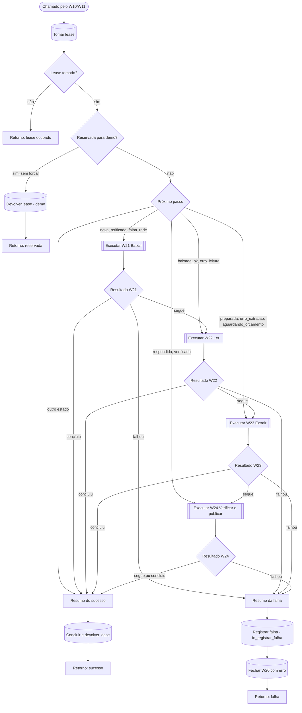

# W20 Processar uma licitação

> [!abstract] Em uma frase
> O W20 pega **uma** licitação, reserva-a com um lease, descobre pelo estado dela em que ponto o trabalho parou e encadeia os passos que faltam — [[W21 Baixar]] → [[W22 Ler]] → [[W23 Extrair]] → [[W24 Verificar e publicar]] —, parando no primeiro que falhar ou que encerrar o caso, e registra o resultado (sucesso, falha com backoff ou recusa).

## Papel na solução

É o **orquestrador por licitação**. Ele não baixa, não lê, não extrai e não verifica: decide **qual** sub-fluxo roda e **o que fazer com o resultado**. Isso torna o processamento **retomável**: se a leitura falhar hoje, amanhã o W20 começa direto da leitura, sem baixar de novo, porque o estado ficou gravado ([[Ciclo de vida de uma licitação]]).

Também é o único dos fluxos de processamento que tem **workflow de erro** configurado ([[W90 Erro]]). Os sub-fluxos W21–W24 não têm, de propósito: se tivessem, uma falha dispararia o W90 em cascata, com o id da sub-execução, e o W90 não conseguiria achar o lease `W20:<id>` para devolver.

## Como cada passo responde

Todo sub-fluxo devolve o mesmo envelope: `{ok, continuar, estado, motivo}`.

| `ok` | `continuar` | Significado | O que o W20 faz |
|---|---|---|---|
| verdadeiro | verdadeiro | o passo terminou e o próximo pode rodar | chama o próximo sub-fluxo |
| verdadeiro | falso | **desfecho** — sem PDF legível, sem vaga de extração, sem orçamento, publicada | encerra com sucesso (e, se foi só adiado, não zera tentativas) |
| falso | — | falha | registra a falha com backoff e encerra com erro |

## Fluxograma

## Passo a passo — os 24 nós

### Nota do canvas

#### Passo 1 — Sobre o W20
- **Tipo:** nota do canvas.
- **O que diz:** orquestra W21 → W22 → W23 → W24; é chamado pela fila e pelo site; o workflow de erro fica só aqui (a raiz); explica o lease `W20:<execução>`, a regra da reservada para demonstração, o ponto de entrada por estado, o envelope `{ok, continuar, estado, motivo}`, o ramo de erro por `fn_registrar_falha` e que as linhas `ok`/`erro` do W20 alimentam o disjuntor do [[W10 Fila]].

### Etapa 1 — Reservar a licitação

#### Passo 2 — Chamado pelo W10/W11
- **Tipo:** *Execute Workflow Trigger* com as entradas `controle` (texto) e `forcar` (booleano).

#### Passo 3 — Tomar lease
- **Tipo:** *Postgres*, numa única instrução SQL.
- **O que faz:**
  1. trava a linha da licitação (`FOR UPDATE`);
  2. grava o lease `W20:<execução>` por 2 horas — **se** não houver lease, se ele venceu, se é de outro fluxo que não um W20 (por exemplo, o lease `W10:` que a fila acabou de dar), ou se já é deste W20;
  3. na mesma instrução, abre a linha do W20 em `execucoes_workflow` (`status = em_curso`).
- **Nunca** toma o lease de outro W20 vivo — dois W20 nunca processam a mesma licitação.
- **Saída:** se existe, quem segurava o lease, o estado atual, a leitura vigente, a modalidade, se é reservada para demonstração, as tentativas e o id da linha do W20.

#### Passo 4 — Lease tomado?
- **Tipo:** *IF* — há linha do W20 aberta? Sim → segue; não → devolve "lease ocupado".

#### Passo 5 — Reservada para demo?
- **Tipo:** *IF* — verdadeiro quando a licitação está reservada para demonstração **e** o pedido não veio com `forcar`.
- **Por que existe:** algumas licitações abertas ficam guardadas para uma demonstração ao vivo (reservadas no [[Página Admin|Admin]]); nenhum processo automático pode gastá-las.

#### Passo 6 — Retorno: lease ocupado
- **Tipo:** *Code* — devolve `{ok: false, continuar: false}` com o motivo ("lease ocupado por …" ou "licitação não existe"). **Nada** foi tocado: nem estado, nem tentativas.

#### Passo 7 — Devolver lease (demo)
- **Tipo:** *Postgres* — marca a linha do W20 como `recusado` (fora do disjuntor: não é falha da fonte) e devolve o lease **sem contar tentativa**.

#### Passo 8 — Retorno: reservada
- **Tipo:** *Code* — devolve `{ok: false}` com "reservada para demo (use forcar)".

### Etapa 2 — Escolher onde começar

#### Passo 9 — Próximo passo
- **Tipo:** *Switch* pelo estado atual:

  | Estado | Começa em |
  |---|---|
  | `nova`, `retificada`, `falha_rede`, `baixando` | [[W21 Baixar]] |
  | `baixada_ok`, `erro_leitura`, `lendo` | [[W22 Ler]] |
  | `preparada`, `erro_extracao`, `aguardando_orcamento` | [[W23 Extrair]] |
  | `respondida`, `verificada` | [[W24 Verificar e publicar]] |
  | qualquer outro (por exemplo, `publicada`) | nada a fazer → resumo do sucesso |

- **Por que por estado:** o trabalho é **retomável**. Um estado de erro sabe voltar ao passo que falhou; um passo já feito não é refeito ([[Ciclo de vida de uma licitação]]).

### Etapa 3 — Encadear os sub-fluxos

#### Passo 10 — Executar W21 Baixar
- **Tipo:** *Execute Workflow*, **esperando** o fim, com `controle`. Sempre devolve um item (`alwaysOutputData`), mesmo se o sub-fluxo falhar.

#### Passo 11 — Resultado W21
- **Tipo:** *Switch* — `segue` (ok e continuar) → W22; `falhou` (ok falso) → resumo da falha; `concluiu` (ok sem continuar: por exemplo, nenhum PDF legível) → resumo do sucesso.

#### Passo 12 — Executar W22 Ler
- **Tipo:** *Execute Workflow*, esperando, com `controle`.

#### Passo 13 — Resultado W22
- **Tipo:** *Switch* — mesmas três saídas; `segue` → W23.

#### Passo 14 — Executar W23 Extrair
- **Tipo:** *Execute Workflow*, esperando, com `controle` e o id da linha do W20 (`workflow_execucao_id`) — assim o custo das chamadas ao modelo fica ligado a esta rodada.

#### Passo 15 — Resultado W23
- **Tipo:** *Switch* — `segue` → W24; `concluiu` inclui os desfechos "sem vaga de extração" e "aguardando orçamento" (adiados).

#### Passo 16 — Executar W24 Verificar e publicar
- **Tipo:** *Execute Workflow*, esperando, com `controle`, o `execucao_id` devolvido pelo W23 (se rodou) e `modo = publicar`.

#### Passo 17 — Resultado W24
- **Tipo:** *Switch* — `segue` ou `concluiu` → resumo do sucesso; `falhou` → resumo da falha.

### Etapa 4 — Fechar com sucesso

#### Passo 18 — Resumo do sucesso
- **Tipo:** *Code*.
- **O que faz:** monta o registro da rodada: estado inicial, quais passos rodaram (W21 a W24) com `ok`, estado e motivo de cada um, se foi só **adiado**, o `execucao_id` da extração, o `verificacao_id` e o endereço do relatório HTML.

#### Passo 19 — Concluir e devolver lease
- **Tipo:** *Postgres*.
- **O que faz:**
  1. devolve o lease (só o deste W20);
  2. se o estado **avançou** e não foi só adiado, **zera tentativas e backoff** — a contagem de 4 falhas é de falhas **seguidas**;
  3. soma o **custo real** da rodada a partir de `chamadas_modelo` (a fonte da verdade do custo, não um número devolvido por alguém) e conta chamadas sem preço conhecido;
  4. fecha a linha do W20 com `status = ok`, duração, custo e contadores.

#### Passo 20 — Retorno: sucesso
- **Tipo:** *Code* — devolve a quem chamou: estado inicial e final, custo em R$, chamadas, chamadas sem preço, ids, passos, se o lease foi devolvido, tentativas.

### Etapa 5 — Fechar com falha

#### Passo 21 — Resumo da falha
- **Tipo:** *Code* — o mesmo registro do resumo de sucesso, com `ok = false` e o motivo do passo que falhou.

#### Passo 22 — Registrar falha (fn_registrar_falha)
- **Tipo:** *Postgres*, sempre devolve item.
- **O que faz:** chama `fn_registrar_falha` com o estado de erro do passo em curso:

  | Estava em | Vira |
  |---|---|
  | `baixando` | `falha_rede` |
  | `lendo` | `erro_leitura` |
  | `extraindo` | `erro_extracao` |
  | outro | permanece |

  A função soma uma tentativa, marca a próxima tentativa com backoff (15 min → 2 h → 12 h), transforma em `erro_definitivo` na 4ª falha seguida e devolve o lease.

#### Passo 23 — Fechar W20 com erro
- **Tipo:** *Postgres* — fecha a linha do W20 com `status = erro`, o motivo e os contadores. **Três linhas `erro` em 30 minutos sem nenhum `ok` abrem o disjuntor da fila.**

#### Passo 24 — Retorno: falha
- **Tipo:** *Code* — devolve `{ok: false}` com estado final, motivo, passos, resultado da falha, tentativas, próxima tentativa e se o lease foi devolvido.

## Garantias que este fluxo dá

| Garantia | Como |
|---|---|
| Uma licitação nunca é processada por dois W20 ao mesmo tempo | lease `W20:<execução>` tomado com `FOR UPDATE` |
| Nenhuma licitação fica presa se o W20 morrer | o [[W90 Erro]] devolve o lease desta execução; se nem ele rodar, o [[W10 Fila]] libera o lease vencido em até 2 h |
| Nenhum trabalho é refeito sem necessidade | entrada pelo estado; a leitura e a extração ficam gravadas |
| Falha de fonte não queima todas as licitações | backoff por licitação + disjuntor global |
| O custo é o que foi cobrado | soma de `chamadas_modelo` da rodada |

## Caso real — Itapecuru Mirim/MA (28/09/2026)

> [!example] Duas rodadas do W20 para a mesma licitação
> A linha do tempo abaixo é a que o [[Página Detalhe da licitação|detalhe da licitação]] mostra em produção para o pregão `05648696000180-1-000088/2026`.
>
> | Quando | Transição | Motivo registrado | Execução |
> |---|---|---|---|
> | 06:20 | `nova → baixando` | W21: baixar os documentos do PNCP | #16318 |
> | 06:20 | `baixando → baixada_ok` | W21: 1 arquivo(s), 60 página(s) | #16318 |
> | 06:20 | `baixada_ok → lendo` | W22: congelar o texto | #16322 |
> | 06:20 | `lendo → preparada` | W22: texto congelado na leitura 3480 | #16322 |
> | 10:22 | `preparada → extraindo` | W23: vaga tomada | — |
> | 10:23 | `extraindo → respondida` | W23: todos os lotes respondidos por claude | #16585 |
> | 10:23 | `respondida → verificada` | W24: verificação 3776 | #16587 |
> | 10:24 | `verificada → publicada` | W24: publicada a verificação 3776 | #16587 |
>
> 1. **Primeira rodada (06:20, 36,7 s):** a fila entregou a licitação `nova`; o W20 começou pelo [[W21 Baixar]] e seguiu para o [[W22 Ler]]. Como o provedor da esteira é o `simulado`, o W22 devolveu `continuar = false` e a licitação ficou `preparada`, a custo zero.
> 2. **Segunda rodada (10:22, 2 min 14 s, R$ 0,78):** um administrador clicou em **Extrair com IA** (Claude, modelo Haiku 4.5). O [[W11 Ações do site]] pediu o processamento com prioridade; o W20 entrou direto pelo [[W23 Extrair]] (estado `preparada`) e depois pelo [[W24 Verificar e publicar]].
> 3. O passo "Concluir e devolver lease" somou o custo real das chamadas ao modelo (R$ 0,78) e fechou a linha do W20 como `ok`.
>
> Fonte: página do detalhe e [[Página Execuções|Execuções]] do site em produção, 28/09/2026.

## Relacionadas

[[MOC Fluxos n8n]] · [[W10 Fila]] · [[W11 Ações do site]] · [[W21 Baixar]] · [[W22 Ler]] · [[W23 Extrair]] · [[W24 Verificar e publicar]] · [[W90 Erro]] · [[Ciclo de vida de uma licitação]] · [[Modelo de dados]] · [[Custo por edital]]
