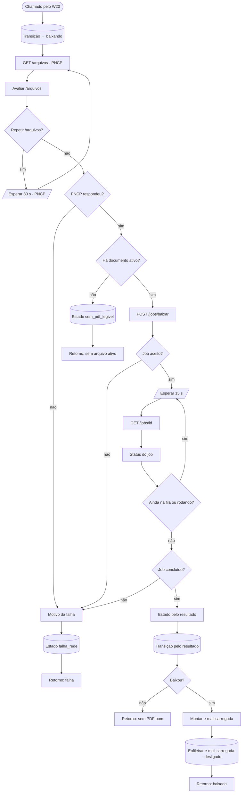

# W21 Baixar

> [!abstract] Em uma frase
> O W21 pede ao PNCP a **lista oficial de documentos** da licitação, entrega essa lista ao **worker**, que baixa cada arquivo, confere o que ele realmente é (PDF, ZIP, Word, imagem…), converte para PDF o que não é PDF e guarda tudo no armazenamento — e então define o estado da licitação pelo resultado: `baixada_ok`, `sem_pdf_legivel`, `formato_nao_suportado` ou `falha_rede`.

## Papel na solução

É o primeiro passo do processamento de uma licitação ([[W20 Processar uma licitação]]). O arquivo **nunca passa pelo n8n**: o n8n só orquestra; quem baixa, mede e guarda é o worker, num **job assíncrono** ([[Worker — visão geral e jobs]]). Isso mantém o n8n leve e deixa o arquivo pesado (há processos de 700+ páginas) onde ele é tratado.

## Regras de negócio aplicadas aqui

| Regra | Onde | Por quê |
|---|---|---|
| A lista de documentos é a do endpoint `/arquivos` do PNCP, **nunca** 1..N por tentativa | nó "Avaliar /arquivos" | numerar por conta própria pula ou inventa documentos |
| Só documentos com `statusAtivo`, em ordem de `sequencialDocumento` | idem | documento inativo foi substituído; o de maior sequencial é o mais recente ([[ADR-006 Documento vigente é o de maior sequencial]]) |
| 429/5xx/rede: espera 30 s e repete **uma** vez; esgotado → `falha_rede` | "Repetir /arquivos?" | o backoff longo é do [[W10 Fila]]/[[W20 Processar uma licitação]] |
| Licitação **de folha** pega **todos** os arquivos, sem teto de tamanho ou de páginas | worker | um processo de 773 páginas recusado pelo teto de 600 deixou uma extração com 5 de 17 respostas ([[ADR-018 Licitação de folha pega todos os arquivos]]) |
| Arquivo que não é PDF **vira PDF** (RTF, DOC, DOCX, XLS, HTML, imagem, RAR, ZIP) | worker | parte do PNCP publica Word e ZIP com nome `.pdf` ([[ADR-017 O arquivo que não é PDF vira PDF]], [[Conversão de formatos]]) |
| Arquivos idênticos (mesmo SHA-256) viram **alias** | worker | um só objeto no armazenamento e uma só leitura |
| O estado muda **só** por `fn_transicao`, que grava o evento | todos os nós de estado | a história da licitação é auditável ([[Ciclo de vida de uma licitação]]) |

## Fluxograma

## Passo a passo — os 28 nós

### Nota do canvas

#### Passo 1 — Sobre o W21
- **Tipo:** nota do canvas.
- **O que diz:** o W21 leva os documentos do PNCP para o armazenamento; é sub-fluxo do W20 e **não** tem workflow de erro próprio (a falha sobe para o W20); o estado só muda por `fn_transicao`; `/arquivos` é a lista, só ativos, por sequencial; 429/5xx/rede esperam 30 s e repetem uma vez; o PDF nunca passa pelo n8n; o job longo é acompanhado a cada 15 s por até 60 voltas; o estado vem do resultado; o e-mail "carregada" só entraria na fila.

### Etapa 1 — Começar e pedir a lista ao PNCP

#### Passo 2 — Chamado pelo W20
- **Tipo:** *Execute Workflow Trigger* com a entrada `controle`.

#### Passo 3 — Transição → baixando
- **Tipo:** *Postgres*.
- **O que faz:** `fn_transicao(controle, 'baixando', …)` — muda o estado e grava o evento com o id da execução. Devolve os dados da licitação (slug, órgão, UF, município, modalidade, objeto, prazo, link) e decompõe o controle em CNPJ, ano e sequencial para montar a URL do PNCP.
- **Por que primeiro:** se o processo morrer daqui em diante, o [[W10 Fila]] sabe que a licitação estava `baixando` e a transforma em `falha_rede`.

#### Passo 4 — GET /arquivos (PNCP)
- **Tipo:** *HTTP Request* — `GET https://pncp.gov.br/api/pncp/v1/orgaos/{cnpj}/compras/{ano}/{sequencial}/arquivos`, 60 s, nunca erro, saída de erro ligada; `User-Agent` com contato.

#### Passo 5 — Avaliar /arquivos
- **Tipo:** *Code*.
- **O que faz:** interpreta a resposta: rede ou HTTP ruim vira `falha` (transitória se 429 ou 5xx); corpo inválido também. Da lista, mantém só os documentos com `statusAtivo`, ordena por `sequencialDocumento` e guarda URL, sequencial, tipo e título.
- **Saída:** `total`, `ativos`, `docs`, `repetir` (verdadeiro na primeira falha transitória).

#### Passo 6 — Repetir /arquivos?
- **Tipo:** *IF* — `repetir` verdadeiro → espera 30 s; senão, segue.

#### Passo 7 — Esperar 30 s (PNCP)
- **Tipo:** *Wait* de 30 s, e volta ao passo 4. O 429 do PNCP não informa quanto esperar; 30 s é o intervalo medido que funciona.

#### Passo 8 — PNCP respondeu?
- **Tipo:** *IF* — sem falha → segue; com falha (depois da nova tentativa) → motivo da falha.

#### Passo 9 — Há documento ativo?
- **Tipo:** *IF* — `ativos > 0`? Sim → manda baixar; não → `sem_pdf_legivel`.

### Etapa 2 — Quando não há o que baixar

#### Passo 10 — Estado sem_pdf_legivel
- **Tipo:** *Postgres* — `fn_transicao(…, 'sem_pdf_legivel', 'nenhum arquivo ativo no PNCP (N no total)')`.
- **Natureza:** é **desfecho**, não erro de rede — não se tenta de novo sozinho.

#### Passo 11 — Retorno: sem arquivo ativo
- **Tipo:** *Code* — devolve `{ok: true, continuar: false, estado: 'sem_pdf_legivel'}` ao W20.

### Etapa 3 — O download pelo worker

#### Passo 12 — POST /jobs/baixar
- **Tipo:** *HTTP Request* (POST `/jobs/baixar` no worker, credencial `worker`), 30 s.
- **Corpo:** `{controle, docs}` — a lista de documentos ativos.
- **O que o worker faz no job** (`api/baixar.py`):
  1. baixa cada documento com o nome padronizado `NN - <tipo> - <título>.pdf` (o nome é o marcador que a citação usa);
  2. descobre o **formato real** pelos bytes, não pela extensão;
  3. se é ZIP disfarçado, abre e guarda os PDFs de dentro (o container fica registrado como `zip_container`);
  4. se não é PDF legível, **converte para PDF**; o original fica `convertido` e cada PDF gerado entra como filho dele;
  5. aplica os tetos (120 MB por arquivo, 400 MB por licitação, 600 páginas) **só se a licitação não for de folha**;
  6. mede páginas, caracteres e se precisa de OCR;
  7. guarda o PDF no armazenamento com chave pelo SHA-256 ([[Armazenamento de arquivos (S3)]]) e grava a linha em `arquivos`;
  8. calcula o `estado_sugerido` — mas **não** muda o estado: quem decide é o n8n.
- **Resposta esperada:** HTTP 202 com `job_id`.

#### Passo 13 — Job aceito?
- **Tipo:** *IF* — 202 com `job_id` → acompanhar; senão → motivo da falha.

#### Passo 14 — Esperar 15 s
- **Tipo:** *Wait* de 15 s — o intervalo entre consultas ao job.

#### Passo 15 — GET /jobs/{id}
- **Tipo:** *HTTP Request* (GET `/jobs/{job_id}` no worker), nunca erro.

#### Passo 16 — Status do job
- **Tipo:** *Code*.
- **O que faz:** lê o status (`queued`, `running`, `done`, `error`). Worker sem resposta numa volta (reinício) **não** mata o laço: conta a volta e pergunta de novo. Limite de **60 voltas** (15 minutos). Monta o motivo se o job falhou ou estourou o tempo.

#### Passo 17 — Ainda na fila ou rodando?
- **Tipo:** *IF* — continua esperando enquanto `queued`, `running` ou sem resposta, e ainda há voltas.

#### Passo 18 — Job concluído?
- **Tipo:** *IF* — `done` → estado pelo resultado; outro → motivo da falha.

### Etapa 4 — Estado pelo resultado

#### Passo 19 — Estado pelo resultado
- **Tipo:** *Code*.
- **A regra (uma só, aplicada pelo worker e aqui apenas lida):**

  | Resultado | Estado | Tratamento |
  |---|---|---|
  | pelo menos um PDF bom | `baixada_ok` | segue para a leitura |
  | só arquivos recusados por formato | `formato_nao_suportado` | desfecho, não se retenta |
  | alguma falha de rede e nenhum PDF bom | `falha_rede` | erro: backoff e nova tentativa |
  | nada disso | `sem_pdf_legivel` | desfecho |

- **Saída:** estado, motivo ("N arquivo(s), M página(s)"), contagem de arquivos e páginas, quantos precisam de OCR, a lista dos arquivos bons, os recusados e as falhas de download.

#### Passo 20 — Transição pelo resultado
- **Tipo:** *Postgres* — `fn_transicao` para o estado calculado, com o job, os números, os recusados (com motivo) e as falhas gravados no evento.

#### Passo 21 — Baixou?
- **Tipo:** *IF* — `baixada_ok`? Sim → e-mail e retorno de sucesso; não → retorno sem PDF bom.

#### Passo 22 — Retorno: sem PDF bom
- **Tipo:** *Code* — devolve `{continuar: false}` com `ok = true` para os desfechos (`formato_nao_suportado`, `sem_pdf_legivel`) e `ok = false` para `falha_rede` (o W20 registra a falha e o backoff).

#### Passo 23 — Montar e-mail carregada
- **Tipo:** *Code* — monta o e-mail "[FOPA] Carregada: <município>/<UF> · sessão <data>" com os arquivos, páginas, OCR previsto, recusados e links.

#### Passo 24 — Enfileirar e-mail carregada
- **Tipo:** *Postgres* — **desligado**: devolve `email_id = NULL`. O aviso "carregada" saiu do produto quando ficou decidido que só dois e-mails existem ([[ADR-016 O produto manda só dois e-mails]]). O nó anterior continua montando o texto para que o registro da execução mostre o que seria enviado.

#### Passo 25 — Retorno: baixada
- **Tipo:** *Code* — devolve `{ok: true, continuar: true, estado: 'baixada_ok'}` com arquivos, páginas, quantos com OCR, recusados e o job.

### Etapa 5 — Falhas

#### Passo 26 — Motivo da falha
- **Tipo:** *Code* — transforma qualquer falha (rede, HTTP ruim, job recusado, job com erro, laço esgotado) num **motivo escrito**: "W21: …". Nunca silêncio.

#### Passo 27 — Estado falha_rede
- **Tipo:** *Postgres* — `fn_transicao(…, 'falha_rede', motivo)`.

#### Passo 28 — Retorno: falha
- **Tipo:** *Code* — devolve `{ok: false, continuar: false, estado: 'falha_rede', motivo}`; o W20 conta a tentativa e agenda o backoff.

## O que fica gravado

| Tabela | Conteúdo |
|---|---|
| `arquivos` | uma linha por documento: nome, sequencial, tipo, título, SHA-256, bytes, formato real, status (`ok`, `alias_duplicado`, `zip_container`, `convertido`, `formato_nao_suportado`, `falha_rede`…), motivo, páginas, caracteres, se requer OCR, chave no armazenamento, se estava ativo no PNCP |
| `licitacao_eventos` | as transições `baixando` → estado final, com os números |
| armazenamento (S3) | os PDFs, com chave pelo SHA-256 |

## Exemplo ilustrativo — um edital com um Word disfarçado

> [!example] Mecânica real do worker; arquivos de exemplo.

1. O `/arquivos` devolve 3 documentos ativos: "Edital", "Termo de Referência" e "Minuta do Contrato".
2. O worker baixa os três. O Termo de Referência tem extensão `.pdf`, mas os bytes dizem DOCX. Antes de recusar, o conversor gera um PDF dele; o original fica `convertido` e o PDF gerado entra como filho.
3. O Edital é um PDF escaneado: `requer_ocr = true`.
4. Resultado: 3 PDFs bons → `baixada_ok`. O W20 segue para o [[W22 Ler]], que fará OCR no Edital.

## Caso real — Itapecuru Mirim/MA (28/09/2026)

> [!example] Pregão Eletrônico `05648696000180-1-000088/2026`
> Na rodada das 06:20 (execução #16318 do n8n), o W21 levou a licitação de `nova` a `baixando` e, pelo resultado do job, a `baixada_ok` com o motivo "W21: 1 arquivo(s), 60 página(s)". O documento tinha camada de texto: nenhuma página precisou de OCR na leitura seguinte.

## Relacionadas

[[MOC Fluxos n8n]] · [[W20 Processar uma licitação]] · [[W22 Ler]] · [[W70 Retificações]] · [[Worker — visão geral e jobs]] · [[Conversão de formatos]] · [[Armazenamento de arquivos (S3)]] · [[Fontes de dados — PNCP]] · [[Ciclo de vida de uma licitação]] · [[ADR-017 O arquivo que não é PDF vira PDF]] · [[ADR-018 Licitação de folha pega todos os arquivos]]
