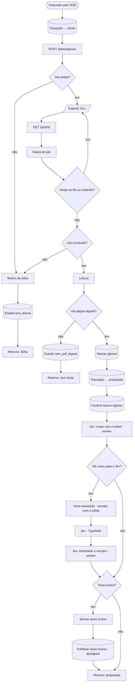

# W22 Ler

> [!abstract] Em uma frase
> O W22 transforma os PDFs baixados em **texto congelado, página por página** — com OCR local onde o PDF é imagem —, grava essa leitura no banco como a **leitura vigente**, detecta texto escondido com cara de instrução para IA, pede ao Jev uma segunda opinião sobre se é mesmo licitação de folha **lendo o edital**, e deixa a licitação `preparada` para a extração.

## Papel na solução

A leitura é o **chão de todo o resto**. O modelo extrai **sobre** este texto e o verificador confere as citações **contra** este mesmo texto. Por isso ela é:

- **congelada** — gravada em `leituras` e `paginas`, uma linha por página, e nunca reescrita;
- **identificada** — mesma assinatura de texto, mesmos nomes de arquivo e mesmo OCR = a mesma leitura (reusada, não duplicada); OCR diferente = leitura diferente, lado a lado;
- **paginada pela página física** do PDF, com o nome do arquivo — é o que torna a citação "arquivo + página" verificável ([[ADR-005 Info é arquivo mais página física]]).

O OCR é **local** (Tesseract 5.4.0 dentro do worker), **nunca** feito por um modelo de linguagem ([[ADR-008 OCR — stack, configuração e limites]], [[OCR]]).

## Fluxograma

## Passo a passo — os 29 nós

### Nota do canvas

#### Passo 1 — Sobre o W22
- **Tipo:** nota do canvas.
- **O que diz:** o W22 congela o texto (`leituras` + `paginas`); é sub-fluxo do W20 sem workflow de erro próprio; o estado só muda por `fn_transicao`; OCR local Tesseract 5.4.0, nunca por LLM; laço de job de até 160 voltas de 15 s (40 min); zero páginas → `sem_pdf_legivel`; gêmea informativa; texto furtivo com cara de instrução vira aviso; sem provedor real a licitação real para em `preparada`; e o Jev é consultado **com o edital** logo depois da leitura, sem que uma falha dele pare a leitura.

### Etapa 1 — Começar a leitura

#### Passo 2 — Chamado pelo W20
- **Tipo:** *Execute Workflow Trigger* com `controle`.

#### Passo 3 — Transição → lendo
- **Tipo:** *Postgres* — `fn_transicao(controle, 'lendo', 'W22: congelar o texto')`; devolve slug, órgão, UF e município (usados no aviso).

#### Passo 4 — POST /jobs/paginas
- **Tipo:** *HTTP Request* (POST `/jobs/paginas` no worker, credencial `worker`), 30 s, nunca erro.
- **O que o worker faz no job** (`api/leitura.py`):
  1. monta uma pasta temporária com os PDFs do armazenamento **sob os nomes originais** (o nome é o marcador de citação);
  2. aplica as marcações de OCR forçado e rotação que um operador tenha feito no arquivo (camada de texto cortada, carimbo por cima de imagem, página de cabeça para baixo);
  3. chama a leitura do pacote de extração (`extrator.carregar_paginas`, a mesma que produziu o acervo): extrai o texto nativo de cada página e, **quando a página tem menos de 120 caracteres**, faz OCR com o Tesseract (perfis de texto e de tabela; limpa a tarja de assinatura digital que atravessa as páginas);
  4. **varre texto furtivo** — texto branco, minúsculo ou fora da página — e classifica o que tem cara de instrução para IA ([[Injeção de prompt e defesas]]);
  5. calcula a assinatura do texto, do conjunto e dos nomes, e o **modo sugerido** de extração: contexto completo até 180.000 caracteres, RAG por BM25 acima disso ([[RAG com BM25]]);
  6. grava `leituras` + `paginas` **numa transação só**, marca a leitura como vigente e devolve o resumo.

#### Passo 5 — Job aceito?
- **Tipo:** *IF* — 202 com `job_id` → acompanhar; senão → motivo da falha.

### Etapa 2 — Acompanhar o job

#### Passo 6 — Esperar 15 s
- **Tipo:** *Wait* de 15 s.

#### Passo 7 — GET /jobs/{id}
- **Tipo:** *HTTP Request* (GET `/jobs/{job_id}` no worker), nunca erro.

#### Passo 8 — Status do job
- **Tipo:** *Code* — o mesmo laço do [[W21 Baixar]], com limite de **160 voltas (40 minutos)**. O limite foi ampliado de 45 voltas depois de leituras reais que levaram 776 s e 881 s (processos grandes com muitas páginas em OCR): com o limite antigo, o fluxo desistia com o texto quase pronto.

#### Passo 9 — Ainda na fila ou rodando?
- **Tipo:** *IF* — continua esperando enquanto `queued`, `running` ou sem resposta.

#### Passo 10 — Job concluído?
- **Tipo:** *IF* — `done` → ler o resultado; senão → motivo da falha.

### Etapa 3 — Resultado da leitura

#### Passo 11 — Leitura
- **Tipo:** *Code* — lê o resultado do job: `leitura_id`, número de páginas, total de caracteres, modo sugerido, versão do OCR, assinatura do conjunto, se a leitura foi **reusada**, tempo, páginas e arquivos com OCR, trechos furtivos e os classificados como suspeitos, arquivos que não são PDF.

#### Passo 12 — Há página legível?
- **Tipo:** *IF* — mais de zero páginas e uma leitura gravada? Sim → segue; não → `sem_pdf_legivel`.
- **Por que:** uma leitura vazia não pode tirar a vigência de uma leitura boa — o worker nem grava a vazia.

#### Passo 13 — Estado sem_pdf_legivel
- **Tipo:** *Postgres* — `fn_transicao(…, 'sem_pdf_legivel', 'nenhuma página legível (N arquivo(s) que não são PDF)')`.

#### Passo 14 — Retorno: sem texto
- **Tipo:** *Code* — devolve `{ok: true, continuar: false, estado: 'sem_pdf_legivel'}` (desfecho).

#### Passo 15 — Marcar gêmea
- **Tipo:** *Postgres*, sempre devolve item.
- **O que faz:** se outra licitação já tem uma leitura com a **mesma assinatura de conjunto** (o mesmo edital publicado duas vezes com controles diferentes), grava `gemea_de` apontando para ela.
- **Natureza:** informativo — a extração acontece mesmo assim.

#### Passo 16 — Transição → preparada
- **Tipo:** *Postgres* — `fn_transicao(…, 'preparada', 'W22: texto congelado na leitura N')`, com o job, páginas, caracteres, modo sugerido, versão do OCR, se foi reusada e a gêmea no evento.

#### Passo 17 — Conferir leitura vigente
- **Tipo:** *Postgres*.
- **O que faz:** grava `leitura_vigente_id` (o worker já gravou na mesma transação; aqui fica explícito e idempotente) e calcula **`extrair_agora`**: verdadeiro se o provedor da esteira é real, se há um pedido de extração com IA para esta licitação, ou se ela é de ensaio.
- **Por que:** com o provedor `simulado`, uma licitação real **para em `preparada`** (custo R$ 0) — a extração simulada seria recusada na publicação.

### Etapa 4 — Segunda opinião do Jev, com o edital

#### Passo 18 — Jev: corpo com o edital (worker)
- **Tipo:** *HTTP Request* (POST `/jev/escopo/edital/corpos` no worker). Em erro, segue.
- **O que o worker monta:** a pergunta "isto é licitação de folha?" com o **objeto** e as **páginas do edital com mais termos da pergunta**.
- **Por que com o edital:** julgando só o objeto, o Jev errava credenciamentos legítimos (o objeto fala em "credenciamento de instituições financeiras" e esconde que é a folha). A **trava da IA** do [[W23 Extrair]] espera esta nota.

#### Passo 19 — Há corpo para o Jev?
- **Tipo:** *IF* — o worker devolveu requisição? Sim → chama o Jev; não → segue para a checagem de texto furtivo.

#### Passo 20 — Uma requisição (escopo com o edital)
- **Tipo:** *Code* — prepara uma única requisição com URL, corpo, controle, o veredito da regra e o contexto enviado.

#### Passo 21 — Jev (TypeSafe)
- **Tipo:** *HTTP Request* (POST na API do Jev), credencial `jev`, 30 s. Em erro, segue.

#### Passo 22 — Jev: interpretar o escopo (worker)
- **Tipo:** *HTTP Request* (POST `/jev/escopo/interpretar` no worker) — converte a resposta em probabilidade de ser folha e grava em `sinais_jev` (com o contexto "edital").

### Etapa 5 — Texto furtivo e retorno

#### Passo 23 — Texto furtivo?
- **Tipo:** *IF* — há trechos escondidos classificados como suspeitos (ou, sem classificação, qualquer trecho furtivo)?
- **Critério de "suspeito":** só o texto escondido que **fala com uma IA** ("ignore as instruções…", "responda…"); timbre branco de papel timbrado e camada de texto invisível do OCR **não** disparam ([[Injeção de prompt e defesas]]).

#### Passo 24 — Montar aviso furtivo
- **Tipo:** *Code* — monta o aviso "[FOPA] Texto furtivo antes do modelo: <município>/<UF>" com até 20 trechos e os links.

#### Passo 25 — Enfileirar aviso furtivo
- **Tipo:** *Postgres* — **desligado** (devolve `email_id = NULL`), pela decisão de manter só dois e-mails no produto ([[ADR-016 O produto manda só dois e-mails]]). O aviso continua visível: a verificação sai com a marcação de injeção e a revisão humana, e o [[Página Detalhe da licitação|detalhe da licitação]] mostra os trechos.

#### Passo 26 — Retorno: preparada
- **Tipo:** *Code*.
- **O que devolve ao W20:** `{ok: true, estado: 'preparada', continuar: extrair_agora}` com a leitura, páginas, caracteres, modo sugerido, páginas com OCR, quantidade de trechos furtivos, se reusou e a nota do Jev com o edital.
- **`continuar = false`** quando o provedor é simulado e não há pedido: a licitação espera `preparada`, e o motivo diz "a extração espera o provedor real".

### Etapa 6 — Falhas

#### Passo 27 — Motivo da falha
- **Tipo:** *Code* — transforma a falha em motivo escrito ("W22: …").

#### Passo 28 — Estado erro_leitura
- **Tipo:** *Postgres* — `fn_transicao(…, 'erro_leitura', motivo)`.

#### Passo 29 — Retorno: falha
- **Tipo:** *Code* — devolve `{ok: false, estado: 'erro_leitura', motivo}`; o W20 registra a falha e o backoff.

## O que fica gravado

| Tabela | Conteúdo |
|---|---|
| `leituras` | uma linha por leitura: tempo, versão do OCR, SHA-256 do `por.traineddata`, condições (páginas com OCR, furtivos, não-PDF, OCR forçado), assinaturas, **modo sugerido**, caracteres, vigente |
| `paginas` | uma linha por página: arquivo, página física, ordem, texto, se veio de OCR |
| `furtivos_achados` / `furtivos_varreduras` | os trechos escondidos, por página e tipo, e a classificação |
| `sinais_jev` | a nota do Jev com o edital |
| `licitacoes` | `leitura_vigente_id`, `gemea_de`, estado |

## Exemplo ilustrativo — um edital parcialmente escaneado

> [!example] Mecânica real; números de exemplo.

1. A licitação tem 3 PDFs, 64 páginas. O edital (12 páginas) é imagem; o termo de referência e a minuta têm texto.
2. O worker extrai o texto nativo das 52 páginas com texto; nas 12 do edital, cada página tem menos de 120 caracteres → OCR com o Tesseract.
3. Total: 138.000 caracteres → **modo sugerido: contexto completo** (abaixo de 180.000).
4. A varredura acha texto branco no rodapé — é o timbre da prefeitura, sem instrução para IA: não é suspeito.
5. O Jev, lendo o objeto e as páginas do edital, dá 96% de ser folha.
6. Com provedor simulado e sem pedido, a licitação para em `preparada`. Quando alguém clicar em "Extrair com IA", o W20 começará direto do [[W23 Extrair]], sem ler de novo.

## Caso real — Itapecuru Mirim/MA (28/09/2026)

> [!example] Pregão Eletrônico `05648696000180-1-000088/2026`
> Na mesma rodada das 06:20 (execução #16322), o W22 congelou o texto na **leitura 3480** — 60 páginas, **0 por OCR**, modo sugerido **contexto completo** (abaixo de 180.000 caracteres). Com o provedor da esteira em `simulado`, a licitação parou em `preparada`, sem custo; a extração só aconteceu às 10:22, quando alguém pediu pelo botão "Extrair com IA" ([[W20 Processar uma licitação#Caso real — Itapecuru Mirim/MA (28/09/2026)]]).

## Relacionadas

[[MOC Fluxos n8n]] · [[W20 Processar uma licitação]] · [[W21 Baixar]] · [[W23 Extrair]] · [[OCR]] · [[RAG com BM25]] · [[Injeção de prompt e defesas]] · [[Jev — score de escopo e sustentação]] · [[Worker — visão geral e jobs]] · [[Modelo de dados]] · [[Consciência operacional]] · [[ADR-008 OCR — stack, configuração e limites]]
