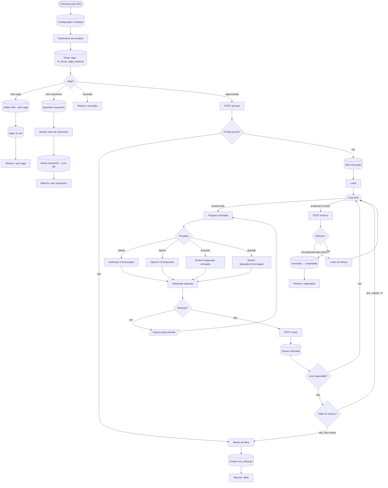

# W23 Extrair

> [!abstract] Em uma frase
> O W23 é o **único fluxo que fala com um modelo de IA**: reserva uma vaga de extração dentro do limite de simultaneidade e do teto de gasto, pede ao worker o prompt pronto, chama o modelo em **3 lotes de 6 perguntas, em série**, grava cada chamada com o custo na hora e, se alguma resposta falhou no verificador, faz até **2 rodadas de reforço (Best-of-N)** só para as perguntas que falharam.

## Papel na solução

É a etapa de **IA generativa**. Todo o resto — baixar, ler, verificar, publicar — é determinístico. Isso é deliberado: o modelo gera, e a verificação sem IA confere ([[ADR-004 Evidência obrigatória]]).

O W23 **não** monta o prompt: quem monta é o worker (`POST /prompt`), com o mesmo código que produziu as medições do projeto. O n8n só faz a chamada HTTP ao provedor. Assim, a chave de API do modelo fica **só** na credencial do n8n; o worker nunca a recebe ([[Controle de acesso e segredos]]).

## Os quatro provedores

| Provedor | Chama | Custa | Pode publicar em licitação real? |
|---|---|---|---|
| `claude` | Anthropic `POST /v1/messages` | sim | sim |
| `openai` | OpenAI `POST /v1/responses` | sim | sim |
| `simulado` | worker `/responder-simulado` (expressões regulares sobre o texto, mesmo formato de resposta) | não | **não** — só em licitação de ensaio |
| `gravado` | worker `/gravado/v1/messages` (repete respostas reais gravadas; plano B de demonstração sem rede) | não | **não** |

O provedor vem de `configuracao.provedor` (definido no [[Página Admin|Admin]]) **ou** de um pedido pendente do botão "Extrair com IA", que vale só para aquela licitação e aquela execução ([[Modelos e provedores]]). A trava que impede um resultado simulado de virar o oficial de uma licitação real está no banco (T15, [[Controles de consistência]]).

## Como é o prompt (montado pelo worker)

- **Sistema:** a instrução do extrator ([[Prompt do extrator]]), com `cache_control` (1º ponto de cache).
- **Mensagem do usuário, em duas partes** (desde a v3.1, [[Cache de prompt e ordem do prompt]]):
  1. a identificação da licitação + **os documentos**, com cada página marcada `=== ARQUIVO x | PÁGINA n ===` — com `cache_control` no Claude (2º ponto de cache): o 1º lote grava o edital no cache e os outros dois o leem;
  2. as **6 perguntas do lote** + a instrução final (responder cada pergunta com trecho literal, arquivo e página física).
- **Modo de contexto:** contexto completo até 180.000 caracteres; acima disso, **RAG por BM25** com as 12 páginas mais relevantes por pergunta ([[RAG com BM25]]). No RAG o bloco de documentos **não** leva cache (cada lote traz páginas diferentes; marcar cobraria a gravação sem leitura).
- **Raciocínio:** `thinking: adaptive` e esforço (`effort`) fixo por modelo — `medium` nos modelos atuais ([[Chain-of-thought e esforço de raciocínio]], [[ADR-020 Esforço fixo e Claude Opus 5.5 no extrator]]).
- **Saída estruturada:** esquema JSON fechado (`json_schema`; na OpenAI com `strict: true`): `id`, `resposta`, `arquivo`, `pagina`, `trecho_literal`, `conflito`, `confianca` ([[Controles de consistência]]).
- **Lotes:** 17 perguntas em lotes de 6 → **3 chamadas, em série** (paralelas estouravam o limite de taxa do provedor) ([[ADR-009 Modelo de extração]]).

## Fluxograma

## Passo a passo — os 40 nós

### Nota do canvas

#### Passo 1 — Sobre o W23
- **Tipo:** nota do canvas.
- **O que diz:** o W23 é o único fluxo que fala com um modelo; o provedor vem da configuração no Postgres; o único freio de simultaneidade e orçamento é `fn_tomar_vaga_extracao`; o corpo do lote é o mesmo da v2 (sistema com cache, raciocínio adaptativo, esquema JSON), montado pelo worker; 3 chamadas em série; o parse usa só blocos de texto, recusa e truncamento viram erro sem nova tentativa com mais tokens; retentativa só em 408/429/500/502/503/529 e rede, 3 vezes; custo gravado na hora pelo `/custo` (preço desconhecido = nulo, nunca zero); lote que falha deixa a execução `parcial` e a próxima tentativa manda só as perguntas pendentes; o pedido do botão vale só para a licitação; e o Best-of-N da v3.1 (N = 3, só as que falham).

### Etapa 1 — Configuração e vaga

#### Passo 2 — Chamado pelo W20
- **Tipo:** *Execute Workflow Trigger* com `controle` e `workflow_execucao_id` (a linha do W20, para ligar o custo à rodada).

#### Passo 3 — Configuração e licitação
- **Tipo:** *Postgres*.
- **O que lê:** estado, leitura vigente e modalidade da licitação; o **pedido de extração pendente** (provedor, modelo, esforço e teto de saída escolhidos no botão); **toda a tabela `configuracao`** (provedor, modelo, modelo OpenAI, esforço, lote, `k_rag`, `max_tokens`, `max_extracoes`, `melhor_de_n`); o teto do dia do orçamento vigente; os ids das 17 perguntas; e, se existir, a **execução parcial** da mesma leitura com o mesmo provedor e as perguntas que ela já cobriu.

#### Passo 4 — Parâmetros da extração
- **Tipo:** *Code*.
- **O que faz:** escolhe o provedor (o do pedido, senão o global) e valida (`simulado | gravado | claude | openai`); define a **origem** (`api` para Claude/OpenAI; `simulado` e `gravado` para os outros); o modelo (do pedido, senão o da configuração — o de OpenAI se o provedor é OpenAI); o esforço, o lote (6), o `k_rag`, o teto de saída (16.000 tokens; 32.000 em `xhigh`, 64.000 em `max`), o máximo de extrações simultâneas (4); e, se houver parcial, a lista `ids_pendentes` — só o que falta.

#### Passo 5 — Tomar vaga (fn_tomar_vaga_extracao)
- **Tipo:** *Postgres* — `fn_tomar_vaga_extracao(controle, max, teto)`.
- **O que a função faz, sob um lock exclusivo (`pg_advisory_xact_lock`)**, na ordem:
  1. recusa se a licitação não existe;
  2. recusa se está **fora do escopo efetivo** (regra ou rótulo humano);
  3. recusa se a **trava da IA** está ativa: a IA leu o edital e disse, com nota ≤ 25%, que não é folha — a licitação vai para o histórico;
  4. recusa se está fora do recorte de ano;
  5. recusa se o estado não permite ir para `extraindo`;
  6. `sem_vaga` se já há `max` extrações em curso (4);
  7. `sem_orcamento` se, havendo teto, **gasto do dia + (em curso + 1) × R$ 6,56** passaria do teto — R$ 6,56 é a reserva de pior caso por extração;
  8. senão, faz a transição para `extraindo` **dentro da mesma transação** e devolve `ok`.
- **Por que um único freio no banco:** vários W23 rodam ao mesmo tempo; só um lock no banco garante que o limite e o teto valem de verdade.

#### Passo 6 — Vaga?
- **Tipo:** *Switch* — `vaga tomada`, `sem vaga`, `sem orçamento` ou `recusada`.

### Etapa 2 — Quando não há extração agora

#### Passo 7 — Voltar à fila (sem vaga)
- **Tipo:** *Postgres* — mantém/volta a licitação em `preparada` com o motivo "sem vaga (limite de extrações simultâneas)".

#### Passo 8 — Adiar 10 min
- **Tipo:** *Postgres* — `proxima_tentativa_em = agora + 10 min`.

#### Passo 9 — Retorno: sem vaga
- **Tipo:** *Code* — devolve `{ok: true, continuar: false, adiado: true}`. Adiado não conta como falha nem zera tentativas.

#### Passo 10 — Aguardar orçamento
- **Tipo:** *Postgres* — transição para `aguardando_orcamento` (quando permitida), com o teto do dia no evento.

#### Passo 11 — Montar aviso de orçamento
- **Tipo:** *Code* — monta "[FOPA] Teto de gasto do dia atingido (R$ X)" com o link para o Admin, onde o teto se muda.

#### Passo 12 — Avisar orçamento (1 por dia)
- **Tipo:** *Postgres* — o e-mail está **desligado** (dois e-mails no produto, [[ADR-016 O produto manda só dois e-mails]]); o nó mantém a espera: `proxima_tentativa_em = agora + 1 h`.

#### Passo 13 — Retorno: sem orçamento
- **Tipo:** *Code* — devolve `{ok: true, continuar: false, adiado: true}` com a próxima tentativa.

#### Passo 14 — Retorno: recusada
- **Tipo:** *Code* — devolve `{ok: false, recusada: true}` com o motivo da guarda. **Nenhum provedor foi chamado e nada foi gravado.**

### Etapa 3 — Prompt e abertura da execução

#### Passo 15 — POST /prompt
- **Tipo:** *HTTP Request* (POST `/prompt` no worker), 60 s.
- **Corpo:** leitura, modalidade, lote, `k_rag`, provedor, modelo, esforço, teto de saída e `ids_pendentes`.
- **O que o worker devolve:** o **modo** (contexto completo ou RAG), a **versão do prompt**, e a lista de lotes — cada um com os ids, o corpo exato para o Claude (`body`), o corpo para a OpenAI (`body_openai`) e o SHA-256 do corpo.

#### Passo 16 — Prompt pronto?
- **Tipo:** *IF* — HTTP 200 com pelo menos um lote? Sim → abre a execução; não → falha.

#### Passo 17 — Abrir execução
- **Tipo:** *Postgres*.
- **O que faz:** se há uma execução **parcial** a retomar, reabre-a (`em_curso`); senão, cria uma nova em `execucoes_modelo` (licitação, leitura, origem, provedor, modelo, modo, esforço, lote, `k_rag`, versão do prompt, `canonica = (origem = 'api')`, linha do W20). **Na mesma instrução, marca o pedido do botão como usado** — se a extração falhar no meio, ninguém tenta de novo com aquele provedor sozinho.
- **Por que antes da primeira chamada:** toda chamada paga fica ligada a uma execução, mesmo que o processo morra.

#### Passo 18 — Lotes
- **Tipo:** *Code* — um item por lote: índice, ids, SHA-256 do corpo, tentativa 0, **rodada 0** (o lote normal). O corpo não é copiado para os nós seguintes (são até 180 mil caracteres); é lido na hora da chamada.

### Etapa 4 — O laço de chamadas ao modelo

#### Passo 19 — Loop lotes
- **Tipo:** *Split in Batches*, um lote por vez; o laço **recomeça** (reset) quando os itens vêm dos lotes do reforço.
- Quando acaba o conjunto, segue para `POST /reforco`.

#### Passo 20 — Preparar chamada
- **Tipo:** *Code* — incrementa a tentativa, marca o instante de início e mantém a rodada.

#### Passo 21 — Provedor
- **Tipo:** *Switch* pelo provedor — `claude`, `openai`, `simulado` ou `gravado`.

#### Passo 22 — Anthropic /v1/messages
- **Tipo:** *HTTP Request* (POST `https://api.anthropic.com/v1/messages`, cabeçalho `anthropic-version: 2023-06-01`), credencial `anthropic` do n8n, tempo limite de **10 minutos**, nunca erro. O corpo é o `body` do lote (do `/prompt` na rodada 0; do `/reforco` nas rodadas seguintes).

#### Passo 23 — OpenAI /v1/responses
- **Tipo:** *HTTP Request* (POST `https://api.openai.com/v1/responses`), credencial `openai`, 10 minutos. Corpo: `body_openai` (Responses API com `instructions`, `input`, `reasoning.effort` e `text.format` JSON estrito). O cache da OpenAI é automático por prefixo — por isso os documentos vêm primeiro.

#### Passo 24 — Worker /responder-simulado
- **Tipo:** *HTTP Request* (POST `/responder-simulado` no worker), 60 s — respostas por expressão regular no mesmo formato do Claude; custo zero.

#### Passo 25 — Worker /gravado/v1/messages
- **Tipo:** *HTTP Request* (POST `/gravado/v1/messages?controle=…` no worker) — repete as respostas reais já gravadas daquela licitação; custo zero.

#### Passo 26 — Interpretar resposta
- **Tipo:** *Code*.
- **O que faz:**
  - rede/tempo esgotado → erro retentável;
  - HTTP diferente de 200 → erro; retentável só em **408, 429, 500, 502, 503 e 529**; respeita `retry-after` (até 60 s), senão 30 s;
  - no Claude, junta **só** os blocos `type = text` (nunca o primeiro bloco às cegas: ele pode ser o raciocínio); na OpenAI, os `output_text`;
  - `stop_reason = refusal` → erro "recusa do modelo"; `max_tokens` → erro "truncado" (**sem** repetir com mais tokens, para não mudar a linha de base medida);
  - o JSON precisa ser válido e conter **todos os ids do lote**; faltando algum → "lote incompleto";
  - **uso de tokens:** entrada, saída, gravação e leitura de cache. Na OpenAI, a entrada relatada soma o que é novo, o que foi gravado e o que foi lido no cache; o nó separa as três (a gravação custa 1,25× — medido na v3.1).
- **Saída:** o envelope inteiro da resposta, o uso, o tempo, `ok`, `erro`, `retentar` (até 3 tentativas) e a espera.

#### Passo 27 — Retentar?
- **Tipo:** *IF* — retentável e ainda há tentativas → espera; senão, grava a chamada (com sucesso ou com o erro).

#### Passo 28 — Esperar para retentar
- **Tipo:** *Wait* — 30 s ou o `retry-after`; volta ao passo 20.

#### Passo 29 — POST /custo
- **Tipo:** *HTTP Request* (POST `/custo` no worker) com o modelo e o uso.
- **O que o worker faz:** calcula US$ e R$ pela tabela de preços do projeto (`modelos.PRECOS`, a única fonte de preço); modelo sem preço → **custo nulo e `preco_conhecido = false`**, nunca zero ([[Custo por edital]]).

#### Passo 30 — Gravar chamada
- **Tipo:** *Postgres* — insere em `chamadas_modelo`: execução, ids do lote, **o envelope inteiro da resposta**, `stop_reason`, HTTP, tentativas, tokens (entrada, saída, cache escrito, cache lido), segundos, SHA-256 do corpo, US$, R$, `preco_conhecido` e a **rodada** (0 = normal; 1 ou 2 = reforço).
- **Por que na hora:** o gasto do dia (`gasto_diario`) soma as chamadas — inclusive de execuções que falharam no meio. O teto do dia protege de verdade.

#### Passo 31 — Lote respondido?
- **Tipo:** *IF* — a resposta foi válida? Sim → próximo lote; não → confere se era reforço.

#### Passo 32 — Falha no reforço?
- **Tipo:** *IF* — se a chamada que falhou era de uma **rodada de reforço**, a falha é ignorada (fica o original) e o laço segue; se era um lote normal, a extração falha.

### Etapa 5 — Best-of-N: o reforço das respostas que falharam

#### Passo 33 — POST /reforco
- **Tipo:** *HTTP Request* (POST `/reforco` no worker), uma vez por passagem, 60 s.
- **O que o worker faz** ([[Best-of-N]]):
  1. funde as respostas já gravadas e passa cada uma pelo **verificador**;
  2. seleciona as que **falharam**: reprovadas na ancoragem, ou "não localizado" numa pergunta que **se aplica** à modalidade;
  3. se há falhas e ainda cabe rodada (`melhor_de_n = 3` → até 2 rodadas de reforço), devolve os lotes **só dessas perguntas**, com `rodada` > 0; senão, devolve `fim = true`.
- **Falha do `/reforco`** não derruba a extração: vale o que já foi respondido.

#### Passo 34 — Reforço?
- **Tipo:** *IF* — há lotes de reforço válidos (`fim = false`, rodada > 0, cada lote com ids)? Sim → lotes do reforço; não → fecha a extração.

#### Passo 35 — Lotes do reforço
- **Tipo:** *Code* — um item por lote do reforço, com a rodada; volta ao laço, que recomeça.

### Etapa 6 — Fechamento

#### Passo 36 — Transição → respondida
- **Tipo:** *Postgres*, uma vez — `fn_transicao(…, 'respondida', 'todos os lotes respondidos por <provedor>')` e soma o custo e o número de chamadas da execução. **A fusão das respostas, a escolha entre candidatos e o veredito são do [[W24 Verificar e publicar]].**

#### Passo 37 — Retorno: respondida
- **Tipo:** *Code* — devolve `{ok: true, continuar: true, estado: 'respondida'}` com a execução, provedor, origem, modelo, chamadas e custo.

### Etapa 7 — Falha

#### Passo 38 — Motivo da falha
- **Tipo:** *Code* — monta o motivo: "lote Q1,…,Q6 falhou após N tentativa(s): …" ou "/prompt respondeu HTTP …".

#### Passo 39 — Estado erro_extracao
- **Tipo:** *Postgres* — marca a execução como **`parcial`** (os lotes pagos continuam gravados) e faz a transição para `erro_extracao`. Na próxima tentativa, o passo 3 encontra a parcial e só as perguntas pendentes são pedidas — **nada que já foi pago é pago de novo**.

#### Passo 40 — Retorno: falha
- **Tipo:** *Code* — devolve `{ok: false, estado: 'erro_extracao', motivo, execucao_id}`; o W20 registra a falha e o backoff.

## O que fica gravado

| Tabela | Conteúdo |
|---|---|
| `execucoes_modelo` | a execução: provedor, modelo, modo, esforço, lote, `k_rag`, versão do prompt, status (`em_curso`, `parcial`, concluída), se é canônica |
| `chamadas_modelo` | cada chamada, com o envelope inteiro, tokens, custo e rodada |
| `pedidos_extracao` | o pedido do botão, marcado como usado |
| `licitacao_eventos` | `extraindo` → `respondida` (ou `erro_extracao`, `aguardando_orcamento`) |

## Números medidos (v3.1, 28/09/2026)

Medição com o script `35_antes_depois.py`, esforço `high`, n = 1 por linha. "Antes" = v3.0 (perguntas antes dos documentos, uma tentativa); "depois" = v3.1 (documentos antes das perguntas + Best-of-N). Gasto total da medição: R$ 23,79.

| Edital | Modelo | Custo antes → depois | Acurácia | Críticas |
|---|---|---|---|---|
| Pirapó/RS (contexto completo) | Claude Opus 5.5 | R$ 3,71 → R$ 2,50 (**−32,5%**) | 16/17 → 16/17 | 7/7 → 7/7 |
| Pirapó/RS (contexto completo) | GPT-5.6 Sol | R$ 3,31 → R$ 4,03 (+21,6%) | 17/17 → 16/17 | 7/7 → 6/7 |
| Bertioga/SP (RAG) | Claude Opus 5.5 | R$ 2,35 → R$ 2,52 (+7,2%) | 16/17 → 16/17 | 6/7 → 6/7 |
| Bertioga/SP (RAG) | GPT-5.6 Sol | R$ 2,75 → R$ 2,63 (−4,6%) | 14/17 → 15/17 | 4/7 → 5/7 |

- **Cache no Claude:** o edital é gravado uma vez e lido nas outras quatro chamadas (186.682 tokens lidos do cache, contra 3.084 antes) — as duas chamadas do reforço saem quase de graça.
- **Cache na OpenAI:** quase nunca é lido (1 leitura em 16 chamadas), em qualquer ordem; por isso o GPT fica mais caro quando o reforço dispara. A próxima hipótese (`prompt_cache_key`) ainda não foi medida.
- **Reforço:** 8 respostas "não localizado" reamostradas — 4 ausências reais confirmadas, 3 erros que se repetiram e **1 resposta crítica recuperada** (a data de abertura suspensa de Bertioga, no GPT). **Nenhuma piorou.**

Detalhes e ressalvas em [[Antes e depois da v3.1]].

## Caso real — Itapecuru Mirim/MA (28/09/2026)

> [!example] Claude Haiku 4.5 pelo botão "Extrair com IA"
> - **5 chamadas** ao modelo: os 3 lotes normais + **2 de reforço** do Best-of-N;
> - modo **contexto completo** (edital de 60 páginas);
> - 1.754 tokens de entrada nova e 8.528 de saída; 1 min 26 s de modelo; **R$ 0,78** no total;
> - versão do prompt `f224a746b51a`, versão das regras `b32b66ede7f6`.
>
> A pergunta **Q11** (obrigações do banco vencedor) falhou na primeira passada; o reforço gerou mais duas tentativas e o site mostra "escolhida a 2ª de 3 tentativas" — ainda **REPROVADA**, porque nenhuma tentativa ancorou; ficou a de trecho mais próximo da página citada. O Best-of-N não aprova nada que o verificador não aprovaria.

## Relacionadas

[[MOC Fluxos n8n]] · [[W20 Processar uma licitação]] · [[W22 Ler]] · [[W24 Verificar e publicar]] · [[Modelos e provedores]] · [[Prompt do extrator]] · [[Questionário — as 17 perguntas]] · [[RAG com BM25]] · [[Cache de prompt e ordem do prompt]] · [[Chain-of-thought e esforço de raciocínio]] · [[Best-of-N]] · [[Custo por edital]] · [[Controles de consistência]] · [[Endpoints do worker]] · [[ADR-009 Modelo de extração]] · [[ADR-024 Best-of-N e documentos antes das perguntas]]
