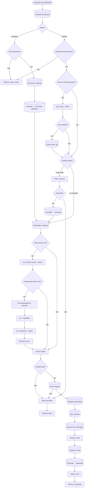

# W24 Verificar e publicar

> [!abstract] Em uma frase
> O W24 manda o worker **fundir e verificar** as respostas do modelo **sem usar IA** (cada trecho citado é procurado na página citada), escolhe a melhor tentativa quando houve reforço, gera o relatório HTML, torna essa verificação a **vigente**, abre revisões humanas onde é preciso, enfileira o e-mail de extração para quem pediu e marca a licitação como `publicada`.

## Papel na solução

É a **porta de saída** e a garantia do produto: **nada é publicado sem arquivo, página e trecho conferidos** ([[ADR-004 Evidência obrigatória]]). O modelo gera; o [[Verificador determinístico]] confere; o W24 publica o que foi conferido — com os vereditos à vista.

Ele trabalha em dois modos:

| Modo | Quem chama | O que faz |
|---|---|---|
| `publicar` | [[W20 Processar uma licitação]]; [[W11 Ações do site]] (importação) | verifica uma extração nova e publica |
| `republicar` | [[W30 Reverificar em lote]]; [[W11 Ações do site]] ("Reverificar") | uma verificação nova sobre as **mesmas** respostas (regras atuais) passa a ser a vigente, com o diff do que mudou |

## Os três vereditos

| Veredito | Significa | Na tela |
|---|---|---|
| **APROVADO** | o trecho literal existe na página citada (similaridade ≥ 0,90, com guarda para números) | verde |
| **REVISAR** | o trecho existe, mas noutra página; ou há conflito entre documentos; ou "não localizado" numa pergunta que deveria ter resposta | âmbar — vai para revisão se a pergunta é crítica |
| **REPROVADO** | o trecho não existe onde foi citado nem em outra página | vermelho — sempre vai para revisão humana |

Detalhes das regras em [[Verificador determinístico]].

## Fluxograma

## Passo a passo — os 38 nós

### Nota do canvas

#### Passo 1 — Sobre o W24
- **Tipo:** nota do canvas.
- **O que diz:** o W24 verifica, publica e republica; é sub-fluxo sem workflow de erro próprio; nada é publicado sem arquivo, página e trecho verificados, e o verificador não usa modelo; a guarda numérica usa os itens da API do PNCP; uma única verificação vigente por licitação, e resultado simulado só vira vigente em licitação de ensaio; o Jev "sustenta?" é só sinal; render que falha não desfaz a verificação; revisão humana para injeção, reprovada ou revisar em pergunta crítica; e o e-mail entra na fila antes de publicar, com custo desconhecido mostrado como "n/d", nunca R$ 0,00.

### Etapa 1 — Contexto e modo

#### Passo 2 — Chamado pelo W20/W30
- **Tipo:** *Execute Workflow Trigger* com `controle`, `execucao_id`, `verificacao_id`, `modo` e `notificar`.

#### Passo 3 — Contexto da licitação
- **Tipo:** *Postgres*, sempre devolve item.
- **O que lê:** estado, slug, modalidade, se é de ensaio, o modo; CNPJ, ano e sequencial (para a URL do PNCP); se os **itens da API** já estão gravados; a execução a verificar (a pedida, ou a última em curso/concluída); a verificação vigente atual; e, no modo republicar, se a verificação pedida é mesmo desta licitação.

#### Passo 4 — Modo?
- **Tipo:** *Switch* — `republicar` ou `publicar` (padrão).

#### Passo 5 — Pode republicar?
- **Tipo:** *IF* — estado `publicada` ou `verificada` **e** a verificação pedida é desta licitação.

#### Passo 6 — Estado permite publicar?
- **Tipo:** *IF* — estado `respondida` (acabou de ser extraída) ou `verificada` (verificada, mas a publicação caiu antes do fim).

#### Passo 7 — Retorno: nada a fazer
- **Tipo:** *Code* — devolve `{ok: false}` com o motivo exato (licitação não existe; verificação de outra licitação; estado sem o que verificar).

### Etapa 2 — Modo republicar

#### Passo 8 — Diff contra a vigente
- **Tipo:** *Postgres*.
- **O que calcula**, antes de trocar a vigente: para cada pergunta cujo veredito mudou, o par (antes, depois); os alertas globais que entraram e saíram; a versão das regras antes e depois; e o resumo (aprovadas, revisar, reprovadas, ancoradas, respondidas) antes e depois.

#### Passo 9 — Transição → verificada (republicar)
- **Tipo:** *Postgres* — `publicada → verificada` com o evento (verificação nova, anterior, vereditos que mudaram). Se o render falhar daqui em diante, a licitação fica `verificada` com a vigente antiga, e a próxima rodada republica.

### Etapa 3 — Modo publicar: itens do PNCP e verificação

#### Passo 10 — Itens da API já gravados?
- **Tipo:** *IF* — se `itens_api` desta licitação já existe, não busca de novo.

#### Passo 11 — GET /itens (PNCP)
- **Tipo:** *HTTP Request* — `GET https://pncp.gov.br/api/pncp/v1/orgaos/{cnpj}/compras/{ano}/{sequencial}/itens`, 60 s, nunca erro.
- **Por que:** os itens declarados no PNCP (quantidade, valor) servem à **guarda numérica** do verificador — cruzar o valor citado com o valor declarado ([[Verificador determinístico]]).

#### Passo 12 — Itens obtidos?
- **Tipo:** *IF* — 200 com corpo → grava; senão segue sem os itens (a verificação não depende deles para acontecer).

#### Passo 13 — Gravar itens_api
- **Tipo:** *Postgres* — guarda o JSON inteiro em `itens_api` (uma vez por licitação).

#### Passo 14 — Verificar agora?
- **Tipo:** *IF* — estado `respondida` → chama o `/verificar`; `verificada` → a verificação já existe, só publica.

#### Passo 15 — POST /verificar
- **Tipo:** *HTTP Request* (POST `/verificar` no worker), 120 s.
- **O que o worker faz** (`api/rotas_extracao.py`):
  1. **funde** as chamadas gravadas da execução (rodada 0) com o mesmo código de extração do projeto, lendo as respostas do banco em vez de chamar o modelo;
  2. se houve reforço, **escolhe o melhor candidato** de cada pergunta pelo veredito do próprio verificador (ancorada > página corrigida > ausência > reprovada; empate fica com o original) e grava o registro em `verificacoes.melhor_de_n` ([[Best-of-N]]);
  3. roda o **verificador** — ancoragem do trecho na página, guarda numérica, regras de negócio (RN) de coerência entre respostas, a política de "não localizado";
  4. fecha a execução (tokens e custo) e grava `verificacoes` + `verificacao_respostas`.
- **Resposta:** 200 com `verificacao_id` e o resumo, ou 409 se esta execução já foi verificada nesta versão das regras.

#### Passo 16 — Verificado?
- **Tipo:** *IF* — 200 ou 409 → segue; senão → falha.

#### Passo 17 — Transição → verificada
- **Tipo:** *Postgres* — `respondida → verificada` com o resumo no evento. **A vigência é decisão deste fluxo**, não do worker.

### Etapa 4 — A verificação a publicar e o sinal do Jev

#### Passo 18 — Verificação a publicar
- **Tipo:** *Postgres*, uma vez — encontra a verificação certa: a que acabou de nascer, a pedida (republicar) ou a mais recente; devolve também a origem e o provedor da execução.

#### Passo 19 — Pedir sinal ao Jev?
- **Tipo:** *IF* — só depois de um `/verificar` novo e **nunca** para execução `simulado` ou `gravado`.

#### Passo 20 — Jev: montar corpos (worker)
- **Tipo:** *HTTP Request* (POST `/jev/sustenta/corpos`). Em erro, segue.
- **O que o worker monta:** para **cada resposta que cita trecho** (qualquer veredito, desde que o arquivo citado exista na leitura), a pergunta "este trecho sustenta esta resposta?", com a página citada e as vizinhas como contexto. Na mesma rodada, se a licitação ainda não tem a nota de escopo **com o edital**, o worker inclui essa requisição também.
- **Por que perguntar:** a ancoragem garante que o trecho **existe**; não garante que ele **responde** à pergunta. É esse ponto cego que o Jev ajuda a cobrir ([[Jev — score de escopo e sustentação]]).

#### Passo 21 — Há aprovada para o Jev?
- **Tipo:** *IF* — o worker respondeu 200 e devolveu ao menos uma requisição? Sim → chama o Jev; não → render. (O nome do nó é de quando só as aprovadas iam ao Jev; a condição real é haver requisição.)

#### Passo 22 — Uma requisição por resposta
- **Tipo:** *Code* — um item por requisição devolvida pelo worker: URL, corpo, pergunta, contexto enviado e versão do critério.

#### Passo 23 — Jev (TypeSafe)
- **Tipo:** *HTTP Request* na API do Jev, credencial `jev`, uma por segundo. Em erro, segue.

#### Passo 24 — Jev: interpretar (worker)
- **Tipo:** *HTTP Request* (POST `/jev/sustenta/interpretar`) — o worker grava o sinal em `sinais_jev`; se a resposta estava **aprovada** e o Jev diz "contradiz" ou "nada diz" com convicção (≥ 0,75), abre uma **candidata** na fila de revisão humana. As respostas que já estão em revisão só recebem a nota na tela. **O veredito não muda.**

#### Passo 25 — Resumo do Jev
- **Tipo:** *Code* — conta perguntas enviadas, sinais gravados, candidatas abertas e o custo em dólar.

### Etapa 5 — Relatório, vigência e publicação

#### Passo 26 — POST /render
- **Tipo:** *HTTP Request* (POST `/render` no worker), 60 s.
- **O que o worker faz:** gera o **relatório HTML** da verificação (as 17 respostas com vereditos, evidência e link para a página do PDF) e guarda no armazenamento em `html/{slug}/{verificacao_id}.html`; devolve o `html_uri`.

#### Passo 27 — Renderizado?
- **Tipo:** *IF* — 200 com `html_uri` → torna vigente; senão → falha (a licitação fica `verificada`; a próxima rodada republica).

#### Passo 28 — Tornar vigente
- **Tipo:** *Postgres*, saída de erro ligada.
- **O que faz:** numa única instrução, tira a vigência da verificação anterior e dá a esta. O banco garante **uma vigente por licitação** (índice único) e o gatilho **T15 recusa** tornar vigente uma verificação de execução `simulado`/`gravado` em licitação que não é de ensaio — nesse caso tudo é desfeito e o erro vai para o passo 37.

#### Passo 29 — Registrar publicação
- **Tipo:** *Postgres* — grava em `publicacoes` o `html_uri` do relatório.

#### Passo 30 — Abrir revisões
- **Tipo:** *Postgres*, idempotente.
- **O que abre em `revisoes_humanas`:**
  - toda resposta **REPROVADA**;
  - toda **REVISAR em pergunta crítica** — Q1, Q5, Q9, Q12, Q13, Q14 e Q17 ([[Questionário — as 17 perguntas]]);
  - a licitação inteira, se a verificação tem a marcação de **injeção de prompt**.
- **Não abre** para execução simulada ou gravada (resposta de regex não é resposta de modelo a revisar).
- **Publica com selo:** a revisão é uma camada à parte; a licitação é publicada com as pendências à vista ([[Página Revisão]]).

#### Passo 31 — Resumo da verificação
- **Tipo:** *Postgres*, uma vez — reúne o que o e-mail mostra: dados da licitação, contagens (aprovadas, revisar, reprovadas, não localizadas, ancoradas, respondidas, taxa), alertas globais, tags, se a leitura foi degradada, a execução (origem, provedor, modelo, custo, se o preço é conhecido), revisões abertas e as 17 respostas com veredito, página e arquivo.

#### Passo 32 — Montar e-mail
- **Tipo:** *Code*.
- **O que monta:** assunto "[FOPA] Processada: <município>/<UF> · N/M ancoradas · R$ X" (ou "Republicada: … · K veredito(s) mudaram"); o corpo com as contagens, custo (**"n/d" quando o preço não é conhecido**), alertas, tags, a tabela das 17 respostas com veredito colorido e **link "arquivo p. N" que abre o PDF na página citada**, e o diff no caso de republicação.

#### Passo 33 — Enfileirar e-mail
- **Tipo:** *Postgres*, sempre devolve item.
- **Regra do segundo e-mail do produto** ([[ADR-016 O produto manda só dois e-mails]]): só entra na fila se **a execução nasceu de um pedido do botão "Extrair com IA"**, do tipo `extracao`, **para quem clicou**; só para "processada" (nunca "republicada"); só se `notificar` não for falso; e só um por verificação. A fila automática, a importação do agente e a reverificação em lote **não** mandam e-mail.

#### Passo 34 — Transição → publicada
- **Tipo:** *Postgres* — `verificada → publicada` **depois** de o e-mail estar na fila e sem depender do envio. `fn_transicao` recusa publicar sem verificação vigente.

#### Passo 35 — Avisar o site
- **Tipo:** *HTTP Request* (POST `{FOPA_SITE_URL}/api/interno/invalidar`, credencial `site`), 10 s, erro ignorado — um aviso de que há publicação nova (o site revalida no navegador).

#### Passo 36 — Retorno: publicada
- **Tipo:** *Code* — devolve `{ok: true, estado: 'publicada'}` com a verificação, o relatório, o custo, revisões abertas, o resumo, o e-mail, o diff (republicação) e o resumo do Jev.

### Etapa 6 — Falha

#### Passo 37 — Motivo da falha
- **Tipo:** *Code* — diz em que etapa falhou (verificar, render ou tornar vigente) e por quê. **O estado não recua:** se o `/verificar` falhou, fica `respondida`; se o render ou a vigência falharam, fica `verificada`.

#### Passo 38 — Retorno: falha
- **Tipo:** *Code* — devolve `{ok: false}` com o estado em que ficou e o motivo.

## O que fica gravado

| Tabela | Conteúdo |
|---|---|
| `verificacoes` | contagens, taxa de ancoragem, alertas globais, tags, se a leitura foi degradada, versão das regras, se é vigente, o registro do Best-of-N |
| `verificacao_respostas` | por pergunta: veredito, página final (corrigida quando o trecho estava noutra página), arquivo canônico, alertas |
| `publicacoes` | o endereço do relatório HTML |
| `revisoes_humanas` | as pendências para a equipe |
| `itens_api` | os itens declarados no PNCP |
| `emails` | o e-mail de extração, quando houve pedido |
| `sinais_jev` | os sinais "sustenta?" |

## Caso real — a escolha do Best-of-N (medição de 28/09/2026)

> [!example] Bertioga/SP com GPT-5.6 Sol
> Na medição antes/depois da v3.1 (script `35_antes_depois.py`, que usa o mesmo código de fusão, verificação e escolha que o worker executa no `/verificar`), a pergunta crítica **Q1 (data da sessão)** voltou "não localizado" na primeira passada. O reforço pediu de novo só essa pergunta; a 2ª tentativa — "21/09/2026 às 10h00 (abertura suspensa)" — **ancorou** e bate com o gabarito humano, então foi a escolhida. Em produção, a mesma escolha fica em `verificacoes.melhor_de_n` e o detalhe da licitação mostra "escolhida a 2ª de 3 tentativas". Fonte: [[Antes e depois da v3.1]].

## Caso real — a publicação de Itapecuru Mirim/MA (28/09/2026)

> [!example] Verificação 3776
> - **9 de 16** respostas com trecho ancorado; **7 aprovadas** sem ressalva, **8 para revisão**, **2 reprovadas**; **1 de 7** perguntas críticas aprovadas; custo R$ 0,78;
> - alertas globais: RN-09 (as faixas da pirâmide somam 3.338 e a Q14 declara 3.385 — diferença de 47), RN-15 (a Q16 sem resposta nos documentos) e "Q1 não contém data no formato DD/MM/AAAA";
> - revisões abertas pelo passo "Abrir revisões": as reprovadas e as críticas em REVISAR (Q5, Q9, Q14 e Q17);
> - sinais do Jev ao lado das aprovadas: Q1 "sustenta 100%"; Q10 "sustenta 13%" — aprovada pela ancoragem, mas o Jev duvida que o trecho responda à pergunta, o que chama olho humano;
> - linha do tempo: `respondida → verificada` e `verificada → publicada` às 10:23–10:24; e-mail para quem pediu às 10:25.
>
> Um resultado assim não é um "erro do sistema": é o sistema mostrando, com página, o que conseguiu provar e o que precisa de gente. Ver [[Página Detalhe da licitação]].

## Relacionadas

[[MOC Fluxos n8n]] · [[W20 Processar uma licitação]] · [[W23 Extrair]] · [[W30 Reverificar em lote]] · [[W11 Ações do site]] · [[W50 Envio de e-mails]] · [[Verificador determinístico]] · [[Best-of-N]] · [[Jev — score de escopo e sustentação]] · [[E-mails do produto]] · [[Página Detalhe da licitação]] · [[Página Relatório]] · [[Página Revisão]] · [[Controles de consistência]] · [[ADR-004 Evidência obrigatória]] · [[ADR-011 Uma regra precisa saber quando falhou em ler]]
