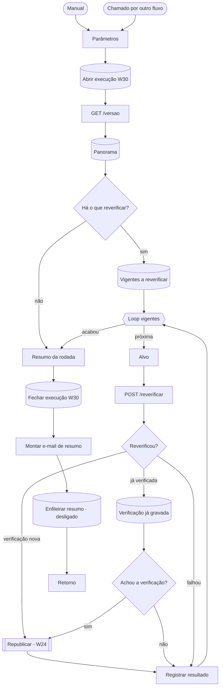

# W30 Reverificar em lote

> [!abstract] Em uma frase
> Quando as **regras do verificador mudam**, o W30 aplica as regras novas às respostas **que já existem**, sobre o texto **já congelado** — sem chamar modelo e sem refazer OCR, a custo zero —, e republica cada licitação pelo [[W24 Verificar e publicar]] com o registro do que mudou.

## Papel na solução

Separa duas coisas que costumam andar juntas e não deveriam: **a resposta do modelo** e **o julgamento sobre ela**. Quando uma regra do verificador é corrigida ou endurecida (por exemplo, a guarda que impede aprovar um número trocado), o acervo inteiro pode ser rejulgado **sem gastar um centavo de API** — porque o verificador é determinístico e o texto está congelado ([[ADR-011 Uma regra precisa saber quando falhou em ler]]).

Cada reverificação é uma **verificação nova**: a antiga fica no histórico e só perde a vigência quando o W24 republica. Mudar números publicados é **decisão**, não efeito colateral: o acervo inteiro só é reverificado pelo gatilho manual ([[ADR-014 Extração por agente, sem API]]).

## Quando roda

| Gatilho | Alcance |
|---|---|
| Manual (editor do n8n) | **todo** o acervo publicado |
| Chamado por outro fluxo com `controles` | só os controles dados |
| Chamado por outro fluxo com `todos: true` explícito | todo o acervo |
| Chamado sem lista e sem `todos` | **nada** — nunca "todos" por omissão |

Não tem agenda: é disparado por quem muda as regras. A reverificação de **uma** licitação, pelo botão do site, é feita pelo [[W11 Ações do site]] com a mesma lógica.

## Fluxograma

## Passo a passo — os 22 nós

### Nota do canvas

#### Passo 1 — Sobre o W30
- **Tipo:** nota do canvas.
- **O que diz:** as regras mudaram, as respostas não; cada reverificação é uma verificação nova e só vira vigente pelo W24 em modo republicar; o workflow de erro é o W90; reverificar = regras atuais sobre o texto congelado, sem modelo e sem OCR; só entram as vigentes com versão de regras diferente e com leitura congelada; mudança de números é decisão; em série, uma por vez; custo R$ 0.

### Etapa 1 — Parâmetros e panorama

#### Passo 2 — Manual
- **Tipo:** *Manual Trigger* — reverifica o acervo publicado inteiro.

#### Passo 3 — Chamado por outro fluxo
- **Tipo:** *Execute Workflow Trigger* com `controles` (lista) e `todos` (booleano).

#### Passo 4 — Parâmetros
- **Tipo:** *Code*.
- **O que faz:** aceita `controles` como lista, texto JSON ou texto separado por vírgulas; tira duplicatas; recusa controle fora do formato `CNPJ-1-SEQ/ANO`. Define `todos` só se for o manual ou se veio `todos: true` explícito. **Sem lista e sem `todos`, o alcance é vazio.**
- **Por que tão rígido:** um teste que pedia 2 licitações chegou aqui sem a lista e reverificou o acervo inteiro; a regra "nunca todos por omissão" nasceu desse incidente.

#### Passo 5 — Abrir execução W30
- **Tipo:** *Postgres* — abre a linha da rodada em `execucoes_workflow` com custo R$ 0.

#### Passo 6 — GET /versao
- **Tipo:** *HTTP Request* (GET `/versao` no worker) — a versão atual das regras (`versao_regras`): o SHA-256 do código que decide vereditos e marcações (`verificador.py`, `questionario.py`, `distribuicao.py`, `condicoes.py`, `api/politica.py`, `api/injecao.py`). Um hash muda sozinho quando o código muda — ninguém precisa lembrar de incrementar um número.

#### Passo 7 — Panorama
- **Tipo:** *Postgres* — conta, no alcance: verificações vigentes; quantas estão em versão antiga **e** têm leitura congelada (a reverificar); quantas já estão na versão atual; quantas não têm leitura congelada (**pendentes de leitura** — não reverificáveis sem ler antes).

#### Passo 8 — Há o que reverificar?
- **Tipo:** *IF* — `a_reverificar > 0`? Sim → lista; não → resumo.

#### Passo 9 — Vigentes a reverificar
- **Tipo:** *Postgres* — lista as verificações vigentes em versão antiga com leitura congelada: controle, vigente atual, execução, versão antiga e estado da licitação.

### Etapa 2 — Uma licitação por vez

#### Passo 10 — Loop vigentes
- **Tipo:** *Split in Batches*, uma por volta — **em série**: a reverificação usa CPU do worker e o W24 troca a vigente; em paralelo, disputariam recursos.

#### Passo 11 — Alvo
- **Tipo:** *Code* — o item da volta: controle, vigente, execução, versão antiga, estado.

#### Passo 12 — POST /reverificar
- **Tipo:** *HTTP Request* (POST `/reverificar` no worker), 120 s.
- **O que o worker faz:** reconstrói a extração vigente a partir das respostas gravadas e do texto congelado (**nunca** chama o extrator de novo) e passa pelo verificador atual; grava a verificação nova (única por execução + versão das regras) e devolve o `verificacao_id` e o diff.

#### Passo 13 — Reverificou?
- **Tipo:** *Switch* — `verificação nova` (200), `já verificada nesta versão` (409) ou `falhou`.

#### Passo 14 — Republicar (W24)
- **Tipo:** *Execute Workflow*, esperando — [[W24 Verificar e publicar]] com `modo = republicar` e **`notificar = false`** (em lote, nenhum e-mail por licitação).

#### Passo 15 — Verificação já gravada
- **Tipo:** *Postgres* — procura a verificação desta versão já gravada para a mesma execução e ainda não vigente (uma rodada anterior reverificou e não chegou a republicar).

#### Passo 16 — Achou a verificação?
- **Tipo:** *IF* — sim → republica essa (retomada); não → nada pendente, a licitação é "pulada".

#### Passo 17 — Registrar resultado
- **Tipo:** *Code* — resultado da licitação: republicada (verificação antes e depois, vereditos que mudaram, diff), pulada, ou falha com motivo. Volta ao laço.

### Etapa 3 — Resumo da rodada

#### Passo 18 — Resumo da rodada
- **Tipo:** *Code* — contadores: vigentes, a reverificar, já na versão, pendentes de leitura, reverificadas, republicadas, com veredito mudado, total de vereditos mudados, puladas e falhas; status `erro` se houve falha.

#### Passo 19 — Fechar execução W30
- **Tipo:** *Postgres* — fecha a linha com status, erro, custo 0, contadores (com o resultado de cada licitação) e duração.

#### Passo 20 — Montar e-mail de resumo
- **Tipo:** *Code* — monta "[FOPA] Reverificação: N republicada(s), K com veredito mudado · regras …" com a tabela de resultados.

#### Passo 21 — Enfileirar resumo
- **Tipo:** *Postgres* — **desligado** (dois e-mails no produto, [[ADR-016 O produto manda só dois e-mails]]). O resumo fica na [[Página Execuções]].

#### Passo 22 — Retorno
- **Tipo:** *Code* — devolve os contadores, os resultados e o id da linha da rodada.

## Por que isto importa para a qualidade

Uma regra do verificador que **aprova errado** é pior do que uma que falha em silêncio, porque ela é justamente a peça em que se confia sem reconferir. Quando um defeito do verificador é achado e corrigido, o W30 **remede o acervo inteiro de graça** e mostra, licitação por licitação, o que mudou ([[A medição que mediu o medidor]]).

## Relacionadas

[[MOC Fluxos n8n]] · [[W24 Verificar e publicar]] · [[W11 Ações do site]] · [[Verificador determinístico]] · [[Endpoints do worker]] · [[Página Execuções]] · [[ADR-011 Uma regra precisa saber quando falhou em ler]] · [[ADR-014 Extração por agente, sem API]]
