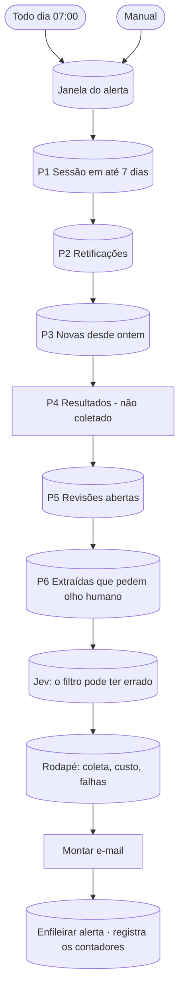

# W40 Alerta diário

> [!abstract] Em uma frase
> Todo dia às 07:00, o W40 calcula, a partir do banco, **as seis prioridades do dia** para a área de negócio — sessões nos próximos 7 dias sem o valor mínimo conferido, retificações, novidades, resultados, revisões abertas e extrações que pedem olho humano — mais os sinais do Jev e a saúde da coleta, e **registra os números** da rodada; o e-mail que ele montava saiu do produto.

## Papel na solução

É o **resumo operacional** do dia: o que merece atenção antes do expediente. A ordem das prioridades é a ordem de impacto no lance: primeiro o que tem sessão marcada em até uma semana e ainda não tem o dado do lance conferido.

> [!info] Estado atual
> O W40 monta o e-mail completo, mas **não o enfileira**: desde a decisão de o produto mandar só dois e-mails ([[ADR-016 O produto manda só dois e-mails]]), a rodada das 07:00 grava os contadores de cada prioridade numa linha de `execucoes_workflow`, visível na [[Página Execuções]]. As mesmas prioridades aparecem, ao vivo, no [[Página Painel|Painel]] (filtros "≤ 7 dias", "com conflito") e na [[Página Revisão|Revisão]].

## As seis prioridades

| # | Prioridade | Critério |
|---|---|---|
| P1 | **Sessão em até 7 dias** | sessão entre hoje e hoje + 7, no escopo e no recorte; destaca as que **ainda não têm o valor mínimo (Q5) com veredito APROVADO** — o dado do lance |
| P2 | **Retificações** | licitações que entraram em `retificada` na janela; marca as que **já tinham sido analisadas** (a data da sessão pode ter mudado) |
| P3 | **Novas** | encontradas no PNCP (no escopo, fora do acervo importado) e extraídas/publicadas na janela |
| P4 | **Resultados** | fixo "não coletado" — o fluxo não lê resultados por licitação aqui (o histórico de resultados vem do [[W41 Histórico do PNCP]]) |
| P5 | **Revisão humana** | licitações com revisões abertas, quantas e desde quando |
| P6 | **Olho humano** | extraídas, com sessão ainda aberta, com injeção suspeita, reprovadas, conflitos entre documentos ou alertas de regra — nesta ordem de gravidade |
| — | Jev: o filtro pode ter errado | o Jev discordou da regra de escopo com convicção (p ≤ 0,25 ou ≥ 0,75) e ainda não há rótulo humano |
| — | Rodapé | a última coleta (quando, se foi **cega**, cobertura média, termos que falharam), a última rodada do [[W70 Retificações]], processadas e falhas na janela, erros de fluxo, chamadas e custo de modelo (com as sem preço), e-mails que falharam, o provedor vigente |

**"Nada visto" ≠ "nada a fazer":** se a coleta falhou (cega), isso aparece em vermelho no topo — um dia sem novidades porque a busca não funcionou não pode parecer um dia tranquilo ([[ADR-007 Cobertura de municípios pequenos]]).

## Fluxograma

## Passo a passo — os 14 nós

### Nota do canvas

#### Passo 1 — Sobre o W40
- **Tipo:** nota do canvas.
- **O que diz:** o alerta é o "produto percebido", lido em dois minutos; monta a partir do banco; as seis prioridades nesta ordem; só o recorte de 2026 e o escopo da regra; "nada visto" ≠ "nada a fazer"; dia sem nada relevante = mensagem curta "nada novo", nunca silêncio; o Jev só lista; a linguagem visual é a do painel; a janela vai do último alerta, nunca menos de 24 h nem mais de 7 dias.

### Etapa 1 — Gatilhos e janela

#### Passo 2 — Todo dia 07:00
- **Tipo:** *Schedule Trigger*, cron `0 7 * * *` (todo dia, inclusive fim de semana), fuso São Paulo.
- **Por que 07:00:** depois da descoberta (06:00) e de a fila ter rodado as primeiras vezes (06:00–07:00), antes do expediente.

#### Passo 3 — Manual
- **Tipo:** *Manual Trigger*.

#### Passo 4 — Janela do alerta
- **Tipo:** *Postgres*.
- **O que calcula:** o início da janela = o último alerta enviado, limitado a no mínimo 24 h e no máximo 7 dias atrás (um dia perdido não some: o seguinte cobre os dois). Como o alerta não é mais enfileirado, a janela é, na prática, **as últimas 24 horas**. Também formata hoje, o limite de 7 dias e o ano mínimo.

### Etapa 2 — As prioridades

#### Passo 5 — P1 Sessão em até 7 dias
- **Tipo:** *Postgres* sobre a view `v_card` (a mesma que alimenta os cartões do site).
- **O que devolve:** as licitações no escopo, no recorte, fora de `fora_escopo`/`fora_janela`, com sessão entre hoje e hoje + 7 dias; para cada uma, o veredito da Q5, se foi extraída, se há revisão pendente ou injeção suspeita, quantos dias faltam e a data. Conta quantas estão **sem lance definido** (Q5 diferente de APROVADO).

#### Passo 6 — P2 Retificações
- **Tipo:** *Postgres* — últimos eventos `→ retificada` na janela (vindos do [[W01 Descoberta]], pela data de atualização do PNCP, ou do [[W70 Retificações]], por documento novo), com o estado anterior e se já estava analisada (`publicada` ou `verificada`).

#### Passo 7 — P3 Novas desde ontem
- **Tipo:** *Postgres* — licitações criadas na janela (no escopo, fora da carga do acervo) e as publicadas na janela (fora das importações), com objeto e ancoragem.

#### Passo 8 — P4 Resultados (não coletado)
- **Tipo:** *No Operation* — marca o lugar da prioridade 4 e deixa explícito, no e-mail, que ela é vazia **por construção**.

#### Passo 9 — P5 Revisões abertas
- **Tipo:** *Postgres* — por licitação: revisões abertas, quantas novas na janela, quais perguntas, o último motivo e desde quando.

#### Passo 10 — P6 Extraídas que pedem olho humano
- **Tipo:** *Postgres* — extraídas, com sessão ainda aberta, com injeção suspeita, reprovadas, conflitos ou alertas globais, ordenadas por gravidade (injeção > reprovada > conflito > alerta de regra).

#### Passo 11 — Jev: o filtro pode ter errado
- **Tipo:** *Postgres* — o sinal mais recente do Jev por licitação, quando é **candidata** (discordância com convicção) e **ainda sem rótulo humano**. Só lista; não decide.

#### Passo 12 — Rodapé: coleta, custo, falhas
- **Tipo:** *Postgres* — a última coleta concluída do W01 (quando, se foi cega, cobertura média e termos que falharam), a última rodada do W70, contagem de processadas e de falhas na janela, erros de fluxo, chamadas e custo de modelo (preço desconhecido nunca vira R$ 0,00), e-mails com falha e o provedor configurado.

### Etapa 3 — Montar e registrar

#### Passo 13 — Montar e-mail
- **Tipo:** *Code*.
- **O que faz:** monta um HTML estático (tabelas e estilo inline, sem JavaScript) na linguagem visual do painel: cada prioridade é uma seção com no máximo 15 linhas (o resto "fica no site"), prazo colorido como no painel (vermelho até 7 dias, âmbar até 20), marcas para veredito, revisão, injeção, conflito; links para a licitação e para a fila de revisão; e os **contadores** de cada seção.

#### Passo 14 — Enfileirar alerta
- **Tipo:** *Postgres*.
- **O que faz hoje:** **não enfileira e-mail**. Insere uma linha em `execucoes_workflow` (`workflow = 'W40'`, status `ok`, duração) com os **contadores** de cada prioridade — o registro diário que a [[Página Execuções]] mostra.

## Relacionadas

[[MOC Fluxos n8n]] · [[Horários e agendamentos]] · [[W01 Descoberta]] · [[W70 Retificações]] · [[W41 Histórico do PNCP]] · [[Página Painel]] · [[Página Revisão]] · [[Página Execuções]] · [[E-mails do produto]] · [[Jev — score de escopo e sustentação]] · [[ADR-016 O produto manda só dois e-mails]]
