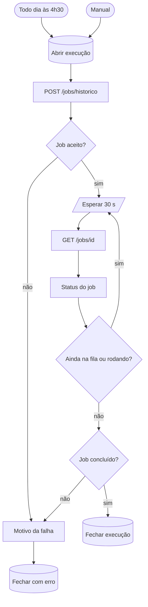

# W41 Histórico do PNCP

> [!abstract] Em uma frase
> Todo dia às 04:30, o W41 pede ao worker que recolete do PNCP o **histórico de compra e venda da folha** — cabeçalho, itens e resultados de cada licitação conhecida (quem venceu, por quanto, quando) e os **contratos** de folha do país inteiro com os aditivos —, para que as páginas de Analytics abram o dia com os dados de mercado atualizados.

## Papel na solução

A extração responde "o que este edital pede". O histórico responde "**o que o mercado fez**": quais instituições financeiras compraram quais folhas, a que preço, em que rodada, e até quando vale cada contrato. É a base das páginas [[Página Analytics de Mercado]] e [[Página Analytics Histórico FOPA]] e da decisão de negócio "vale a pena disputar esta folha, e por quanto" ([[ADR-023 O histórico e os contratos do PNCP todo dia]]).

Custo: **R$ 0** — API pública do PNCP, nenhum modelo.

## O que o job do worker faz (`api/historico_pncp.py`, `rodada_diaria`)

| Passada | O que coleta | Por quê |
|---|---|---|
| 1. Novas | a compra inteira (cabeçalho, itens, resultados) das licitações que nunca tiveram coleta boa | a licitação que o W01 acabou de achar |
| 2. Acervo | itens e resultados de novo, **para o acervo inteiro**, sem o cabeçalho | o vencedor homologado depois, o resultado cancelado — o gateway responde em ~0,1 s por chamada |
| 3. Cabeçalhos | o cabeçalho de quem ficou sem (a API de consulta recusou antes) | uma tentativa por compra, com limite de tempo; o resto fica para a rodada seguinte |
| 4. Contratos | a busca de contratos de folha no PNCP com os termos ativos; detalhe e aditivos do que é novo ou mudou (de todos, aos domingos) | valor inicial, global e acumulado, parcelas, assinatura e **vigência** do contrato |

Cada resposta é guardada **inteira** (o payload), e as colunas que o analytics consulta são extraídas dela (`pncp_compras`, `pncp_itens`, `pncp_resultados`, `pncp_contratos`, `pncp_contrato_termos`, `pncp_coletas`). Uma falha do PNCP marca só a tentativa; o que uma coleta anterior trouxe continua. Os contratos passam pela mesma regra de escopo das licitações (a busca por "folha de pagamento" também traz sistema de RH e consignado).

> [!warning] 30/09/2026 — PNCP fora do ar e a correção
> Na rodada das 04:30 de 30/09 o PNCP estava fora do ar. A passada do acervo gravava cada falha por cima da coleta boa anterior (`pncp_coletas.ok` voltava a falso), e as páginas de Analytics — que contam só a licitação com coleta boa — ficaram vazias, com os dados intactos no banco. A correção (commit `ab55f75` do projeto de origem, `api/historico_pncp.py`, `_registrar`): **uma falha nunca desfaz uma coleta boa** — `ok` só vai de falso a verdadeiro, e o erro da última tentativa continua registrado. As marcas perdidas foram restauradas do backup das 03:15 do mesmo dia, e o teste `test_pncp_fora_do_ar_nao_desfaz_a_coleta_boa` reproduz o caso.

## Fluxograma

## Passo a passo — os 14 nós

### Nota do canvas

#### Passo 1 — Sobre o W41
- **Tipo:** nota do canvas.
- **O que diz:** o W41 mantém o analytics em dia, todo dia às 04:30, com custo R$ 0; o trabalho é do worker (licitações nunca coletadas, itens e resultados do acervo inteiro, cabeçalhos pendentes e contratos); o laço de job espera 30 s por volta até 150 voltas (75 minutos; uma rodada leva cerca de 15); 04:30 para não disputar o worker com o W01 e a fila; toda rodada deixa rastro em `execucoes_workflow`.

### Etapa 1 — Disparo

#### Passo 2 — Todo dia às 4h30
- **Tipo:** *Schedule Trigger*, cron `30 4 * * *`, fuso São Paulo.
- **Por que 04:30:** termina antes de a descoberta (06:00) e a fila (06:00–07:50) ocuparem o worker, e o analytics abre o dia atualizado.

#### Passo 3 — Manual
- **Tipo:** *Manual Trigger*.

#### Passo 4 — Abrir execução
- **Tipo:** *Postgres*, uma vez — linha `W41` em `execucoes_workflow` com o gatilho (`agenda` ou `manual`).

#### Passo 5 — POST /jobs/historico
- **Tipo:** *HTTP Request* (POST `/jobs/historico` no worker), 30 s, nunca erro — dispara o job `rodada_diaria`.

#### Passo 6 — Job aceito?
- **Tipo:** *IF* — 202 com `job_id` → acompanhar; senão → motivo da falha.

### Etapa 2 — Acompanhar o job

#### Passo 7 — Esperar 30 s
- **Tipo:** *Wait* de 30 s.

#### Passo 8 — GET /jobs/{id}
- **Tipo:** *HTTP Request* (GET `/jobs/{job_id}`), nunca erro.

#### Passo 9 — Status do job
- **Tipo:** *Code* — o laço de jobs longos, com limite de **150 voltas de 30 s (75 minutos)**; worker sem resposta numa volta não mata o laço.

#### Passo 10 — Ainda na fila ou rodando?
- **Tipo:** *IF* — continua esperando enquanto `queued`, `running` ou sem resposta.

#### Passo 11 — Job concluído?
- **Tipo:** *IF* — `done` → fecha com sucesso; senão → falha.

### Etapa 3 — Fechar

#### Passo 12 — Fechar execução
- **Tipo:** *Postgres*, uma vez — `status = ok`, duração, **os números do job como contadores** (novas, acervo, cabeçalhos, contratos, vencedores novos, erros) e `cego = true` se a busca de contratos caiu em algum termo.

#### Passo 13 — Motivo da falha
- **Tipo:** *Code* — o motivo escrito: POST recusado, worker fora, job com erro ou laço esgotado.

#### Passo 14 — Fechar com erro
- **Tipo:** *Postgres*, uma vez — `status = erro` com o motivo escrito. A falha tratada termina o fluxo normalmente (quem a vê é a [[Página Execuções]]); só um erro **não tratado** dentro do fluxo aciona o [[W90 Erro]].

## O que fica gravado

| Tabela | Conteúdo |
|---|---|
| `pncp_coletas` | cada tentativa de coleta por licitação (ok ou falha, motivo) |
| `pncp_compras` | o cabeçalho da compra: valores estimado e homologado, situação, datas |
| `pncp_itens` | os itens e a situação de cada um (homologado, deserto, fracassado) |
| `pncp_resultados` | vencedor, CNPJ, natureza jurídica, porte, valor homologado, data |
| `pncp_contratos` / `pncp_contrato_termos` | contrato, valores, parcelas, vigência e aditivos |

## Relacionadas

[[MOC Fluxos n8n]] · [[Horários e agendamentos]] · [[Página Analytics de Mercado]] · [[Página Analytics Histórico FOPA]] · [[Fontes de dados — PNCP]] · [[Modelo de dados]] · [[Worker — visão geral e jobs]] · [[ADR-023 O histórico e os contratos do PNCP todo dia]]
