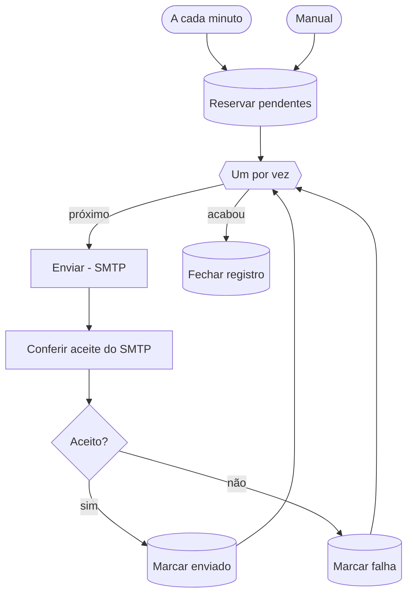

# W50 Envio de e-mails

> [!abstract] Em uma frase
> A cada minuto, o W50 reserva até 20 e-mails pendentes da fila `emails`, envia um por vez pelo SMTP (Resend), marca como `enviado` **só** o que o servidor de e-mail aceitou de fato, e devolve à fila, com espera crescente, o que falhou — até 5 tentativas.

## Papel na solução

É o **único lugar que fala com o servidor de e-mail**. Os outros fluxos só **inserem** uma linha `pendente` em `emails`; o W50 entrega. Isso separa "decidir avisar" de "conseguir avisar": uma queda do servidor de e-mail nunca derruba uma extração ou uma descoberta, e toda falha de envio fica registrada com o motivo ([[E-mails do produto]]).

Hoje existem **dois** tipos de e-mail na fila ([[ADR-016 O produto manda só dois e-mails]]):

| Tipo | Quem enfileira | Para quem |
|---|---|---|
| `licitacao_nova` | [[W01 Descoberta]] | os administradores ativos |
| `extracao` | [[W24 Verificar e publicar]], quando a extração veio do botão "Extrair com IA" | quem clicou |

## Fluxograma

## Passo a passo — os 11 nós

### Nota do canvas

#### Passo 1 — Sobre o W50
- **Tipo:** nota do canvas.
- **O que diz:** único lugar que fala com o servidor de e-mail; falha nunca é silêncio (o motivo fica na linha); falha não é definitiva na primeira (esperas de 2, 5, 15 e 40 minutos; `falhou` só na 5ª tentativa); marca órfã é solta no próximo ciclo; no máximo 20 por minuto; canal SMTP com a credencial `smtp`; `enviado` só com aceite do servidor; o destinatário padrão são os administradores ativos; execuções bem-sucedidas da agenda não são guardadas no n8n (a trilha é a tabela `emails` + `execucoes_workflow`).

### Etapa 1 — Reservar

#### Passo 2 — A cada minuto
- **Tipo:** *Schedule Trigger*, cron `* * * * *`.
- **Por que a cada minuto:** um aviso de licitação nova ou de extração pronta chega em até um minuto; com fila vazia, a execução termina imediatamente.

#### Passo 3 — Manual
- **Tipo:** *Manual Trigger* — teste de envio.

#### Passo 4 — Reservar pendentes
- **Tipo:** *Postgres*, **uma única instrução** (o `SKIP LOCKED` só vale dentro da própria instrução):
  1. **solta marcas órfãs:** um e-mail marcado "em envio: W50 execução N" cuja execução começou há mais de 30 minutos (ou não existe) volta para a fila — ou vira `falhou`, se as 5 tentativas já foram gastas. Protege contra o container reiniciado no meio de um envio;
  2. **esgota o que não tem mais tentativas:** `pendente` com 5 tentativas e sem marca → `falhou`;
  3. **escolhe até 20** pendentes, respeitando a espera escrita no erro ("nova tentativa a partir de <UTC>"), na ordem de chegada, com `FOR UPDATE SKIP LOCKED`;
  4. **reserva:** soma uma tentativa e marca "em envio: W50 execução N";
  5. **registra a rodada** em `execucoes_workflow` (reservados, órfãs soltas, esgotados).
- **Destinatário:** o da linha (`para`, usado pelo e-mail de extração); sem ele, **todos os administradores ativos** de `usuarios`.
- Fila vazia = nenhum item, e o fluxo termina aqui.

### Etapa 2 — Enviar um por vez

#### Passo 5 — Um por vez
- **Tipo:** *Split in Batches* — um e-mail por volta.

#### Passo 6 — Enviar (SMTP)
- **Tipo:** *Send Email* (credencial `smtp`), remetente `FOPA_EMAIL_FROM`, HTML, sem a assinatura do n8n. Em erro, segue (a conferência decide).
- **Servidor em produção:** Resend, remetente `avisos@licitacaofopa.com.br`, domínio com SPF, DKIM e DMARC ([[E-mails do produto]]).

#### Passo 7 — Conferir aceite do SMTP
- **Tipo:** *Code*, um por item.
- **Regra:** só é `enviado` o que o servidor **aceitou** — a resposta traz `messageId` **e** a lista `accepted` não vazia. Caso contrário, o erro é explicado: recusa do servidor, destinatário rejeitado, SMTP não configurado, aceite não confirmado, ou nenhum administrador ativo.
- **Por que não confiar na saída do nó:** quando o nó de e-mail morre antes de processar os itens (por exemplo, sem credencial), o n8n repassa o item de entrada como se fosse sucesso. Uma versão anterior deste fluxo marcou como enviado um e-mail que nunca saiu — a conferência nasceu disso.

#### Passo 8 — Aceito?
- **Tipo:** *IF*, validação estrita — `enviado` verdadeiro?

#### Passo 9 — Marcar enviado
- **Tipo:** *Postgres* — `status = enviado`, `canal = smtp`, hora do envio, erro limpo. Vale mesmo se a marca foi solta como órfã numa execução lenta: o e-mail saiu, e isso é fato. Nunca reescreve linha já resolvida.

#### Passo 10 — Marcar falha
- **Tipo:** *Postgres*.
- **O que faz:** se ainda há tentativas, volta a `pendente` com o erro "tentativa N/5 falhou; nova tentativa a partir de <UTC>: motivo" — a espera cresce: **2, 5, 15 e 40 minutos** depois da 1ª, 2ª, 3ª e 4ª falha. Na 5ª, `falhou` com o último motivo.
- Só mexe na linha se a marca ainda é **desta** execução.

### Etapa 3 — Fechar

#### Passo 11 — Fechar registro
- **Tipo:** *Postgres*, uma vez — fecha a linha da rodada com `ok` (tudo saiu) ou `parcial`, a duração e os contadores: enviados, que voltam para a fila, que falharam de vez.

## Onde ver os e-mails

A [[Página E-mails]] (só administradores) mostra cada e-mail como foi enviado, com destinatário, status, tentativas e erro. A [[Página Saúde]] mostra se o canal de e-mail está saudável: o [[W00 Saúde]] considera o canal com problema se algum e-mail falhou na última hora ou se algum pendente está parado há mais de 10 minutos.

## Relacionadas

[[MOC Fluxos n8n]] · [[Horários e agendamentos]] · [[E-mails do produto]] · [[W01 Descoberta]] · [[W24 Verificar e publicar]] · [[W90 Erro]] · [[W00 Saúde]] · [[Página E-mails]] · [[Domínio, DNS e HTTPS]] · [[ADR-016 O produto manda só dois e-mails]]
