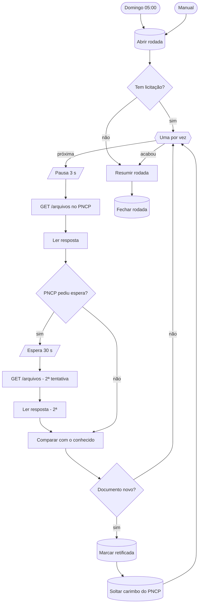

# W70 Retificações

> [!abstract] Em uma frase
> Todo domingo às 05:00, o W70 pergunta ao PNCP, licitação por licitação (das ainda abertas), se apareceu **documento que o sistema não conhece** — uma retificação, um aviso de suspensão, uma errata —; havendo, a licitação volta ao estado `retificada` e a fila a baixa, lê e extrai de novo.

## Papel na solução

Um edital muda depois de publicado: a data da sessão é adiada, um anexo é corrigido, a disputa é suspensa. Se o sistema não perceber, a resposta publicada fica **velha e errada com cara de certa** — exatamente o erro invisível que o produto existe para evitar ([[Problema de negócio]]).

A retificação é detectada por dois caminhos complementares:

| Caminho | Como detecta | Frequência |
|---|---|---|
| [[W01 Descoberta]] | a data de atualização da licitação no PNCP mudou | dias úteis, 06:00 |
| **W70** | há documento **ativo** no PNCP com um sequencial que o banco **não conhece** | domingo, 05:00 |

O segundo pega o que o primeiro não pega: um documento novo anexado sem mudar a data de atualização da compra.

## Quem entra na conferência

- dentro do recorte de ano e do escopo;
- sessão ainda aberta (hoje ou depois);
- sem lease (não está sendo processada agora);
- em estado que admite ir para `retificada` (pela tabela de transições: `publicada`, `verificada`, `preparada`, `baixada_ok`);
- **não** reservada para demonstração (a demo precisa dela parada; é contada à parte);
- no máximo `configuracao.w70_limite` licitações por rodada (padrão **200**), as de sessão mais próxima primeiro; o que passa do limite é registrado nos contadores.

## Fluxograma

## Passo a passo — os 19 nós

### Nota do canvas

#### Passo 1 — Sobre o W70
- **Tipo:** nota do canvas.
- **O que diz:** a regra do documento novo (sequenciais ativos menos os conhecidos, contando como conhecido **todo** arquivo com sequencial, inclusive os recusados); nunca iterar 1..N; quem entra; PNCP com nunca-erro, pausa de 3 s, 429/5xx esperam 30 s e tentam uma vez; sem resposta é "não conferida", nunca "sem novidade"; o limite por rodada; e reabrir solta o carimbo do PNCP para o W01 não acusar a mesma mudança de novo.

### Etapa 1 — Abrir a rodada

#### Passo 2 — Domingo 05:00
- **Tipo:** *Schedule Trigger*, cron `0 5 * * 0`.
- **Por que domingo de madrugada:** a conferência faz uma chamada por licitação com pausa de 3 s; no domingo cedo não disputa o worker nem a API com a descoberta e a fila dos dias úteis.

#### Passo 3 — Manual
- **Tipo:** *Manual Trigger*.

#### Passo 4 — Abrir rodada
- **Tipo:** *Postgres*, sempre devolve item.
- **O que faz:** seleciona as elegíveis (critérios acima), numera pela sessão mais próxima, abre a linha `W70` em `execucoes_workflow` com os contadores de partida (elegíveis, puladas por reserva de demonstração, na rodada, fora do limite, com as listas) e devolve, para cada licitação da rodada, os **sequenciais já conhecidos** e quantos arquivos ela tem.

#### Passo 5 — Tem licitação?
- **Tipo:** *IF* — há controle? Sim → percorre; não → resume.

### Etapa 2 — Uma licitação por vez

#### Passo 6 — Uma por vez
- **Tipo:** *Split in Batches*.

#### Passo 7 — Pausa 3 s
- **Tipo:** *Wait* de 3 s — ritmo gentil com a API pública.

#### Passo 8 — GET /arquivos no PNCP
- **Tipo:** *HTTP Request* — a lista de documentos da licitação, 60 s, nunca erro, saída de erro ligada.

#### Passo 9 — Ler resposta
- **Tipo:** *Code*, um por item — status HTTP e erro de rede viram dado; 200 com lista (ou 204 vazio) = documentos; rede, 429 ou 5xx na 1ª tentativa → pedir espera.

#### Passo 10 — PNCP pediu espera?
- **Tipo:** *IF* — `repetir` → espera 30 s; senão → compara.

#### Passo 11 — Espera 30 s
- **Tipo:** *Wait* de 30 s.

#### Passo 12 — GET /arquivos (2ª tentativa)
- **Tipo:** *HTTP Request*, igual ao passo 8.

#### Passo 13 — Ler resposta (2ª)
- **Tipo:** *Code* — a mesma leitura, na tentativa 2 (sem nova repetição).

#### Passo 14 — Comparar com o conhecido
- **Tipo:** *Code*, um por item.
- **Resultados possíveis:**

  | Resultado | Quando |
  |---|---|
  | `nao_conferida` | o PNCP não respondeu (rede ou HTTP ruim) — **nunca** conta como "sem novidade" |
  | `nao_comparavel` | a licitação está em `falha_rede` e nunca teve arquivo baixado — não há com o que comparar (a fila já tenta baixar) |
  | `sem_novidade` | todo sequencial ativo já é conhecido |
  | `documento_novo` | há sequencial ativo desconhecido; lista seq, título, tipo e data de publicação de cada novo |

#### Passo 15 — Documento novo?
- **Tipo:** *IF* — `documento_novo` → marca; senão, volta ao laço.

#### Passo 16 — Marcar retificada
- **Tipo:** *Postgres*.
- **O que faz:** reconfere, no momento, que a licitação ainda admite `retificada`, não tem lease e não é reservada (o estado pode ter mudado desde a seleção); se sim, `fn_transicao(…, 'retificada', 'W70: documento novo no PNCP')` com os documentos novos e o carimbo anterior no evento. Se não admite, o evento volta nulo e a rodada registra o caso.

#### Passo 17 — Soltar carimbo do PNCP
- **Tipo:** *Postgres* — zera `atualizado_pncp` da licitação reaberta.
- **Por que:** o W01 detecta retificação pela data de atualização; se o carimbo antigo ficasse, o W01 acusaria **a mesma** mudança depois do reprocessamento (e pagaria outra extração). Carimbo nulo = "guarde na próxima vista, compare a partir da seguinte".

### Etapa 3 — Fechar

#### Passo 18 — Resumir rodada
- **Tipo:** *Code* — contadores: tentadas, conferidas, sem novidade, retificadas (com os sequenciais novos), documento novo sem transição, não conferidas (com o motivo), não comparáveis. **Cega** se nenhuma foi conferida; `parcial` se alguma não foi.

#### Passo 19 — Fechar rodada
- **Tipo:** *Postgres* — fecha a linha com status (`ok`, `parcial` ou `cego`), duração e contadores. O [[W40 Alerta diário]] e a [[Página Execuções]] mostram a última rodada.

## O que acontece depois

A licitação `retificada` volta para a fila com prioridade sobre as demais do mesmo nível ([[W10 Fila]]); o [[W20 Processar uma licitação]] começa pelo [[W21 Baixar]], que baixa **todos** os documentos ativos de novo — incluindo o novo —; a leitura é refeita e a extração também. A verificação nova vira a vigente; a antiga fica no histórico.

## Relacionadas

[[MOC Fluxos n8n]] · [[Horários e agendamentos]] · [[W01 Descoberta]] · [[W10 Fila]] · [[W21 Baixar]] · [[W40 Alerta diário]] · [[Ciclo de vida de uma licitação]] · [[Fontes de dados — PNCP]] · [[ADR-006 Documento vigente é o de maior sequencial]] · [[ADR-007 Cobertura de municípios pequenos]]
