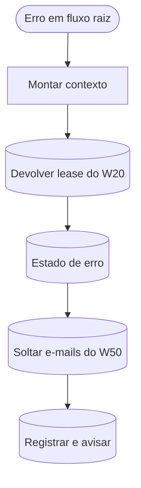

# W90 Erro

> [!abstract] Em uma frase
> Quando um fluxo raiz morre com um erro não tratado, o n8n chama o W90, que **arruma a casa**: devolve a licitação que estava reservada (com nova tentativa em 15 minutos), grava o estado de erro na linha do tempo dela, devolve à fila os e-mails que estavam em envio e **fecha como erro** a linha da execução que morreu — para nada ficar "em curso" para sempre.

## Papel na solução

É a **rede de segurança** da automação. Os fluxos tratam os erros esperados (PNCP fora, worker lento, modelo recusando) nos próprios ramos; o W90 cobre o que **escapou** — uma exceção em código, um nó que quebrou, um *Stop and Error* deliberado.

**Onde ele é o workflow de erro:** só nos fluxos **raiz** — [[W00 Saúde]], [[W01 Descoberta]], [[W10 Fila]], [[W11 Ações do site]], [[W20 Processar uma licitação]], [[W30 Reverificar em lote]], [[W40 Alerta diário]], [[W41 Histórico do PNCP]], [[W50 Envio de e-mails]] e [[W70 Retificações]]. **Nunca** nos sub-fluxos W21–W24: a falha deles sobe para o W20, e o W90 é chamado uma única vez, com o id da execução do W20 — o que permite achar o lease `W20:<id>`.

> [!info] Um detalhe do n8n
> O Error Trigger **não dispara em execução manual** (clicada no editor). Ensaios de erro são feitos por agenda ou webhook.

## Fluxograma

## Passo a passo — os 7 nós

#### Passo 1 — Sobre o W90
- **Tipo:** nota do canvas.
- **O que diz:** é o Error Workflow das raízes, nunca de W21–W24; erro vira registro, não print; lease devolvido com backoff de 15 minutos; estado de erro pela máquina de estados; e-mails do W50 que morreu voltam para a fila com a mesma espera crescente; fecha a linha "em curso" da execução que morreu; anti-tempestade (iguais em 1 hora contam juntos); não dispara em execução manual.

#### Passo 2 — Erro em fluxo raiz
- **Tipo:** *Error Trigger*.
- **O que recebe:** o fluxo que falhou (nome), a execução (id, URL, modo, último nó executado) e o erro (mensagem) — ou, se a falha foi no próprio gatilho, o erro do gatilho, sem execução.

#### Passo 3 — Montar contexto
- **Tipo:** *Code*.
- **O que faz:** extrai o código do fluxo (`W20`, `W50`…), o id da execução, a URL, a mensagem (até 500 caracteres) e o último nó executado, e monta um corpo HTML de aviso.

#### Passo 4 — Devolver lease do W20
- **Tipo:** *Postgres*, sempre devolve item.
- **O que faz:** se a execução que morreu era um W20, encontra a licitação com lease `W20:<id>`, **soma uma tentativa**, agenda nova tentativa em **15 minutos** e solta o lease. Para outros fluxos, não casa nada.

#### Passo 5 — Estado de erro
- **Tipo:** *Postgres*, sempre devolve item.
- **O que faz:** se a licitação estava num passo transitório, grava o estado de erro correspondente pela máquina de estados (`fn_transicao`, com evento): `baixando → falha_rede`, `lendo → erro_leitura`, `extraindo → erro_extracao`. Outros estados ficam como estão.

#### Passo 6 — Soltar e-mails do W50
- **Tipo:** *Postgres*, uma vez, sempre devolve item.
- **O que faz:** se quem morreu foi o [[W50 Envio de e-mails]], os e-mails marcados "em envio" **por esta execução** voltam para a fila com a mesma espera crescente do W50 (2, 5, 15, 40 minutos) — ou viram `falhou` se já gastaram 5 tentativas.
- **Por que não "falhou" na hora:** uma queda do SMTP no meio do lote mataria e-mails que o próprio W50 reenviaria.

#### Passo 7 — Registrar e avisar
- **Tipo:** *Postgres*, uma vez.
- **O que faz:**
  1. conta quantos erros **iguais** (mesmo fluxo, mesma mensagem) houve na última hora (anti-tempestade);
  2. se a execução que morreu tinha aberto sua linha em `execucoes_workflow` (`em_curso`), **fecha essa linha** como `erro` com a mensagem, a licitação e a URL — não cria outra;
  3. se não havia linha aberta (morreu antes de abrir), insere uma linha `erro` do próprio fluxo.
- **E-mail:** desligado — o erro fica registrado e visível na [[Página Execuções]] ([[ADR-016 O produto manda só dois e-mails]]).
- **Efeito no disjuntor:** a linha `erro` de um W20 conta para o disjuntor do [[W10 Fila]].

## Relacionadas

[[MOC Fluxos n8n]] · [[W20 Processar uma licitação]] · [[W50 Envio de e-mails]] · [[W10 Fila]] · [[Convenções dos fluxos n8n]] · [[Página Execuções]] · [[Saúde e observabilidade]]
