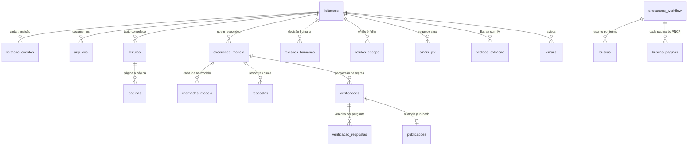

# Modelo de dados

> [!abstract] Em uma frase
> Um banco **PostgreSQL 16** (`fopa`) com **42 tabelas**, 4 views, 36 funções e 7 gatilhos, organizado em torno da **licitação** (chave: o número de controle do PNCP) e de uma regra: **o que a máquina produziu nunca é reescrito** — leituras, respostas, verificações e eventos só acumulam, e as decisões humanas ficam em camadas próprias por cima.

## Papel na solução

O banco é a memória e o árbitro: guarda o texto congelado contra o qual toda citação é conferida, a procedência de cada resposta (quem respondeu, com que modelo, a que custo), a máquina de estados que impede transições inválidas, a fila com concorrência segura e o que as pessoas decidiram. O n8n, o worker e o site falam com o mesmo banco, cada um com um papel de acesso próprio.

## O mapa

## As tabelas, por assunto

### A licitação e seu ciclo de vida

| Tabela | O que guarda |
|---|---|
| `licitacoes` | uma linha por licitação. Chave `controle` (validada por expressão regular) e, **gerados** a partir dela, o `slug` da URL e o `cnpj` do órgão — ninguém consegue gravar um slug que não bate com a identidade. Dados do PNCP (órgão, UF, município, modalidade, objeto, situação, publicação, fim do prazo, carimbo de atualização do PNCP); escopo (`escopo_dentro`, `escopo_motivo`, `escopo_versao`); **estado** (enum de 20 valores), motivo e desde quando; fila (tentativas, próxima tentativa, *lease*, prioridade); `gemea_de`; `leitura_vigente_id`; marcas `ensaio`, `reserva_demo`, `procedencia_incerta` |
| `transicoes` | a tabela das transições permitidas entre estados ([[Ciclo de vida de uma licitação]]) |
| `licitacao_eventos` | **só inserção**: cada mudança de estado, com de → para, motivo e detalhes; um gatilho recusa transição que não está na tabela |
| `pastas_legado` | de qual pasta do acervo anterior cada licitação veio ([[Acervo e migração da v2]]) |
| `sem_documento_fonte` | licitações cujo PNCP não tem documento (ou é duplicata de outra) |

### Os documentos e o texto congelado

| Tabela | O que guarda |
|---|---|
| `arquivos` | cada documento baixado: sequencial e tipo no PNCP, nome original (é o marcador de citação), SHA-256, bytes, formato real (pelos bytes), **status** (`ok`, `convertido`, `zip_container`, `formato_nao_suportado`, `falha_rede`, `alias_duplicado`…), motivo, `pai_id` (de qual ZIP/RAR/conversão saiu), páginas, caracteres, se requer OCR, `forcar_ocr` e `girar`, chave no armazenamento, se estava ativo no PNCP |
| `leituras` | uma leitura = o texto de todos os arquivos numa versão de OCR: versão do Tesseract e SHA-256 do modelo, condições (arquivos e páginas por OCR, texto furtivo, não-PDF), assinatura do conjunto de bytes, modo sugerido, total de caracteres; **uma vigente por licitação** (índice único) |
| `paginas` | **texto congelado**: uma linha por página física de cada arquivo da leitura, com a ordem de precedência e se veio de OCR — é contra ela que o verificador confere, para sempre |
| `furtivos_varreduras`, `furtivos_achados` | a varredura de texto escondido de cada leitura e cada trecho achado, com a classe e se é suspeito ([[Injeção de prompt e defesas]]) |

### A extração: quem respondeu, a que custo

| Tabela | O que guarda |
|---|---|
| `perguntas` | as 17 perguntas (texto, orientação, formato, marca de crítica), semeadas iguais ao código ([[Questionário — as 17 perguntas]]) |
| `execucoes_modelo` | uma execução de extração: **origem** (`api`, `agente`, `harness`, `experimento`, `simulado`, `gravado`, `legado`), provedor, modelo, modo, esforço, lote, `k_rag`, `versao_prompt`, tokens (entrada, saída, cache gravado, cache lido, raciocínio), tempo, US$ e R$ (**nulo quando o preço é desconhecido**), status, se é canônica; uma restrição impede execução `simulado`/`gravado` canônica |
| `chamadas_modelo` | **imutável**: cada ida ao modelo — ids do lote, **o envelope inteiro da resposta**, `stop_reason`, HTTP, tentativas, tokens, SHA-256 do corpo enviado, custo calculado na hora, **rodada** (0 = lote normal; 1–2 = reforço do Best-of-N) |
| `respostas` | **imutável**: a resposta crua de cada pergunta, antes do verificador — inclusive a **página que o modelo citou** |
| `pedidos_extracao` | o pedido do botão "Extrair com IA": provedor, modelo, esforço, teto de saída, quem pediu, quando foi usado e por qual execução |

### A verificação e a publicação

| Tabela | O que guarda |
|---|---|
| `verificacoes` | uma por execução e **versão de regras** (única): contagens, taxa de ancoragem, alertas globais, tags, degradação, condições, a Q13 estruturada, a auditoria completa, o registro do Best-of-N e se é a **vigente** (uma por licitação; um gatilho impede resultado de ensaio vigente em licitação real) |
| `verificacao_respostas` | o veredito de cada pergunta: APROVADO, REVISAR ou REPROVADO; arquivo resolvido, página final, página citada, alertas, tipo de ausência |
| `publicacoes` | a publicação de uma verificação: o endereço do relatório HTML e quando |
| `itens_api` | o retorno de `/itens` do PNCP, guardado inteiro, usado pelo verificador para conferir valor e critério |
| `gabaritos` | as respostas de referência escritas à mão — medem acurácia, nunca alimentam o modelo ([[Gabaritos]]) |

### As decisões humanas (camadas próprias)

| Tabela | O que guarda |
|---|---|
| `revisoes_humanas` | cada item da fila de revisão: licitação, verificação, pergunta, motivo, status (`aberta`, `aceita`, `corrigida`, `rejeitada`), resposta corrigida, nota, quem decidiu e quando — **nunca altera** respostas nem vereditos |
| `rotulos_escopo` | o rótulo "dentro"/"fora" com motivo, quem e quando; o mais recente prevalece na tela sobre a regra |
| `sinais_jev` | cada sinal do Jev (escopo ou sustentação), com o critério usado, a probabilidade, o contexto enviado, se é candidata e o custo |

### A operação

| Tabela | O que guarda |
|---|---|
| `execucoes_workflow` | cada rodada de fluxo do n8n: fluxo, gatilho, duração, argumentos, contadores, se foi **cega**, status, erro |
| `buscas_paginas`, `buscas` | cada página de busca do PNCP, gravada **antes** de pedir a próxima (um erro no meio nunca apaga o parcial), e o resumo por termo com a **cobertura** |
| `termos` | os termos de busca, editáveis no Admin (6 ativos em produção) |
| `orcamento` | o teto diário, o máximo por execução e se a fila processa sozinha; histórico, com uma linha vigente |
| `configuracao` | os parâmetros da extração (provedor, modelo, esforço, lote, `k_rag`, Best-of-N, simultaneidade, ano mínimo), com quem mudou e quando |
| `jobs` | os jobs longos do worker (baixar, ler, histórico, importar) com status e progresso |
| `emails` | a fila dos dois e-mails, com destinatário, status e tentativas ([[E-mails do produto]]) |
| `saude` | cada medição do [[W00 Saúde]] |
| `gastos_ia` | o gasto real por fornecedor, lido da fatura ([[Custo por edital]]) |
| `importacoes` | cada importação do acervo anterior, com contagens, avisos e decisões |

### O site

| Tabela | O que guarda |
|---|---|
| `usuarios` | e-mail, nome, papel (`leitor`, `operador`, `admin`), ativo e a marca `supremo` — um só, sempre admin ativo ([[Papéis e acesso]]) |
| `sessoes` | as sessões de login, com expiração ([[Login com Google]]) |

### O mercado (dados do PNCP para o Analytics)

| Tabela | O que guarda |
|---|---|
| `pncp_compras` | o cabeçalho de cada compra (valores estimado e homologado, situação, datas) |
| `pncp_itens` | os itens de cada compra, com situação, valor e critério |
| `pncp_resultados` | os resultados por item: fornecedor (a instituição financeira), valor homologado, data, cancelamento |
| `pncp_coletas` | o controle da coleta por licitação |
| `pncp_contratos`, `pncp_contrato_termos` | os contratos assinados (vínculo com a compra, valores, vigência, escopo pela mesma regra) e os termos aditivos |

## As views

| View | Para quê |
|---|---|
| `gasto_diario` | soma o custo de `chamadas_modelo` por dia de São Paulo — é a base do teto diário, e conta até os lotes pagos de execuções que falharam no meio |
| `v_execucoes_workflow_custo` | o custo de cada rodada de fluxo, somado das chamadas |
| `v_card` | o cartão de cada licitação nas listas do site |
| `v_detalhe` | o detalhe de uma licitação |

## Quem pode escrever o quê

| Papel de acesso | Quem usa | Pode |
|---|---|---|
| `n8n_rw` | os fluxos do n8n | estado e *lease* das licitações (pelas funções), eventos, execuções, buscas, chamadas ao modelo, publicações, abertura de revisões, e-mails |
| `worker_rw` | o worker | arquivos, leituras, páginas, respostas, verificações, jobs, sinais do Jev, e a licitação quando reavalia escopo ou importa |
| `api_rw` | o site | **só decisões humanas:** revisões, rótulos, usuários, sessões, termos, orçamento, configuração, pedidos de extração; em `licitacoes`, só reserva para demonstração, fim do prazo, prioridade e solicitante |
| `api_ro` | leitura | só consulta |

O site **não consegue** mudar o estado de uma licitação, publicar ou alterar uma resposta. E as tabelas imutáveis — `licitacao_eventos`, `paginas`, `respostas`, `chamadas_modelo`, `verificacao_respostas` e `buscas` — só recebem **inserção** de qualquer papel; a única exceção de atualização numa fila é `emails`, que o W50 marca como enviado ou falhou ([[Controle de acesso e segredos]]). As senhas dos papéis vêm de variáveis de ambiente na hora da migração: nenhum segredo entra no repositório.

## Invariantes

Uma consulta (`db/invariantes.sql`) que devolve **zero linhas** quando o banco está íntegro, rodada no CI e na migração:

| Invariante | O que não pode acontecer |
|---|---|
| `publicada_sem_vigente` | licitação publicada sem exatamente uma verificação vigente |
| `aprovada_sem_pagina` | resposta APROVADA apontando para página que não existe no texto congelado |
| `api_com_brl_zero` | execução por API com custo R$ 0 (preço desconhecido tem de ser nulo) |
| `arquivo_ok_sem_storage` | arquivo `ok` sem chave no armazenamento |
| `simulado_vigente_sem_ensaio` | resultado de ensaio vigente numa licitação real |

## Relacionadas

[[MOC Dados]] · [[Ciclo de vida de uma licitação]] · [[Funções e views do banco]] · [[Migrações do banco]] · [[Armazenamento de arquivos (S3)]] · [[Pipeline de dados]] · [[Controles de consistência]] · [[Controle de acesso e segredos]]
