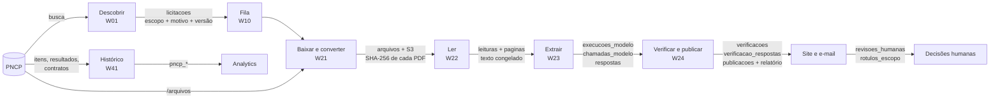

# Pipeline de dados

> [!abstract] Em uma frase
> O caminho de um dado do PNCP até a resposta publicada — **descobrir → baixar → converter → ler → extrair → verificar → publicar → revisar** —, com o que é gravado em cada etapa e a **impressão digital** (hash) que permite provar, depois, de onde veio cada resposta: o arquivo exato, o texto exato, o prompt exato, as regras exatas e o código exato.

## Papel na solução

Uma resposta só vale se puder ser reconstruída. Por isso cada etapa grava o que produziu **sem sobrescrever** a anterior, e cada artefato leva um hash. Esta nota é a linhagem dos dados; os fluxos que executam cada etapa estão em [[MOC Fluxos n8n]] e o desenho dos componentes em [[Arquitetura]].

## O caminho

## Etapa a etapa: o que entra, o que sai, o que fica

| Etapa | Entra | Transformação | Fica gravado | Impressão digital |
|---|---|---|---|---|
| **Descobrir** ([[W01 Descoberta]]) | resultados da busca do PNCP | deduplicação pelo número de controle; recorte de ano; regra de escopo; nota do Jev (objeto) | `licitacoes` (nova ou fora de escopo), `buscas_paginas`, `buscas` (cobertura), `sinais_jev`, `execucoes_workflow` | `escopo_versao` (hash da regra) |
| **Baixar** ([[W21 Baixar]]) | a lista `/arquivos` da compra | download de todos os documentos ativos; formato pelos bytes; conversão do que não é PDF; ZIP e RAR abertos | `arquivos` (status, formato real, pai) e o PDF no S3 | **SHA-256 de cada PDF** — é a própria chave do objeto |
| **Ler** ([[W22 Ler]]) | os PDFs | texto nativo por página; OCR onde falta texto; tarja de assinatura removida; varredura de texto escondido; nota do Jev com o edital | `leituras` (vigente), `paginas` (**texto congelado**), `furtivos_*`, `sinais_jev` | versão do OCR + SHA-256 do modelo de idioma; assinatura do conjunto (nomes + hashes dos arquivos) |
| **Extrair** ([[W23 Extrair]]) | as páginas congeladas | modo (contexto completo ou RAG); prompt montado pelo worker; 3 lotes; reforço do Best-of-N | `execucoes_modelo` (origem, modelo, custo), `chamadas_modelo` (**o envelope inteiro de cada resposta**), `respostas` (cruas) | `versao_prompt`; **SHA-256 de cada corpo enviado**; hash das respostas cruas |
| **Verificar** ([[W24 Verificar e publicar]]) | as respostas cruas + o texto congelado | ancoragem, regras de domínio, política da v3, condições | `verificacoes` (com a auditoria completa), `verificacao_respostas` | **`versao_regras`** (hash do código das regras) |
| **Publicar** | a verificação | torna vigente, gera o relatório HTML, enfileira o e-mail | `publicacoes`, o relatório no S3, `emails` | a imagem do worker (`git_sha`) |
| **Revisar** ([[Página Revisão]]) | a fila de revisão | decisão humana: aceitar, corrigir, rejeitar; rótulo de escopo | `revisoes_humanas`, `rotulos_escopo` | quem decidiu e quando |
| **Reverificar** ([[W30 Reverificar em lote]]) | respostas vigentes + texto congelado | regras novas | uma verificação nova, com o diff | nova `versao_regras` |

## As garantias de linhagem

1. **O texto contra o qual se verifica é o texto que o modelo leu.** As páginas ficam congeladas numa leitura; reverificar nunca refaz o OCR. Outra versão de OCR gera **outra** leitura, lado a lado.
2. **Nada da máquina é reescrito.** `licitacao_eventos`, `paginas`, `respostas`, `chamadas_modelo`, `verificacao_respostas` e `buscas` só recebem inserção; uma verificação nova não apaga a anterior.
3. **Cada resposta publicada é reconstruível:** o PDF (pelo hash), a página e o texto (pela leitura), o corpo exato enviado ao modelo (pelo hash do corpo) e a resposta crua (o envelope guardado), as regras (pela versão) e o código (pelo SHA do commit na imagem).
4. **O humano decide por cima, nunca por dentro:** revisões e rótulos são camadas próprias; o veredito da máquina continua gravado.
5. **Custo também é dado com linhagem:** cada chamada tem os tokens informados pelo provedor e o custo calculado na hora; o gasto do dia é a soma delas ([[Custo por edital]]).

## Os fluxos laterais

| Fluxo | Dado |
|---|---|
| [[W41 Histórico do PNCP]] | itens, resultados, cabeçalhos e contratos com aditivos → `pncp_*` → Analytics |
| [[W70 Retificações]] | documento novo no PNCP → a licitação volta a `retificada` e o caminho recomeça |
| [[W40 Alerta diário]] | os números do dia, registrados na execução |
| [[W50 Envio de e-mails]] | a fila `emails` → Resend |
| [[W00 Saúde]] | a medição de hora em hora → `saude` |

## Relacionadas

[[MOC Dados]] · [[Arquitetura]] · [[Ciclo de vida de uma licitação]] · [[Modelo de dados]] · [[Fontes de dados — PNCP]] · [[Armazenamento de arquivos (S3)]] · [[Verificador determinístico]] · [[Controles de consistência]]
