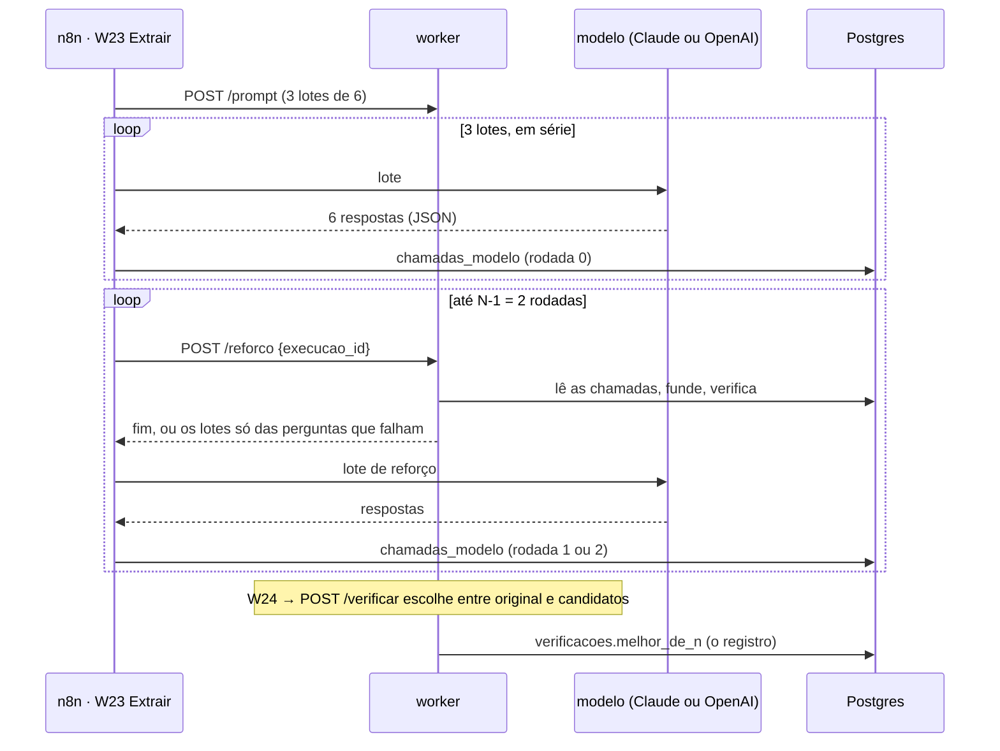

# Best-of-N

> [!abstract] Em uma frase
> Quando uma resposta **falha** no verificador (reprovada, ou "não localizado" numa pergunta que se aplica), a solução pede ao modelo **até mais duas tentativas só daquela pergunta** e fica com a melhor — e quem escolhe a melhor é o **verificador determinístico**, não outro modelo.

## Papel na solução

Best-of-N é uma técnica de **escala de computação na inferência**: gerar N candidatos e escolher pelo melhor sinal. O problema usual é a origem do sinal: quase toda implementação usa um modelo como juiz e herda a subjetividade dele. Aqui o juiz já existia e não é um modelo — é o [[Verificador determinístico]], que diz se o trecho citado existe na página citada, sem IA e a custo zero. Em termos de aprendizado por reforço, o verificador é um **modelo de recompensa de resultado** (ORM) determinístico: premia a resposta final, não os passos do raciocínio.

Como o reforço só é pedido para o que falhou, o custo marginal é pequeno: no estudo de 23/09/2026, 153 de 155 respostas já ancoravam na primeira tentativa.

## As regras

1. **Só reamostra o que falhou.** Falha é: resposta **REPROVADA** na ancoragem, ou **"não localizado" sem evidência** (sem trecho, arquivo nem página) numa pergunta que **se aplica** à modalidade. A ausência esperada — Q1, Q4 e Q6 em dispensa e inexigibilidade; Q4 e Q6 em credenciamento — não gasta reforço ([[Questionário — as 17 perguntas#Perguntas que não se aplicam a certas modalidades]]).
2. **No máximo N−1 rodadas.** Com `N = 3`, até **duas rodadas de reforço**. Cada rodada manda ao modelo só as perguntas que **ainda** falham, considerando o melhor candidato já obtido, com o mesmo contexto do lote original (a mesma seleção de páginas). O reforço para cedo quando não sobra falha: a rodada desnecessária não é paga.
3. **Quem escolhe é o verificador**, pela ordem do veredito:

| Pontos | Situação do candidato |
|---|---|
| **2** | ancorado — o trecho está na página citada |
| **1** | o trecho existe, mas em outra página: o verificador corrige a citação e manda para revisão |
| **0** | ausência declarada ("não localizado" sem evidência) |
| **−1** | reprovado — o trecho não foi encontrado, ou afirma número que a página não tem |

   Empate na pontuação é desempatado pela **similaridade** do trecho com a página citada (0 a 1, a mesma janela deslizante da ancoragem); empate persistente fica com o **original**.
4. **Um original que ancora nunca é trocado.** O Best-of-N não aprova nada que o verificador não aprovaria: ele só dá à resposta mais chances de mostrar a evidência.
5. **Silêncio não é resposta.** Se uma chamada de reforço falha, volta truncada ou volta sem a pergunta, ela **não gera candidato** — nunca vira um "não localizado" inventado que venceria uma original reprovada. A pergunta fica com o que já tinha, e o registro conta a tentativa como falha.

## Como roda em produção



- **O n8n chama o modelo; o worker decide.** O `POST /reforco` calcula a rodada seguinte a partir do banco (a maior gravada + 1 — o n8n não guarda estado), funde o que já veio, roda o verificador e devolve os lotes só das perguntas pendentes, ou `fim`.
- **Quando o worker devolve `fim`:** `N = 1` (desligado); as N−1 rodadas já foram feitas; não sobra falha; a execução é de importação do agente, de replay (`gravado`) ou do legado; ou o **gasto do dia já atingiu o teto** — nesse caso fica o original e a extração segue ([[Custo por edital]]).
- **Cada chamada extra** é uma linha de `chamadas_modelo` com `rodada` de 1 a N−1 (`db/050`). O custo entra no custo da execução e no gasto do dia.
- **A escolha acontece na fusão:** no [[W24 Verificar e publicar]], o `POST /verificar` trata as chamadas da rodada 0 como sempre e, para cada pergunta com candidatos, escolhe pelo `melhor_de_n` antes de verificar.
- **O registro** vai para `verificacoes.melhor_de_n` (nulo = execução sem Best-of-N). Exemplo do formato:

```json
{"n": 3, "rodadas": 1,
 "perguntas": {"Q7": {"tentativas": 2, "escolhida": 1, "falhas": 0,
                      "pontos": [[-1, 0.41], [2, 1.0]]}}}
```

`escolhida: 0` é o original; `pontos` traz `[pontuação, similaridade]` de cada tentativa.
- **Configuração:** `configuracao.melhor_de_n = 3` no [[Página Admin|Admin]]; `1` desliga.
- **No site:** toda pergunta que ganhou tentativas extras mostra a nota no cartão do [[Página Detalhe da licitação|detalhe]]: "escolhida a 2ª de 3 tentativas" quando um candidato do reforço venceu, ou "3 tentativas; prevaleceu a primeira" quando nenhum foi melhor que o original.

## Caso real — Itapecuru Mirim/MA (28/09/2026)

A extração pedida pelo botão "Extrair com IA" (Claude Haiku 4.5, contexto completo) fez **5 chamadas: 3 lotes e 2 rodadas de reforço**, por R$ 0,78 no total. Na Q11 (obrigações do banco vencedor), o detalhe registra **"escolhida a 2ª de 3 tentativas"** — e o veredito final continuou **REPROVADO**: nenhuma das três tentativas ancorou, e o desempate por similaridade escolheu a que chegou mais perto do texto da página. É o comportamento desenhado: o reforço dá chances, mas não transforma uma citação que não confere em aprovada. A pergunta foi para a fila de revisão humana, como toda reprovada.

### A mesma licitação com outro modelo

Depois, a mesma licitação foi extraída de novo pelo botão, com o GPT-6 Luna (esforço `medium`). O reforço disparou nas mesmas três perguntas nos dois modelos:

| Pergunta | Claude Haiku 4.5 (R$ 0,78) | GPT-6 Luna (R$ 0,20) |
|---|---|---|
| Q11 | reprovada nas 3 tentativas; ficou a de trecho mais parecido | reprovada na 1ª e na 2ª, **ancorada na 3ª** |
| Q12 | reprovada nas 3 tentativas; ficou a de trecho mais parecido | reprovada na 1ª, **ancorada na 2ª** |
| Q16 | "não localizado" nas 3 — ausência confirmada | "não localizado" nas 3 — ausência confirmada |

No Luna, o reforço levou a extração de **2 reprovadas para 0**: as 16 respostas respondidas ancoraram, e as duas rodadas de reforço custaram R$ 0,08 dos R$ 0,20. Foi também a primeira execução real do reforço pelo caminho da OpenAI, com todas as chamadas respondidas sem erro. No Haiku, as mesmas duas perguntas não ancoraram em nenhuma tentativa: **reamostrar não cria a evidência que o modelo não acha**.

> [!warning] Ancoragem não é acurácia
> Esta licitação não tem gabarito humano: o que se mede é se cada citação existe na página citada, não se a resposta está certa. E é n = 1 por modelo. No edital difícil com gabarito, Bertioga/SP, o GPT-6 Luna acertou 11 de 17 na medição do harness e, pelo botão com a v3.1, 14 e 13 de 17 em `medium` e 13 de 17 em `high` — abaixo dos 16 de 17 do Claude Opus 5.5; por isso o Claude continua como padrão ([[Modelos e provedores]]).

**Ancorada não quer dizer certa (Bertioga/SP, 28/09/2026).** Na extração 2709 do GPT-6 Luna, o reforço levou a Q13 — a pirâmide salarial — de reprovada a ancorada, mas a resposta escolhida continuou incompleta contra o gabarito. A Q17 foi reforçada nas três extrações do Luna e voltou com a mesma resposta nas três tentativas. O reforço corrige a citação; a acurácia se mede no gabarito ([[Comparação de modelos]]).

## O que foi medido

Medição de 28/09/2026 (`scripts/35_antes_depois.py`, R$ 23,79): Pirapó/RS em contexto completo e Bertioga/SP em RAG, no Claude Opus 5.5 e no GPT-5.6 Sol, com esforço `high`. "Antes" = uma tentativa; "depois" = Best-of-N com N = 3 mais a nova ordem do prompt.

**Oito respostas foram reforçadas nas quatro execuções — todas eram "Não localizado".** Cruzadas com o gabarito humano:

| Onde | Pergunta | Gabarito | Tentativas | O que ficou |
|---|---|---|---|---|
| Pirapó · Claude e GPT | Q15, Q16 | ausência real | 3 | a ausência, confirmada 3 vezes — **certa** |
| Pirapó · GPT | Q17 | exige "garantia" | 3 | "Não localizado" nas 3 — errada, como veio |
| Bertioga · Claude e GPT | Q17 | exige "garantia" | 3 | "Não localizado" nas 3 — errada em todas as execuções |
| Bertioga · GPT | **Q1** (crítica) | 21/09/2026, sessão suspensa | 2 | **recuperada na 2ª**: "21/09/2026 às 10h00 (abertura suspensa)", ancorada — **certa** |

- **4 ausências reais confirmadas**, **3 erros sistemáticos** (a mesma resposta nas 3 tentativas — a Q17 pede uma nuance, "não exige garantia, mas as penalidades a pressupõem", que reamostrar não produz) e **1 falha de amostragem recuperada**, numa pergunta crítica.
- **Nenhuma resposta piorou** — por construção, a original só é trocada por candidato de pontuação maior.
- **O custo do reforço depende do cache:** no Claude em contexto completo, as duas chamadas extras leem o documento do cache e saem quase de graça (a extração inteira ficou 32,5% mais barata que antes, com a nova ordem do prompt); no RAG não há o que ler do cache, e o reforço somou 7,2% no Claude ([[Cache de prompt e ordem do prompt]]).
- **n = 1 por configuração:** custo e tempo repetem em cerca de 1%; a acurácia, em ±1 resposta de 17 ([[Variância e como citar números]]).

## O que ficou de fora, e por quê

| Alternativa | Por que não |
|---|---|
| Um modelo como juiz dos candidatos | herdaria a subjetividade do juiz; o verificador é determinístico, gratuito e já decide a aprovação |
| Reamostrar as 17 perguntas | N vezes o custo para mexer no que já ancora |
| Best-of-N na importação do agente e no replay | a importação é de uma passada, e o replay não tem modelo a quem perguntar de novo |

## Relacionadas

[[MOC IA]] · [[Verificador determinístico]] · [[Chain-of-thought e esforço de raciocínio]] · [[Técnicas avaliadas e descartadas]] · [[Cache de prompt e ordem do prompt]] · [[W23 Extrair]] · [[W24 Verificar e publicar]] · [[Antes e depois da v3.1]] · [[ADR-024 Best-of-N e documentos antes das perguntas]] · [[Página Detalhe da licitação]]
