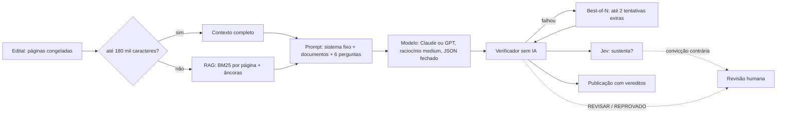

# MOC IA

> [!abstract] Em uma frase
> Onde e como a inteligência artificial entra na solução: um modelo generativo **responde** as 17 perguntas com citação obrigatória, um verificador **sem IA** confere cada citação, um classificador probabilístico dá **segundo sinal** sobre escopo e sustentação — e cada técnica usada tem a medição que a justificou.

## Papel na solução

A IA faz uma coisa só, e a faz sob controle: **ler editais longos e contraditórios e devolver respostas com evidência**. Tudo em volta — coleta, download, OCR, escopo, verificação, publicação — é determinístico, auditável e de custo zero em modelo. A divisão é o desenho: **o modelo gera, o código confere, a pessoa decide** o que ficou em dúvida ([[ADR-004 Evidência obrigatória]]).

## Onde a IA atua — e onde não atua

| Etapa | O que faz | Técnica | Quem | Decide? |
|---|---|---|---|---|
| Escopo (é folha?) | separa compra de folha do ruído da busca | regras de vocabulário | código | **sim** |
| Escopo, segunda opinião | nota de 0 a 1, com o objeto e depois com o edital | classificação probabilística | Jev | não — sinal; trava só com convicção e depois de ler o edital |
| Leitura | texto de cada página, OCR onde é imagem | Tesseract local | código | — |
| **Extração** | responde as 17 perguntas com arquivo, página e trecho literal | LLM + RAG/contexto completo + raciocínio + saída estruturada + cache | Claude ou GPT | não — gera |
| Reforço | novas tentativas só do que falhou | Best-of-N | o mesmo modelo | não — o verificador escolhe |
| **Verificação** | confere cada trecho na página e aplica as regras de domínio | comparação de texto e aritmética | código | **sim** — veredito |
| Sustentação | o trecho responde mesmo à pergunta? | classificação probabilística | Jev | não — abre revisão |
| Revisão | aceita, corrige ou rejeita o que ficou em dúvida | — | pessoa | **sim** |

## As notas

| Nota | O que responde |
|---|---|
| [[Questionário — as 17 perguntas]] | o que se pergunta, o formato, as 7 críticas, o que não se aplica por modalidade, os termos de recuperação |
| [[Prompt do extrator]] | o que o modelo recebe: as nove regras, a estrutura da chamada, os lotes, os corpos para cada provedor |
| [[RAG com BM25]] | quando o modelo lê tudo e quando lê só as páginas recuperadas; por que BM25 e não embeddings; por que não fine-tuning |
| [[Chain-of-thought e esforço de raciocínio]] | por que o modelo raciocina, quanto isso custa e por que o esforço é fixo em `medium` |
| [[Best-of-N]] | as tentativas extras só do que falhou, escolhidas pelo verificador |
| [[Cache de prompt e ordem do prompt]] | documentos antes das perguntas: −32,5% no Claude |
| [[Modelos e provedores]] | o catálogo, a configuração de produção, Claude × OpenAI, as outras origens de resposta |
| [[Verificador determinístico]] | a ancoragem, a guarda numérica, as regras de domínio, a política da v3, a reverificação a custo zero |
| [[Regras antes de IA]] | o filtro de escopo passo a passo, a camada de ajuste, o rótulo humano, a trava |
| [[Jev — score de escopo e sustentação]] | o segundo sinal: escopo e "sustenta?", os limiares e a configuração medida |
| [[Consciência operacional]] | as condições da leitura declaradas a partir de fatos, não da confiança do modelo |
| [[Custo por edital]] | quanto custa, como é calculado, o teto do dia, a fatura |
| [[Técnicas avaliadas e descartadas]] | o que entrou, o que ficou de fora e por quê |

## Os números que resumem a família

| Medida | Valor |
|---|---|
| Respostas com o trecho conferido na página citada — Histórico, produção | **99,96%** (25.114 de 25.122) |
| Acurácia contra gabarito humano — Claude, edital difícil (Bertioga/SP, RAG) | **17/17**, 7/7 críticas |
| Custo de uma extração — Claude Opus 5.5, contexto completo, v3.1 | **R$ 2,50** (Pirapó/RS, 38 páginas) |
| Economia do cache com os documentos antes das perguntas — Claude | **−32,5%** |
| Economia do RAG no mesmo edital, mesma acurácia | **−36%** de custo |
| Best-of-N: respostas pioradas | **0** de 8 reforçadas |

Os detalhes, a variância e o jeito certo de citar cada número estão na família [[MOC Avaliação]].

## Relacionadas

[[Home]] · [[Arquitetura]] · [[MOC Fluxos n8n]] · [[W23 Extrair]] · [[W24 Verificar e publicar]] · [[MOC Avaliação]] · [[MOC Decisões]] · [[Injeção de prompt e defesas]] · [[ADR-004 Evidência obrigatória]]
