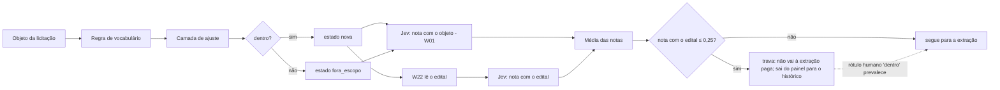

# Regras antes de IA

> [!abstract] Em uma frase
> Decidir se uma licitação é **compra de folha** é feito primeiro por **regras de vocabulário** — custo zero, determinísticas, com o motivo escrito —, depois por uma camada de exclusões medidas; o Jev dá uma segunda opinião em probabilidade que **nunca decide**, o rótulo humano prevalece na tela, e só o que passa por esse portão chega à extração paga.

## Papel na solução

É o portão mais barato do pipeline e o mais caro de errar. Um falso positivo custa uma extração inteira e volta com metade das perguntas em branco (Rio Azul/PR, uma terceirização de consignado, custou uma extração e voltou com 6 de 17 vazias); um falso negativo perde uma licitação de folha em silêncio. E a busca do PNCP é ruidosa: em 24/09/2026, o termo "folha de pagamento instituição financeira" declarava 1.895 resultados, cheios de software de RH, consignado e tarifa bancária.

**Regras antes de IA** ([[ADR-003 Classificação por regras antes de IA]]): a IA só opina sobre o que as regras não resolvem bem, e toda decisão — inclusive o descarte — registra o motivo e a versão da regra.

## A distinção que organiza a regra

Numa **cessão de folha**, o município **recebe** dinheiro de um banco pelo direito de pagar os servidores. Numa **terceirização em volta da folha** (sistema, consultoria, consignado, tarifa), o município **paga** uma empresa. São fluxos financeiros opostos, e o objeto quase sempre denuncia qual é pelo que contrata. O discriminador certo não é **quem** se contrata, é **o que** se contrata: operar a folha, ou vender um serviço em volta dela ([[Escopo — o que é licitação de folha]]).

## A regra, passo a passo

`escopo.avaliar(objeto)` devolve `(dentro, motivo)`. A ordem é o desenho:

| # | Passo | Resultado | Motivo gravado |
|---|---|---|---|
| 0 | **Só o objeto:** se o órgão colou a justificativa no mesmo campo ("JUSTIFICATIVA:", "Estudo Técnico Preliminar:"), corta nela — desde que o que sobra tenha ao menos 60 caracteres | — | — |
| 1 | **Fala de folha?** "folha de pagamento/salário/servidores/remuneração/vencimentos/proventos/benefícios" (com plural, número no meio e o texto que o PNCP corta, "FOLHA DE PAGAMEN"), a folha descrita sem a palavra ("pagamento de remuneração … dos servidores"), a operação da folha, ou "pagamento dos servidores" com um banco contratado | se não: **fora** | "não é sobre folha de pagamento" |
| 2 | **Sistema ou software** (licença de uso, plataforma, migração de dados, backup, "cessão de sistema"), salvo quando o objeto **abre** contratando instituição financeira para operar a folha | **fora** | "sistema ou plataforma que opera sobre a folha" |
| 3 | **Serviço sobre a folha** (consultoria, auditoria, contabilidade, curso, estudo de viabilidade, ponto eletrônico, programa de estágio, RH terceirizado) | **fora** | "serviço SOBRE a folha (consultoria, contabilidade, curso, estudo)" |
| 4 | **Serviço bancário pago pelo órgão** (pagamento de tarifas, envio e retorno de arquivos, conta institucional), salvo cessão onerosa | **fora** | "serviço bancário pago pelo órgão (tarifas, arquivos, conta), não compra da folha" |
| 5 | **Consignado** (margem, averbação, empréstimo pessoal, compra de dívida) sem sinal de operação da folha | **fora** | "consignado ou margem consignável, não a folha em si" |
| 6 | **Cessão onerosa** do direito de pagar a folha | **dentro** | "cessão onerosa do direito de pagar a folha" |
| 7 | **Operação da folha** (pagamento, gestão, processamento, créditos provenientes da folha, conta-salário, "operar, com exclusividade, a folha") | **dentro** | "contrata a operação da folha (pagamento, gestão, créditos)" |
| 8 | **Contrata instituição financeira** e nada indica consignado | **dentro** | "contrata instituição financeira, e nada indica consignado" |
| 9 | **Objeto curto demais** (menos de 60 caracteres, como "CONTRATAÇÃO DE INSTITUIÇÃO FINANCEIRA.") | **dentro** | "objeto curto demais para decidir — passa para revisão" |
| 10 | nenhum dos anteriores | **fora** | "fala de folha, mas não é a operação dela" |

- **Por que as exclusões vêm antes das inclusões:** um edital de sistema quase sempre descreve "gestão da folha", o que acionaria o sinal de operação. A primeira versão perguntava "empresa ou instituição financeira?" e descartava Carapicuíba/SP — *"prestação de serviço de pagamento de folha de salário dos servidores"* —, que é exatamente a operação procurada.
- **Por que objeto curto passa:** o erro barato é passar (custa uma extração, e o verificador sinaliza as lacunas); descartar custa uma licitação.
- **Cada padrão tem o caso real que o criou**, registrado no próprio código: Vinhedo/SP (plural), Vacaria/RS (número no meio), Camaçari/BA e Campo Belo do Sul/SC (folha sem a palavra), Maravilhas/MG (pagamento dos servidores), Uberlândia/MG e Mangaratiba/RJ (credenciamento de consignado), Ronda Alta/RS (relógio de ponto com a justificativa citando a folha).

## A camada de ajuste

Uma segunda camada (`api/escopo_ajuste.py`, versão `ajuste-1`) roda **depois** da regra e **só pode tirar** do escopo — nunca pôr para dentro. Cada exclusão tem nome, e o nome vira o motivo gravado ("fora (ajuste-1: sistema ou TI de folha) — a regra dizia: …").

| Tipo | Exclusões |
|---|---|
| **Duras** (valem sempre — frases que folha de banco não diz) | objeto que começa com "despesas com tarifas bancárias"; "exceto folha"; termo de fomento ou parceria (Lei 13.019); locação de imóvel; recrutamento ou temporários; recuperação de imposto; estudo técnico sobre a folha |
| **Brandas** (não valem se houver qualquer sinal de folha de banco: instituição financeira, cessão onerosa, exclusividade, pagamento da folha, créditos da folha, credenciamento de instituição) | estudo ou consultoria; obra ou manutenção predial ("folhas de brasilit"); compra de bens; sistema ou TI de folha; serviço de RH ou contábil; apoio a APAE ou associação; evento ou curso; pesquisa e desenvolvimento; só o canal de consignações |

Os padrões vieram dos rótulos humanos "fora" em que a regra dizia "dentro" e dos casos em que o Jev recusava com convicção. **Medida antes de entrar:** a primeira versão, mais dura, tiraria 12 folhas já publicadas; a que entrou não tira nenhuma — tirou 85 licitações, pegando 27 dos 28 rótulos humanos "fora" e 53 dos 57 casos do Jev.

## Versão e reavaliação

- A **`escopo_versao`** é o SHA-256 de `escopo.py` + `escopo_ajuste.py`; toda decisão gravada (`licitacoes.escopo_dentro`, `escopo_motivo`) cita a versão. Em produção: `5700476d5b8c…` ([[Página Saúde]]).
- Quando a regra muda, `POST /escopo/reavaliar` reaplica a regra de hoje ao que foi julgado por outra versão — primeiro em modo **seco**, que só conta, depois de verdade. O que ainda não tem evidência e saiu do escopo vai para `fora_escopo`; o que a regra voltou a aceitar recomeça em `nova`; o publicado só troca a marca ([[Ciclo de vida de uma licitação]]).
- A mesma função (`escopo_ajuste.avaliar`) é usada nos quatro lugares onde a regra decide: o `POST /escopo` do [[W01 Descoberta]], a reavaliação do acervo, a descoberta histórica e a "regra" contra a qual o Jev discorda.

## O que vem depois da regra

| Camada | Quem | Pode decidir? | Efeito |
|---|---|---|---|
| Regra + ajuste | código determinístico | **sim** | grava `escopo_dentro` e o motivo |
| Jev (objeto, no W01; objeto + páginas do edital, no W22) | classificador TypeSafe | **não** — é sinal | nota de 0 a 1 na tela; discordância convicta vira candidata na aba Escopo da [[Página Revisão]] ([[Jev — score de escopo e sustentação]]) |
| Trava da IA | função do banco sobre a nota **com o edital** | só **para** a extração paga | nota ≤ 0,25 **depois de ler o edital** tira a licitação da fila e do painel e a manda ao histórico; a nota só com o objeto nunca trava, porque barraria credenciamentos legítimos antes de a IA ver o edital |
| Rótulo humano | administrador, na aba Escopo | **sim**, na tela | o rótulo mais recente prevalece sobre a regra e sobre a IA (`fn_escopo_efetivo`); a regra continua gravada e intocada; rotular de novo desfaz |
| Recorte de 2026 | `configuracao.ano_minimo` | **sim** | fora do recorte não entra no painel nem na fila ([[Escopo — o que é licitação de folha]]) |

Nada é apagado em nenhuma camada: a licitação recusada fica no banco com o motivo, e qualquer camada posterior pode ser revista.

## O que foi medido

- **O score do filtro no acervo** (24/09/2026, 1.162 licitações do recorte): na primeira passada, 146 discordâncias entre regra e Jev, 75 com convicção. Lidas uma a uma, nas 21 em que a regra recusava e o Jev dizia "folha", o Jev tinha razão em 20 — compras de folha que a regra perdia por redação ("operar, com exclusividade, a folha", "pagamento dos servidores" sem a palavra folha, o texto cortado pelo PNCP). Depois de corrigir a regra (22 compras recuperadas, 3 serviços excluídos) e o critério do Jev:

| Medida | Antes | Depois |
|---|---|---|
| discordâncias regra × Jev | 146 | 19 |
| discordâncias convictas (candidatas) | 75 | **2** |
| probabilidade média de o filtro estar certo, segundo o Jev | 0,83 | **0,91** |

  Custo de todos os sinais de escopo dessa medição: US$ 0,057. O Jev não decidiu nada, mas apontou onde a regra errava — e cada erro virou caso de teste.
- **Em produção (28/09/2026):** no Painel, "Não reconhecidas como folha pela IA: 0 de 76" (nota média 92%); no Histórico, 0 de 2.015 (nota média 93%); na aba Escopo, 1 candidata pendente e 281 licitações já rotuladas por humanos.

## Por que não IA para tudo

| Alternativa | Por que não |
|---|---|
| IA para classificar tudo | caro, não determinístico, e descarte sem motivo auditável |
| Só regras, sem IA | não resolve objeto genérico nem aponta os próprios pontos cegos |
| Classificador treinado | não há volume rotulado independente: os rótulos disponíveis vêm, em boa parte, do próprio filtro — treinar neles imitaria o filtro, erros incluídos ([[Técnicas avaliadas e descartadas]]) |

## Relacionadas

[[MOC IA]] · [[Escopo — o que é licitação de folha]] · [[Jev — score de escopo e sustentação]] · [[W01 Descoberta]] · [[W22 Ler]] · [[Página Revisão]] · [[Ciclo de vida de uma licitação]] · [[Funções e views do banco]] · [[ADR-003 Classificação por regras antes de IA]] · [[ADR-015 Acervo só de 2026 e só compra de folha]] · [[ADR-019 O site mostra só o que a IA confirma como folha]]
