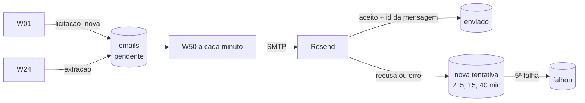

# E-mails do produto

> [!abstract] Em uma frase
> A solução manda **dois e-mails**, pelo **Resend** e com o remetente **avisos@licitacaofopa.com.br**: o aviso de **licitação nova de folha** (para os administradores, minutos depois da descoberta) e o resultado de uma **extração pedida** (para quem clicou, com as 17 respostas e o link para cada página citada); os fluxos só enfileiram, e um único fluxo envia, com nova tentativa e confirmação do servidor.

## Papel na solução

O e-mail é a parte do produto que chega a quem não está com o site aberto — e resolve o problema de tempo do negócio: a licitação nova avisa no dia em que foi achada, não dias depois ([[Problema de negócio]]). Por isso são poucos e acionáveis ([[ADR-016 O produto manda só dois e-mails]]).

## Os dois e-mails

### 1. Licitação nova (`licitacao_nova`)

| Item | Conteúdo |
|---|---|
| quem enfileira | [[W01 Descoberta]], para cada licitação que a rodada **inseriu** como nova (no escopo e na janela); nunca na rodada seca |
| para quem | os administradores ativos |
| assunto | "[FOPA] Licitação nova de folha: <município>/<UF> · <modalidade>" |
| corpo | local e órgão; modalidade e **prazo** (dia e hora em Brasília); o objeto (até 600 caracteres); "Abrir no site" (o detalhe da licitação) e o link do PNCP; o número de controle e a data em que foi encontrada |

### 2. Extração pronta (`extracao`)

| Item | Conteúdo |
|---|---|
| quem enfileira | [[W24 Verificar e publicar]], só quando a execução nasceu de um pedido do botão **"Extrair com IA"** — uma vez por verificação |
| para quem | quem clicou |
| assunto | "[FOPA] Processada: <município>/<UF> · N/M ancoradas · R$ X" |
| corpo | as contagens (aprovadas, revisar, reprovadas), o **custo** ("n/d" quando o preço não é conhecido), alertas e tags, e a **tabela das 17 respostas** — pergunta (crítica marcada com `*`), veredito colorido, resposta e o link "arquivo p. N" que **abre o PDF na página citada** |

A fila automática, a importação do agente e a reverificação em lote **não** mandam e-mail.

## Como o envio funciona

- **Só o [[W50 Envio de e-mails]] fala com o servidor de e-mail.** Uma queda do SMTP nunca derruba uma descoberta ou uma extração.
- **Até 20 por minuto**, um por vez.
- **Enviado só com aceite:** a linha só vira `enviado` quando o servidor devolve o destinatário na lista de aceitos e o identificador da mensagem.
- **Falha não é definitiva na primeira:** novas tentativas depois de 2, 5, 15 e 40 minutos; `falhou` na 5ª, com o motivo gravado.
- **O banco só aceita os dois tipos** (restrição da tabela): um fluxo que tentasse outro aviso falharia na hora.

## O provedor e o domínio de envio

| Item | Configuração |
|---|---|
| provedor | **Resend**, por SMTP (porta 587 com STARTTLS), domínio configurado na região São Paulo, TLS obrigatório |
| remetente | `FOPA <avisos@licitacaofopa.com.br>` |
| credencial | uma chave com permissão **só de envio**, restrita ao domínio, guardada na credencial `smtp` do n8n |
| autenticação do domínio | **DKIM** (chave pública em `resend._domainkey`), **SPF/Return-Path** num subdomínio de envio, **DMARC em quarentena**; a raiz do domínio declara que não envia e-mail (`v=spf1 -all`) — ninguém consegue se passar pelo domínio |
| rastreamento | de abertura e de clique **desligado** — ele reescreveria os links do e-mail da extração, que apontam para as páginas do PDF |
| limites do plano | 3.000 e-mails por mês e 100 por dia — muito acima do volume de dois tipos de e-mail |

## Onde acompanhar

A [[Página E-mails]] (administradores) mostra a fila: tipo, destinatário, assunto, status, tentativas e o erro, com o corpo para conferência.

## Caso real (28/09/2026)

Itapecuru Mirim/MA: o `licitacao_nova` saiu às **06:04**, quatro minutos depois da rodada das 06:00; o `extracao` saiu às **10:25**, um minuto depois da publicação, para quem pediu a extração ("[FOPA] Processada: Itapecuru Mirim/MA · 9/16 ancoradas · R$ 0,78").

## Relacionadas

[[MOC Infra]] · [[W50 Envio de e-mails]] · [[W01 Descoberta]] · [[W24 Verificar e publicar]] · [[Página E-mails]] · [[Domínio, DNS e HTTPS]] · [[ADR-016 O produto manda só dois e-mails]]
