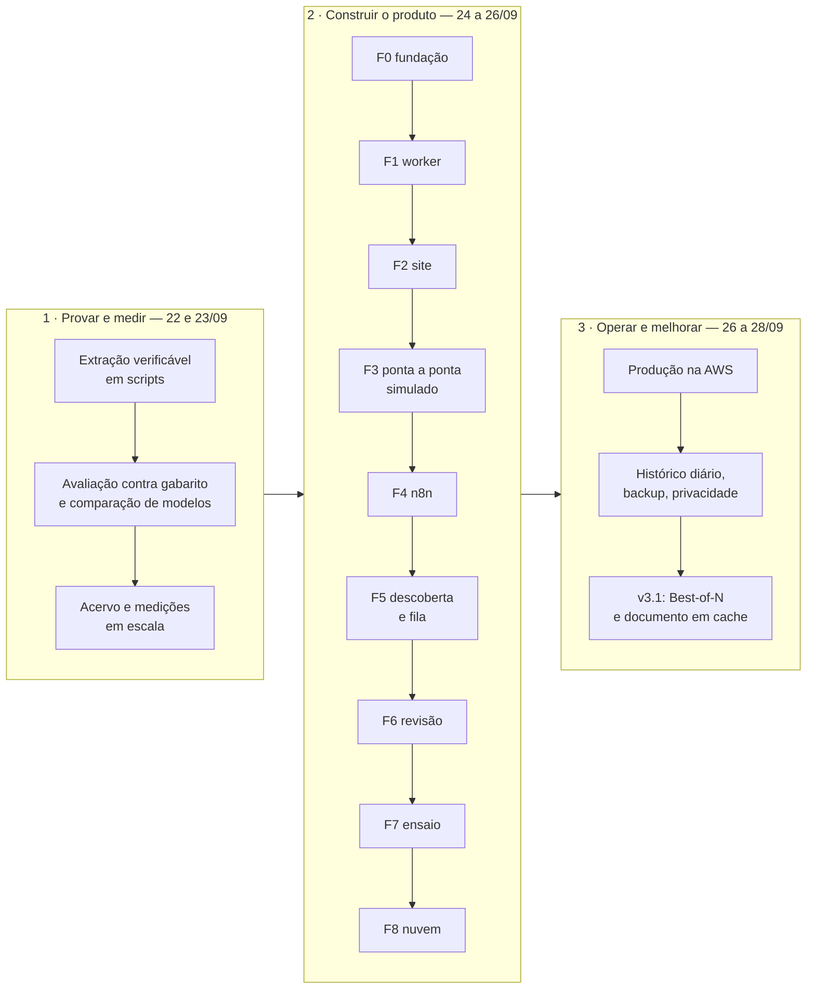

# Linha do tempo da construção

> [!abstract] Em uma frase
> A solução foi construída em **sete dias** — de 22 a 28/09/2026, em 573 commits — em três etapas: **provar e medir** a extração verificável em scripts; **transformar em produto**, seguindo um plano de implementação em nove fases (F0 a F8), cada uma com entrega e prova de pronto; e **operar e melhorar** em produção, onde a v3.1 entrou no ar em 28/09/2026, às 07:58, com a melhoria medida antes de ser publicada.

## Papel na solução

É o plano de implementação **executado**: a ordem em que as peças foram construídas, por que nessa ordem e como cada fase provou que estava pronta. Mostra também de onde vieram as decisões — boa parte das ADRs nasceu de um número que contrariou uma suposição ([[MOC Decisões]]).

## As três etapas

## Etapa 1 — Provar e medir (22 e 23/09)

A primeira pergunta não era "dá para automatizar?", e sim "dá para **confiar**?". Esta etapa construiu a extração com prova e mediu tudo o que ela afirmava — ainda em scripts, gravando em pastas e arquivos JSON (o acervo que depois foi importado para o banco, [[Acervo e migração da v2]]).

| Data | Marco | Onde está hoje |
|---|---|---|
| 22/09 | a primeira versão funcional: o modelo responde com arquivo, página e trecho literal, e um verificador sem IA confere | [[Verificador determinístico]], [[ADR-004 Evidência obrigatória]] |
| 22/09 | o harness de avaliação contra gabarito humano, a comparação justa entre modelos e as três alavancas de custo medidas | [[Harness de avaliação]], [[Comparação de modelos]] |
| 22/09 | as primeiras decisões fechadas com números: modelo de extração, RAG × contexto completo, regra que sabe quando falhou em ler | [[ADR-009 Modelo de extração]], [[ADR-010 RAG vs contexto completo]], [[ADR-011 Uma regra precisa saber quando falhou em ler]] |
| 22/09 | a bateria adversarial de injeção, o recall da recuperação, o segundo gabarito e a variância com n = 3 | [[Injeção de prompt e defesas]], [[RAG com BM25]], [[Gabaritos]], [[Variância e como citar números]] |
| 23/09 | o segundo provedor de modelo como plano B, o custo real conferido na fatura e o placar de seis modelos | [[ADR-012 Segundo provedor de modelo]], [[Custo por edital]] |
| 23/09 | o detector de texto escondido no PDF, a LGPD e a LAI, a legalidade da coleta | [[Injeção de prompt e defesas]], [[Privacidade e LGPD]], [[Legalidade da automação]] |
| 23/09 | o acervo em escala (255 licitações e 1.004 PDFs ao fim do dia), o OCR medido em 324 PDFs e a identidade pelo número de controle | [[ADR-013 Identidade de licitação é o número de controle]], [[ADR-008 OCR — stack, configuração e limites]] |
| 23/09 | a cobertura medida: municípios dispensados do PNCP, diários oficiais, plataformas de pregão, estatais | [[ADR-007 Cobertura de municípios pequenos]], [[Lei 13.303-2016 - estatais]] |
| 23/09 | a fumaça — um teste que prova as garantias do verificador sem chamar modelo — e o cruzamento com o campo estruturado do PNCP | [[Testes e CI]], [[Verificador determinístico]] |

## Etapa 2 — Construir o produto (24 a 26/09): o plano em nove fases

O plano transformou os scripts num produto — o n8n na orquestração, o worker em Python, o Postgres com a máquina de estados, o site com login — **sem mudar um veredito** do que já tinha sido medido. Cada fase tinha um checklist com a entrega e **como se prova**; uma fase só era marcada com a prova ao lado.

| Fase | Objetivo | Prova de pronto | Quando |
|---|---|---|---|
| **F0 — Congelar e fundar** | congelar o código de extração e o acervo; subir a composição, o banco e a imagem com o Tesseract 5.4.0 | a infraestrutura sobe; o `/health` confere a versão do OCR e a ausência de chave; o *build* falha, de propósito, com um sha256 errado | 24/09 |
| **F1 — Worker e importador** | expor por HTTP o que o código já fazia (escopo, leitura, prompt, verificação, relatório) e trazer o acervo para o banco sem reprocessar | importação em uma transação, com manifesto de hashes e relatório de reconciliação | 24/09 |
| **F2 — Site e Google** | o site React com login Google lendo do Postgres | um produto navegável, ainda sem n8n | 24/09 |
| **F3 — Ponta a ponta simulado** | o caminho baixar → ler → prompt → modelo → custo → verificar → relatório com provedor simulado, a R$ 0 e sem chave em lugar nenhum | 20 processamentos simulados com gasto do dia de R$ 0; resultado de ensaio nunca vira oficial | 24/09 |
| **F4 — n8n** | o n8n na frente do worker: o clique no site vira uma execução visível no canvas | o núcleo W20–W24 e o W11 provados na instância real, sem *mock* | 24/09 |
| **F5 — Descoberta e fila** | achar licitação nova sozinho, enfileirar com trava e *backoff* no banco, detectar retificação | W01, W10 e W70 testados na instância; uma rajada de pedidos nunca passa de 4 extrações | 24/09 |
| **F6 — Alerta, revisão e reverificação** | fechar o laço humano: fila de revisão com decisões e reverificação em lote sem apagar procedência | o W30 e a republicação do W24 testados | 24/09 |
| **F7 — Ensaio** | preparar a extração paga com teto de gasto e a demonstração em três variantes (com rede, sem PNCP, sem rede) | reserva de licitações para demonstração, login local, backup restaurado num banco efêmero, e o caminho "sem PNCP" provado (a reservada vai do W20 direto ao W23) | 24/09 |
| **F8 — Nuvem** | a mesma composição num servidor com HTTPS, S3 e login Google público | no ar em 26/09, com o mesmo `/health` da máquina local | 26/09 |

Entre e depois das fases, o produto ganhou o que as medições e o uso pediram:

| Data | Marco | Onde está hoje |
|---|---|---|
| 24/09 | "Não localizado" sempre vai para revisão; o RAG com 12 páginas por pergunta; o histórico de compra e venda do PNCP e o Analytics | [[Verificador determinístico]], [[RAG com BM25]], [[Página Analytics de Mercado]] |
| 24/09 | a injeção suspeita marcada; o Jev em toda resposta com trecho; o rótulo humano de escopo prevalecendo | [[Injeção de prompt e defesas]], [[Jev — score de escopo e sustentação]] |
| 25/09 | o acervo de 2026 extraído sem API, por agente, e conferido pelo mesmo verificador | [[ADR-014 Extração por agente, sem API]], [[ADR-015 Acervo só de 2026 e só compra de folha]] |
| 25/09 | o arquivo que não é PDF vira PDF; a licitação de folha pega todos os arquivos; o site mostra só o que a IA confirma como folha | [[ADR-017 O arquivo que não é PDF vira PDF]], [[ADR-018 Licitação de folha pega todos os arquivos]], [[ADR-019 O site mostra só o que a IA confirma como folha]] |
| 26/09 | OCR forçado e rotação por arquivo; o esforço fixo e o Claude Opus 5.5; os papéis de acesso; o Analytics em duas páginas | [[ADR-020 Esforço fixo e Claude Opus 5.5 no extrator]], [[ADR-021 Quem vê o quê — usuário, operador, admin e admin supremo]] |
| 26/09 | o envio de e-mail ligado; a produção na AWS, em São Paulo | [[E-mails do produto]], [[ADR-022 Produção na AWS, em São Paulo, numa máquina pequena]] |

## Etapa 3 — Operar e melhorar (27 e 28/09)

| Data | Marco | Onde está hoje |
|---|---|---|
| 27/09 | o histórico e os contratos do PNCP todo dia; o que cada instituição financeira comprou; a gestão de usuários | [[ADR-023 O histórico e os contratos do PNCP todo dia]], [[W41 Histórico do PNCP]], [[Página Admin]] |
| 28/09 | a página pública de privacidade e o login Google aberto a qualquer conta | [[Página Privacidade]], [[Login com Google]] |
| 28/09 | os jobs órfãos declarados no arranque do worker; o OCR de referência medido no servidor, reproduzindo a imagem local | [[Worker — visão geral e jobs]], [[OCR]] |
| 28/09 | o backup diário com cópia no S3 e verificação semanal; o ponto de restauração da produção; o `User-Agent` com contato nas chamadas ao PNCP | [[Backup e restauração]], [[Legalidade da automação]] |
| 28/09 | **v3.1**: documentos antes das perguntas, com o documento em cache; Best-of-N nas respostas que falham; medição antes e depois; **no ar às 07:58** | [[ADR-024 Best-of-N e documentos antes das perguntas]], [[Antes e depois da v3.1]] |

## O ritmo

| Dia | Commits | Foco |
|---|---|---|
| 22/09 | 21 | extração verificável, avaliação, primeiras decisões |
| 23/09 | 234 | medições em escala, segundo provedor, cobertura, legalidade |
| 24/09 | 172 | o produto: fases F0 a F7 |
| 25/09 | 48 | extração do acervo de 2026, fluxo de exceção, site enxuto |
| 26/09 | 28 | papéis, esforço fixo, produção na AWS |
| 27/09 | 22 | histórico diário do PNCP, Analytics por instituição |
| 28/09 | 48 | privacidade, backup fora da máquina, v3.1 |

## O que a ordem garantiu

1. **Medir antes de construir.** A etapa 1 decidiu modelo, técnica de recuperação, política de revisão e fonte de dados com números; a etapa 2 transportou o que estava provado.
2. **O simulado antes do pago.** A F3 provou o caminho inteiro a R$ 0 e sem chave; no produto, chamada paga só existe sob o teto de gasto do banco ([[Funções e views do banco]]).
3. **Medir a melhoria antes de publicá-la.** A v3.1 foi comparada com o comportamento anterior — a ordem antiga do prompt continua reproduzível byte a byte — e a troca teve ponto de restauração ([[Deploy e atualização]]).

## Relacionadas

[[MOC Evolução]] · [[Desafios enfrentados]] · [[Próximos passos]] · [[MOC Decisões]] · [[Decisões de construção da v3]] · [[Resultados medidos]]
