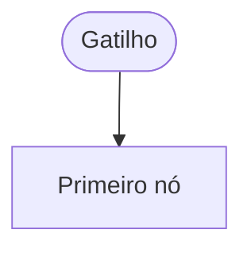

# {{title}}

> [!abstract] Em uma frase
> <!-- o que o fluxo faz, quando e para quem, numa frase -->

## Papel na solução

<!-- que dor ele resolve e onde está no caminho de uma licitação -->

## Quando roda

| Gatilho | Quando | Modo | O que muda |
|---|---|---|---|
|  |  |  |  |

## Entradas, saídas e dependências

| | |
|---|---|
| **Lê** |  |
| **Escreve** |  |
| **Chama** |  |
| **Em caso de erro** |  |
| **Custo** |  |

## Fluxograma

## Passo a passo — os N nós

<!-- um bloco por nó, na ordem de execução: tipo, o que faz, entrada, saída, condição, erro e por que existe; o número de passos é igual ao número de nós do JSON -->

#### Passo 1 — 
- **Tipo:** 
- **O que faz:** 

## Tratamento de erros, em resumo

| Falha | O que acontece | Onde aparece |
|---|---|---|
|  |  |  |

## Caso real

<!-- uma licitação real passando pelo fluxo, com data, hora e números -->

## Relacionadas

[[MOC Fluxos n8n]] · [[Horários e agendamentos]]
