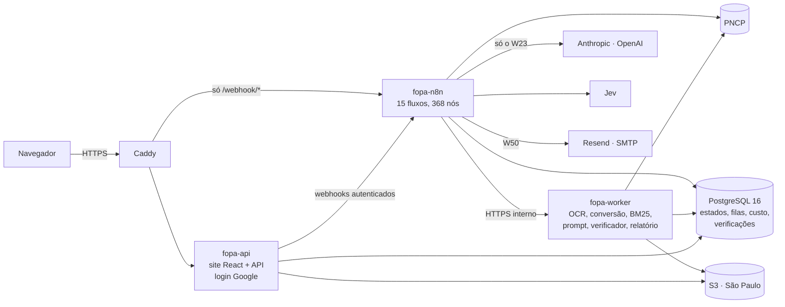

# FOPA — licitações de folha de pagamento pública, lidas e verificadas página a página

**No ar:** https://licitacaofopa.com.br · **Versão:** v3.1 (em produção desde 28/09/2026) · **Documentação completa:** o vault Obsidian em [`Fopa-v3/`](<Fopa-v3/00-Entrada/Home.md>)

O **FOPA** é uma solução de IA generativa que acompanha, para um banco, as licitações em que prefeituras, estados e outros órgãos públicos vendem o direito de processar a **folha de pagamento** dos seus servidores. Toda manhã ele descobre as licitações novas no PNCP, baixa e lê todos os documentos, responde as **17 perguntas** que decidem o lance com **arquivo, página e trecho literal**, confere cada resposta com um **verificador sem IA**, publica tudo num site com revisão humana e mostra quem compra folha no país, por quanto e até quando.

Case **Engenheiro de IA — Academia Santander**, tema *Automação e Extração de Conhecimento*.

---

## O problema

> Informado pelo banco: o banco investe cerca de **R$ 1,05 bilhão por ano** na compra de folhas; uma área de **26 pessoas** lê editais e anexos que se contradizem; um fornecedor terceirizado, por cerca de **R$ 100 mil por ano**, entrega o PDF por e-mail em **D+3** da publicação; a regra interna dá **5 dias** para atacar a folha — sobram **2**; e os concorrentes leem a API pública do PNCP diretamente, muitas vezes antes da data oficial de publicação.

A solução troca o fornecedor pela fonte oficial, entrega a informação na manhã da descoberta e transforma a leitura do edital em conferência de uma fila curta, com a evidência na mão. Detalhes em [Problema de negócio](<Fopa-v3/01-Negocio/Problema de negócio.md>) e [Ganho para o negócio](<Fopa-v3/01-Negocio/Ganho para o negócio.md>).

## O que a solução faz

| # | Passo | Como |
|---|---|---|
| 1 | **Descobrir** | busca no PNCP às 06:00 de cada dia útil; regra de escopo antes de IA, com um segundo sinal probabilístico (Jev); e-mail das novas |
| 2 | **Baixar e ler** | todos os documentos; o que não é PDF vira PDF; texto por página com OCR local (Tesseract 5.4.0); texto escondido detectado |
| 3 | **Extrair** | Claude Opus 5.5 responde as 17 perguntas em 3 lotes, lendo o documento inteiro ou as páginas recuperadas por BM25; o documento vai em cache; o que falha ganha até duas tentativas extras (Best-of-N) |
| 4 | **Verificar** | o trecho citado precisa existir na página citada, com os números exatos; regras conferem pirâmide, totais, objeto, lacunas e o registro do PNCP — **sem IA** |
| 5 | **Publicar e avisar** | relatório com link para cada página; e-mail para quem pediu; fila de revisão com o motivo de cada item |
| 6 | **Revisar e analisar** | pessoas aceitam, corrigem ou rejeitam o que ficou em dúvida; o Analytics mostra o mercado a partir do histórico e dos contratos do PNCP |

## Arquitetura



- **O n8n orquestra** (agenda, fila, ordem dos passos, chamadas ao modelo); **o worker processa** (Python, o mesmo código das medições); **o Postgres guarda as regras que não podem falhar** (máquina de estados, fila com trava de linha, teto de gasto, trava de ensaio, imutabilidade).
- **A chave do modelo existe só na credencial do n8n**, e só o fluxo W23 fala com o modelo; nenhum container a recebe — e há testes que provam isso.
- Tudo roda em **Docker Compose** numa EC2 em São Paulo, com os arquivos num bucket S3 na mesma região.

Mais em [Arquitetura](<Fopa-v3/02-Solucao/Arquitetura.md>), [Stack e justificativa tecnológica](<Fopa-v3/02-Solucao/Stack e justificativa tecnológica.md>) e [Mapa mental](<Fopa-v3/00-Entrada/Mapa mental.md>).

## IA — técnicas e por quê

| Técnica | Na solução | Nota |
|---|---|---|
| modelos | Claude Opus 5.5 com esforço fixo; GPT-5.6 Sol como segundo provedor; Sonnet 5 e Haiku 4.5 disponíveis | [Modelos e provedores](<Fopa-v3/07-IA/Modelos e provedores.md>) |
| RAG | contexto completo até 180 mil caracteres; acima disso, **BM25** com 12 páginas por pergunta — sem embeddings, por decisão medida | [RAG com BM25](<Fopa-v3/07-IA/RAG com BM25.md>) |
| cache de prompt | documentos antes das perguntas, com o documento em cache: **−32,5%** de custo no Claude, com a mesma acurácia | [Cache de prompt](<Fopa-v3/07-IA/Cache de prompt e ordem do prompt.md>) |
| raciocínio | esforço de raciocínio fixo, medido contra acurácia e custo | [Chain-of-thought](<Fopa-v3/07-IA/Chain-of-thought e esforço de raciocínio.md>) |
| Best-of-N | até 3 tentativas **só** nas perguntas que falham, escolhidas pelo verificador; em produção, levou uma extração de 2 reprovadas a 0 por R$ 0,08 | [Best-of-N](<Fopa-v3/07-IA/Best-of-N.md>) |
| verificação | ancoragem por comparação de texto, guarda numérica e regras de negócio — sem IA | [Verificador determinístico](<Fopa-v3/07-IA/Verificador determinístico.md>) |
| segundo sinal | o Jev dá a probabilidade de escopo e de sustentação; nunca decide | [Jev](<Fopa-v3/07-IA/Jev — score de escopo e sustentação.md>) |

## Números (produção, 28/09/2026)

| | |
|---|---|
| licitações de folha em andamento | **71** |
| licitações no histórico | **2.020**, com **2.019** extraídas |
| respostas com o trecho conferido na página citada | **99,96%** no histórico · **98,67%** nas ativas |
| mercado no histórico do PNCP | **726** compras, **R$ 5,56 bi**, **79** instituições |
| custo por extração | de **R$ 0,20** a cerca de **R$ 5** |
| acurácia contra gabarito humano | Claude Opus em **17/17**, com as **7/7** críticas, no edital mais difícil |

Método, variância e todos os resultados em [Resultados medidos](<Fopa-v3/08-Avaliacao/Resultados medidos.md>).

## Como acessar

Abra **https://licitacaofopa.com.br** e entre com qualquer conta Google: o acesso é de usuário (painel, histórico, análises, detalhe com as respostas e a revisão). As ações que chamam a automação ou gastam API são dos administradores. Veja [Como acessar a versão no ar](<Fopa-v3/14-Reproducao/Como acessar a versão no ar.md>).

## Como rodar em outra máquina

Precisa de **Docker com Compose v2**, **Git** e **Python 3.12**. O resumo:

```bash
cp docker/.env.exemplo docker/.env        # e preencha (segredos: python -c "import secrets; print(secrets.token_hex(24))")
cd docker
FOPA_GIT_SHA=$(git rev-parse HEAD) docker compose build fopa-worker     # compila o Tesseract 5.4.0 (10 a 20 min na 1ª vez)
docker compose up -d fopa-postgres
docker compose --profile migrate run --rm fopa-migrate                    # as 51 migrações
docker compose up -d fopa-worker fopa-api fopa-n8n
cd ..
python n8n/bootstrap.py                                                   # dono, chave e credenciais do n8n
python n8n/importar.py --publicar W20,W21,W22,W23,W24,W90                 # os 15 fluxos; ativa só os sem agenda
python n8n/executar.py W01                                                # traz licitações reais do PNCP, a custo zero
```

O site sobe em http://localhost:8080 (com `FOPA_ENV=demo` e `FOPA_AUTH_MODE=local`, o login local entra como administrador) e o editor do n8n em http://localhost:5679. O passo a passo completo — os dois modos de execução, a extração sem chave (ensaio, R$ 0) e com chave (a de produção) e a instalação num servidor com domínio — está em [Como rodar em outra máquina](<Fopa-v3/14-Reproducao/Como rodar em outra máquina.md>) e em [`docs/DEPLOY.md`](docs/DEPLOY.md).

## Testes

```bash
python ci/rodar.py --camada a     # o mesmo que o GitHub Actions roda: sem acervo, sem infraestrutura, sem chave
python ci/rodar.py                # e, se houver a instalação local, também a camada (b)
```

Guardas de texto, banco (Postgres efêmero em porta sorteada), migração, worker e API, containers, site (Vitest e *build*) e filtro de escopo — mais de mil testes, todos sem chave de modelo no ambiente. Num clone limpo deste repositório, em 28/09/2026, a camada (a) aprovou os 8 passos (1.131 testes, nenhuma falha; os pulados dizem por quê). No GitHub Actions, sem Tesseract, os 8 passos também passam, com os testes de OCR desmarcados e o motivo listado. Detalhes em [Testes e CI](<Fopa-v3/14-Reproducao/Testes e CI.md>).

> **O OCR fora do container.** Os testes que fazem OCR de verdade precisam do Tesseract 5.4.0 com o modelo de português em `tessdata/por.traineddata` — que o `setup.ps1` baixa e a imagem do worker traz compilado e conferido por SHA-256. Sem o modelo, como no runner do GitHub Actions, o executor desmarca esses testes com o motivo e o resto da suíte roda. O portão do OCR em produção é o *build* da imagem.

## Mapa do repositório

| Pasta | O que tem |
|---|---|
| [`api/`](api/README.md) | o worker (FastAPI: OCR, conversão, prompt, verificação, relatório, jobs) e a API do site (login, leitura, ações) |
| [`scripts/`](scripts/README.md) | o pacote `fopa` (extrator, recuperação BM25, verificador, OCR, escopo, Best-of-N) e os scripts de medição |
| [`n8n/`](n8n/README.md) | os 15 fluxos versionados e os scripts que instalam, importam e executam |
| [`db/`](db/README.md) | as 51 migrações, os invariantes e o aplicador |
| [`web/`](web/README.md) | o site (React 18, TypeScript, Vite, TanStack Query) |
| [`docker/`](docker/README.md) | a composição, a imagem, o backup e o ponto de restauração |
| [`migracao/`](migracao/README.md) | a importação do acervo da versão anterior, sem reprocessar |
| [`ci/`](ci/README.md) · [`tests/`](tests/README.md) | o executor do CI, as guardas e a linha de base do OCR |
| [`docs/`](docs/README.md) | o roteiro de implantação, as credenciais do n8n e as medições brutas |
| [`amostras/`](amostras/README.md) · [`saidas/`](saidas/_catalogo_escopo.json) | a licitação de teste versionada e os 23 casos de escopo julgados à mão, que o filtro precisa acertar |
| [`Fopa-v3/`](Fopa-v3/README.md) | **a documentação completa**: o vault Obsidian, com 148 notas em 16 famílias |

Na raiz: `requirements.txt` (as dependências Python da imagem), `Makefile` (atalhos do CI), `setup.ps1` (prepara e confere uma máquina Windows para rodar os scripts fora do container), `.env.exemplo` (as variáveis dos scripts, sem valor) e `Dockerfile` (a imagem da prova de conceito em scripts; a de produção é [`docker/worker.Dockerfile`](docker/worker.Dockerfile)).

## Versão documentada

| | |
|---|---|
| versão | v3.1 |
| código em produção | o worker e a API do site no commit `ab55f75` do projeto de origem (imagem `fopa/worker:ab55f759efcc`, desde 30/09/2026 às 05:38); a extração é a da v3.1: os hashes de versão das regras, do prompt e do escopo são os mesmos desde 28/09/2026 às 07:58 |
| código deste repositório | o do commit `ab55f75` do projeto de origem, com ajustes só de publicação: e-mails pessoais trocados por `admin@exemplo.com` e `contato@exemplo.com`, caminhos locais por `C:\Users\Nome`, e comentários revisados para um tom técnico e impessoal (sem citações de pessoas, primeira pessoa ou referências a outros projetos). Nenhuma lógica muda: comparado ao commit de origem, o AST do Python sem docstrings só difere em textos (e-mails, caminhos, mensagens e a ajuda de um CLI); com os textos neutralizados, é idêntico. Como o texto dos arquivos de regras e de escopo entra no hash, esta cópia calcula `versao_regras` `9a67c4f85557` e `escopo_versao` `95834bb93fa8`; a produção roda `b32b66ede7f6` e `5700476d5b8c`, com as mesmas regras. A `versao_prompt` é a mesma, `f224a746b51a` |
| fluxos | os 15 de `n8n/workflows/`, importados do mesmo commit, com uma nota explicativa ao lado de cada passo no canvas |
| no ar desde | 28/09/2026, às 07:58 |

## Uso

Repositório privado, de uso restrito. Nenhuma licença de uso, cópia, modificação ou distribuição é concedida por este repositório.
